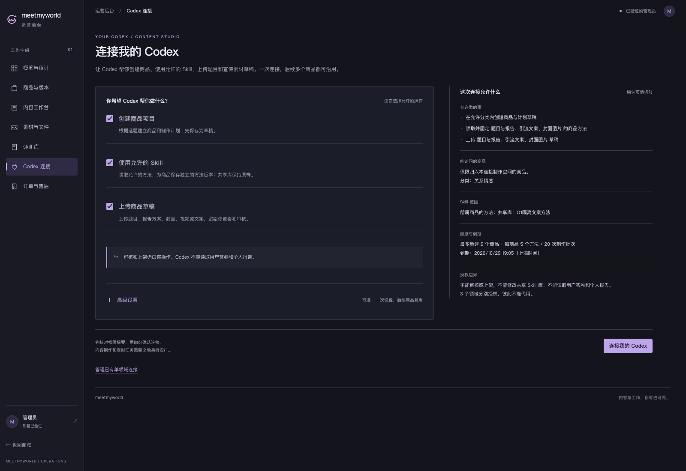
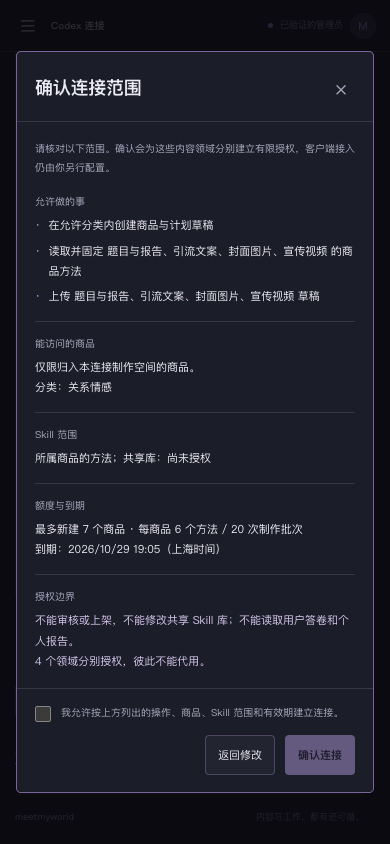

# O1「连接我的 Codex」正式页面验收

2026-10-22。按已批准的 R2 简化设计完成正式后台页面与业务接口，本批技术验证通过，**正式 UI 尚待用户验收，O1 整体未关闭，O2 未启动**。停止点来自用户保留的正式 UI 验收关卡；R2 设计批准不自动通过此关。

页面入口：[本地后台 · Codex 连接](http://127.0.0.1:5173/admin/machine)。正常开发服务没有本轮的测试连接；仅查看页面不会签发授权。截图里的工作区、Skill 和授权均为已回收的隔离样例，没有可继续访问的测试商品/连接链接。

## 本次实现

“创建商品项目 / 使用允许的 Skill / 上传商品草稿”默认全部不选。高级设置提供新建有限工作区或选择当前管理员已有工作区、分类、数量/期限、领域及共享 Skill 白名单；摘要随选择变化。上传需要用户明确允许相应领域读取方法，不能通过高级设置暗中授权。

服务器先只读核对权限摘要；用户再次确认后，一个事务保存工作区（如需新建）、连接分组和各领域独立凭据。支持列表/详情、原请求恢复、一次性交接、部分领域或工作区失效说明、整组撤销。旧入口在 `?view=legacy` 保留。assessment 独占项目创建/规划写权限，不授予共享库编辑、审核/上架或用户答卷/个人报告访问。

保存成功表示授权记录存在，不表示客户端已经接入。一次性说明仅在首次响应后的当前页面内存中可用，复制时才填入凭据；密钥不展示在 DOM，不写入 URL、Storage 或查询缓存。离开、隐藏、主动隐藏或身份失效后清除；丢响应、刷新或未保存说明时无法再次取回，应先撤销，再重新设置。说明中的本机路径/API/允许目录需要实际填写，本页不写客户端配置。

## 核对画面

桌面为 1600×1100，手机为 390×844 模拟视口，不代表真机或内置浏览器验收。

| 画面 | 核对内容 |
| --- | --- |
| [首次入口](desktop-first-connect.png) | 业务操作默认不授权，高级设置收起 |
| [桌面高级设置](desktop-advanced.png) | 隔离库真实分类/Skill 与额度、领域摘要 |
| [桌面确认](desktop-confirm.png) | 服务端固定范围、再次明确同意与返回修改 |
| [恢复既有记录](desktop-recovered.png) | 成功响应丢失后同请求恢复，不重复签发、不可重取密钥 |
| [数据库失败](desktop-save-failure.png) | 中间 INSERT 故障全部回滚，保留原请求核对/重试 |
| [桌面授权记录](desktop-authorized.png) | 已保存的固定范围与下一步交接 |
| [一次性说明预览](desktop-handoff.png) | 页面不展示密钥，复制与客户端配置分开 |
| [桌面撤销确认](desktop-revoke-confirm.png) / [撤销后](desktop-revoked.png) | 可取消，确认后整组失效，历史保留 |
| [工作区失效](desktop-workspace-disabled.png) | 正式连接继承工作区撤销状态 |
| [手机入口](mobile-ready.png) / [授权记录](mobile-authorized.png) | 同一套正式表单和权限范围，无横向溢出 |
| [手机撤销确认](mobile-revoke-confirm.png) / [撤销后滚动](mobile-revoked.png) | Escape 返回焦点；运营区域独立滚动、顶部保持固定 |
| [旧单领域入口](desktop-legacy.png) | 原有签发、调用历史与撤销路径继续保留 |

共 17 张图，完整清单见 [浏览器结果](verification.json)。正式桌面入口、桌面确认、手机确认/授权/撤销后滚动画面已完成目视检查。

## 技术验证及边界

| 检查 | 实际结果 |
| --- | --- |
| 全量 `pnpm test` | API 364＋web 65＋SDK 19＝448 项，失败/跳过均 0 |
| 新连接服务专项 | 15 项；与旧机器凭据共 35 项专项通过 |
| `pnpm typecheck` / `pnpm build` | 均退出 0 |
| O1 正式页面浏览器 | 11 个情境、17 张图；未捕获页面错误、非预期 HTTP 错误和非本机网络请求均 0 |
| 旧业务浏览器回归 | 57 项通过；旧连接相关跳转更新到 `?view=legacy`，保留全部业务断言 |
| 本机数据库 | 71 模型/25 迁移，schema diff 无差异；旧迁移及已应用 SQL 校验和保持 |
| 数据保全 | 63 类旧表、1157 行旧字段、5 份 release 及历史引用保持；临时库 0 |
| 开发库新增授权 | Codex 连接 0、分组领域凭据 0 |
| 开发服务 | API 4100 ready 和 Vite 5173 均返回 200，未停止原服务 |

正式组件使用真实隔离 API/数据库，身份由 `SupabaseAuthGateway` 测试提供者替换；不是用真实登录账号完成接入。剪贴板由浏览器替身拦截，系统剪贴板和客户端配置写入均 0。临时 TEST 数据库、独立 API/浏览器和文件目录已回收。

覆盖默认拒绝、分类/额度/共享 Skill、权威预览/同意/取消/焦点、丢成功响应恢复、真正 SQL 部分失败回滚/原请求重试、一次性说明和泄漏检查、工作区撤销继承、手机操作/滚动、旧入口和普通账户拒绝。服务测试另覆盖受控时钟下的连接/工作区到期、跨管理员/scope、提交后读取失败恢复、并发与持久业务键、同工作区其他连接不受整组撤销影响。

故障回滚情境故意注入一次数据库 INSERT 失败，不将该预期 5xx 计作非预期错误。O1 浏览器测试使用隔离读写预算 3000，不声称正常限流或真实 Auth 已通过。旧业务回归中的资源/模块回退故障也是显式测试输入。

R2 统一入口要求持久分组、原子签发/恢复和整组撤销，因此新增 `CodexConnection` 元数据及第 24/25 份向前迁移；这明确修正最初逐领域 R1“无需新表”的假设。原始密钥仍只存摘要，旧迁移和旧历史不改写；第 25 份仅排除旧单领域凭据的无关延迟约束事件。

本批未验证真实账户持续访问、真实客户端、真机、公网或无人值守制作；没有模型调用、实际内容生产、日程、云资源、付费执行、发布、提交或推送。商城及消费者前端相对本批 519 文件基线摘要不变。

## 批准与后续

用户于 2026-10-22 18:13:46（上海）对 R2 指定桌面入口/手机确认页回复「可以」。已核对原型与两图摘要，批准独立保存在 [r2-design-approval.json](../machine-project-authorization-o1-20261022/r2-design-approval.json)。R1 18 文件历史、R2 原型验证及交付时 pending 记录保持，不追写成正式 UI 或真实凭据批准。

当前仅等待本批正式 UI 验收；通过后按任务顺序处理 O2 的基础 Skill、商品定制层、模块固定方法选择/捕获/交接。W6 模型比较和 W3 内容制作继续暂停，O3/O4 尚未实施。本地完整工程证据在 `.local/o1-implementation/verification.json`，任务状态见 [业务验收清单](../../../prd/v1/PLATFORM-BUSINESS-ACCEPTANCE.md) 和 [执行记录](../../../prd/v1/PROGRESS.md)。
