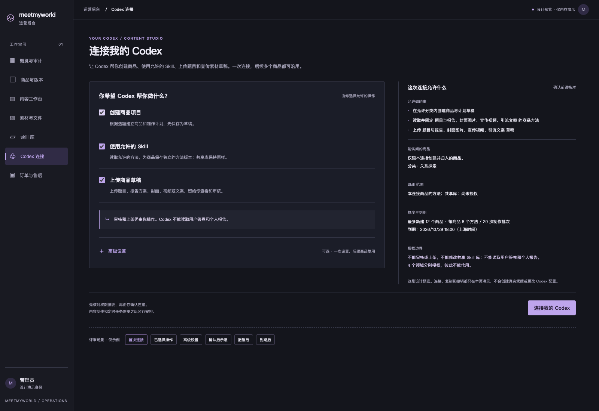
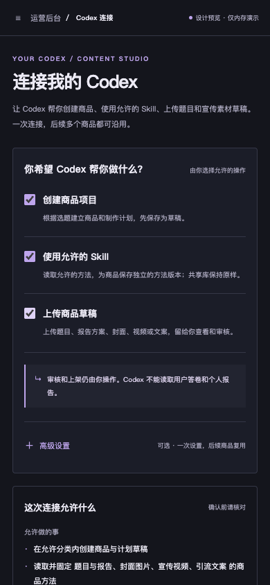
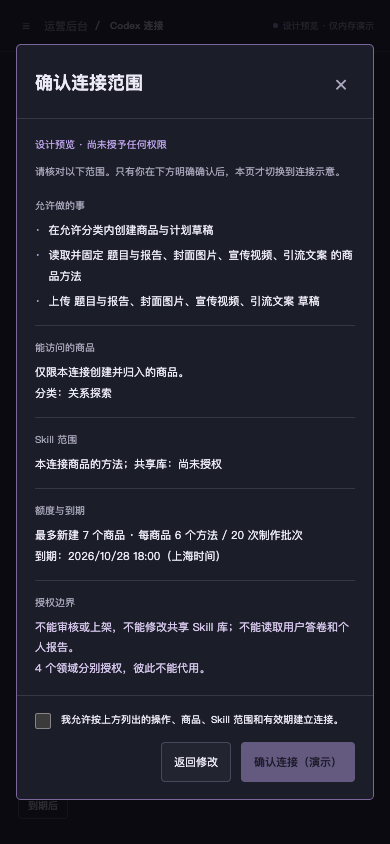

# 连接我的 Codex · O1 简化设计 R2

这个页面只负责一件事：让你的 Codex 在你允许的范围内制作商品，并把草稿交回后台。一次设置后，后续多个商品沿用同一份连接；审核和上架仍由你操作。

**当前为独立设计原型，重新停在 O1 设计审核。** 本轮只获得了简化方向的认可，新界面尚未获批；正式前后端、凭据和客户端配置都没有接入。

[打开交互原型](index.html)。页面标明“设计预览 · 仅内存演示”，首次进入不勾选任何操作。底部“评审场景”可以查看选择后、确认后、撤销和到期示例；这些场景切换不产生授权。

## 现在怎么用

1. 选择允许 Codex 做的事：创建商品项目、使用允许的 Skill、上传商品草稿。
2. 核对权限摘要，再明确勾选确认。摘要一直列明能访问的商品、Skill、内容范围、数量和到期时间。
3. 查看连接说明，后续商品重复使用；需要停止时，撤销这份连接。

工作区、各领域权限、共享 Skill、额度和有效期都收进“高级设置”。调整会同步到摘要和确认页，不会自动勾选主页面操作。已有工作区涉及的现有商品访问也会在摘要中明确列出。

### 桌面主流程

以下为用户手动选择三项操作后的状态；首次打开时三项均未勾选。

### 手机主流程

### 手机确认范围

这个例子在高级设置里改成最多 7 个商品、每商品 6 个方法，并调整了到期时间，确认页同步显示。确认框默认不勾选，返回修改或 Escape 都不会建立连接。

## 本轮审核重点

- 主入口能否直接说明“让我的 Codex 做商品、交回草稿”，无需先理解工作区概念。
- 三项业务选择和权限摘要是否清楚，能否看懂允许访问什么、何时到期，以及不能审核/上架或读取用户私密答卷报告的边界。
- 连接确认、返回修改、查看连接说明和撤销入口是否容易找到；手机是否顺手。

## 具体画面

| 场景 | 桌面 | 手机 |
| --- | --- | --- |
| 首次进入，未选权限 | [查看](r2-desktop-start.png) | [查看](r2-mobile-start.png) |
| 选择允许的操作 | [查看](r2-desktop-ready.png) | [查看](r2-mobile-ready.png) |
| 权限摘要 | 主流程右侧 | [默认摘要](r2-mobile-summary.png) / [调整后的摘要](r2-mobile-summary-custom.png) |
| 高级设置 | [范围与领域](r2-desktop-advanced.png) / [额度与期限](r2-desktop-advanced-limits.png) | [查看](r2-mobile-advanced.png) |
| 明确确认 | [查看](r2-desktop-confirm.png) | [查看](r2-mobile-confirm.png) |
| 确认后的连接方案示意 | [查看](r2-desktop-connected.png) | [查看](r2-mobile-connected.png) |
| 连接说明预览 | [查看](r2-desktop-copy-preview.png) | 使用同一原生模态窗口 |
| 撤销确认 | [查看](r2-desktop-revoke-confirm.png) | [查看](r2-mobile-revoke-confirm.png) |
| 已撤销 | [查看](r2-desktop-revoked.png) | [查看](r2-mobile-revoked.png) |
| 已到期 | [查看](r2-desktop-expired.png) | [查看](r2-mobile-expired.png) |

## 原型验证与保留范围

`node output/design-review/machine-project-authorization-o1-20261022/check.mjs`：21 项交互检查、20 张新截图通过；520 份既有代码、文档、脚本和依赖摘要保持不变，其中正式代码/脚本/依赖 467 份。旧设计的 18 份文件逐份摘要保留。结果见 [verification.json](verification.json)。

检查覆盖默认无权限、高级设置不自动授权、摘要/确认一致、共享 Skill 明确选择、领域限制、上传依赖显式选择、既有商品访问提示、额度/期限、确认/取消/Escape/焦点返回、连接复用、说明复制示意、撤销/取消/重新设置、到期及 390/360px 手机布局。HTTP 请求、业务写入、真实凭据签发、剪贴板写入、客户端配置写入和页面错误均为 0。

手机仍为浏览器模拟视口。这里没有真实 Auth、API 保存或真机验收；没有生成内容、模型比较、云服务、定时器、发布，也没有推进 O2。

后续实现必须保留的授权边界（本轮未实施）

- “连接我的 Codex”是一次设置的业务入口，底层仍按题目/封面/视频/文案/可选体验分别授权，不产生跨领域万能凭据。创建商品/共同计划只由 assessment 连接承担；运营者不必为每个商品重配连接。
- 主操作全部默认不勾选。高级设置是待确认的限制，不能自动给予权限；只有用户明确选择并确认后，未来实现才能申请对应的有限授权。
- 使用 Skill 仅限明确允许的共享库和所属项目的方法；商品方法快照独立保存，不授予共享库写权限。允许上传的领域必须同时允许读取相应方法，缺失时提示用户选择，不自动补选。
- 工作区仍限定当前管理员和 scope。新空间有限额/分类/到期约束；已有空间的范围和额度不可随意修改，访问已有商品必须在摘要里说明。连接不得晚于空间到期，失效空间不可选择。
- 后台接口目前逐工作区、逐领域签发。未来统一入口须处理部分签发失败、同请求接续、一次性密钥交接及撤销反馈；本轮没有新增批量签发接口，没有自动写客户端配置。
- 真正连接、复制密钥和撤销之前仍需对应授权。原型只切换内存状态，连接说明中只有示例占位，没有可用密钥，也不写入剪贴板。
- 审核、上架以及读取用户私密数据都不是可开启的选项。连接也不会启用内容生成或定时生产；撤销不代表终止第三方已开始的作业。

## 反馈与旧稿

主会话转达：用户于 2026-10-22 09:20:44 UTC 反馈「这些是什么业务，我没懂」。主会话建议以“连接我的 Codex”为主入口，把工作区、领域权限和额度放高级设置，旧复杂稿先不算通过；用户于 09:29:00 UTC 回复「可以」。这只认可简化方向，不批准旧稿、新稿或真实凭据配置。

旧稿完整保存在 [R1 历史目录](history/r1-workspace-first/README.md)，原始源码/截图/验证文件及 SHA-256 见 [archive.json](history/r1-workspace-first/archive.json)。R1 保持未批准，原 13 项检查/14 图只是旧原型技术证据；没有将其改写为用户通过。历史副本用于查阅，不作为当前原型检查入口。

本轮按用户保留的新 UI 先审关卡，**重新停在 O1 设计审核；请审核这份简化后的具体界面。** 批准设计后，正式实现和真实业务验收仍另行进行。
