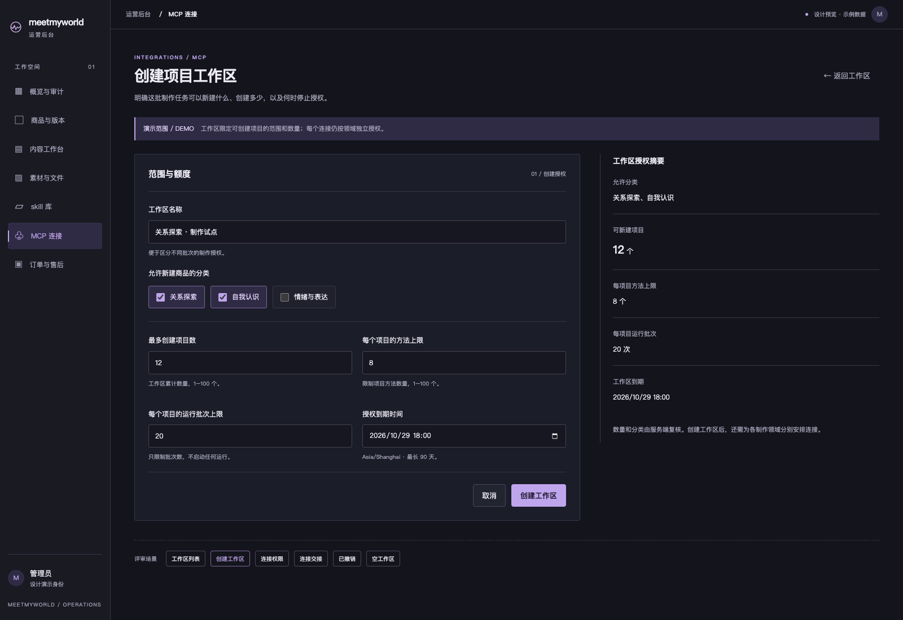
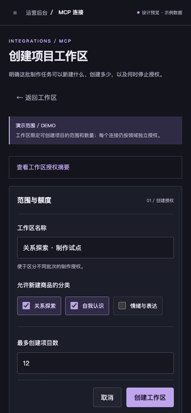
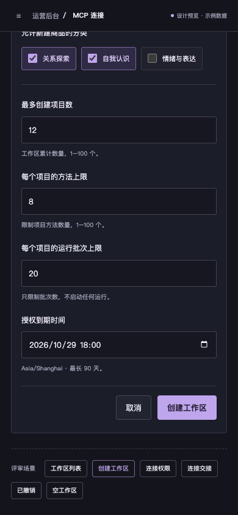

# O1 项目工作区授权 · 设计评审

2026-10-22。上一批 G8 指定的桌面编辑、手机添加模块和手机保存后目录已获用户批准，记录见 [G8 user-approval.json](../project-planning-g7-20261022/user-approval.json)。本批补查发现，正式 MCP 连接页面还没有项目工作区入口，无法从运营页面安排可新建项目的有限授权。

下一业务任务为 **T14.O1：项目工作区授权与连接交接**。本批完成独立设计原型，沿用 B 精密工具紫；**当前停在 O1 新设计审核**，正式页面/真实 API 接入、真实 Auth 验收和正式 UI 审核均未完成。

## 具体设计

保持左侧 MCP 导航选中，在现有页面内增加“项目工作区”页签。工作区限定可新建商品的分类、项目数量、每项目方法/运行批次上限和到期时间；各领域连接仍独立签发，不能把共享工作区当作跨领域的万能权限。

创建表单使用清楚的范围/额度与授权摘要；手机把摘要折叠到表单上方，操作区单独滚动，顶部导航固定。连接表单保留“指定已有内容”，新增“项目工作区”模式；非 assessment 领域不显示新建项目/修改共同计划权限。失效工作区不可选择，连接到期不能晚于工作区，方法/Skill 写权限独立选择。

### 桌面 · 创建有限工作区

### 手机 · 创建与额度

### 其他场景

| 场景 | 桌面 | 手机 |
| --- | --- | --- |
| 工作区列表 | [查看](desktop-list.png) | [查看](mobile-list.png) |
| 领域连接与权限 | [查看](desktop-connection.png) | [查看](mobile-connection.png) |
| 视频领域权限与操作区 | — | [查看](mobile-video-permissions.png) |
| 签发后交接状态示意 | [查看](desktop-handoff.png) | [查看](mobile-handoff.png) |
| 撤销后的访问限制 | [查看](desktop-revoked.png) | [查看](mobile-revoked.png) |
| 首个工作区空状态 | [查看](desktop-empty.png) | [查看](mobile-empty.png) |

[打开独立交互原型](index.html)。可从底部“评审场景”切换，原型仅在内存演示创建/撤销和表单限制；日期使用固定的设计示例时间，不依赖系统当天时间。页面始终标注“设计预览 · 示例数据”。没有真实密钥、业务请求或客户端配置写入。

## 与现有代码的对应

| 业务 | 已有实现 | O1 正式实现待补 |
| --- | --- | --- |
| 工作区 | 管理员 GET/POST `/api/admin/machine-workspaces` 及 `:id/revoke`；数量/分类/到期/所有者约束已有 | 页面列表、创建表单、撤销及错误/加载/失效状态 |
| 连接 | credential create 支持 `workspaceId` 和九项权限，服务端校验领域/归属/期限 | `machine.tsx` 目前只渲染五项旧权限；补工作区选择、领域限制和准确摘要，旧模式保持可用 |
| 失效 | MCP 每次调用检查工作区撤销/到期 | 列表应解释工作区继承的不可用状态，不能仅显示凭据自身有效期 |
| Skill 和运行 | 固定方法、原件、运行/尝试 MCP 与回执已存在 | 完整运营方法交接与运行恢复分为后续 O2/O3；未启用配置准备为 O4，不把它们算作 O1 完成 |

O1 无需新表/迁移，不添加模型执行队列。正式实现只复用既有业务授权；测试可在自动回收的隔离 TEST 库中签发临时凭据，本批没有配置或签发真实生产连接。

## 原型验证

运行 `node output/design-review/machine-project-authorization-o1-20261022/check.mjs`：13 项原型检查、14 张截图通过，pageerror=0、HTTP 请求=0、业务写入=0；467 份既有前后端/脚本/依赖文件摘要保持不变。详见 [verification.json](verification.json)。

覆盖六个桌面/手机场景、分类必选、1–100 数量限制、设计示例期限、领域权限限制、失效工作区禁选、连接到期限制、空权限拒绝、交接示意、撤销确认/Escape/焦点恢复、手机操作区滚动和主操作可达。这里没有实际 Auth、API、数据保存或真机验收。

当前 427 项平台测试及 G7 的 14 个真实业务情境是上一批已通过的证据，本轮没有重跑或将其算作本原型验收。G8 批准不扩展到本批新界面。

按保留的新 UI 先审关卡，**请审核这批项目授权设计；批准后才接入正式后台**。后续顺序和实现约束见 [平台业务验收](../../../prd/v1/PLATFORM-BUSINESS-ACCEPTANCE.md)。内容生成/模型比较继续暂停，真实凭据配置、云/付费、定时器与发布各自另审。
