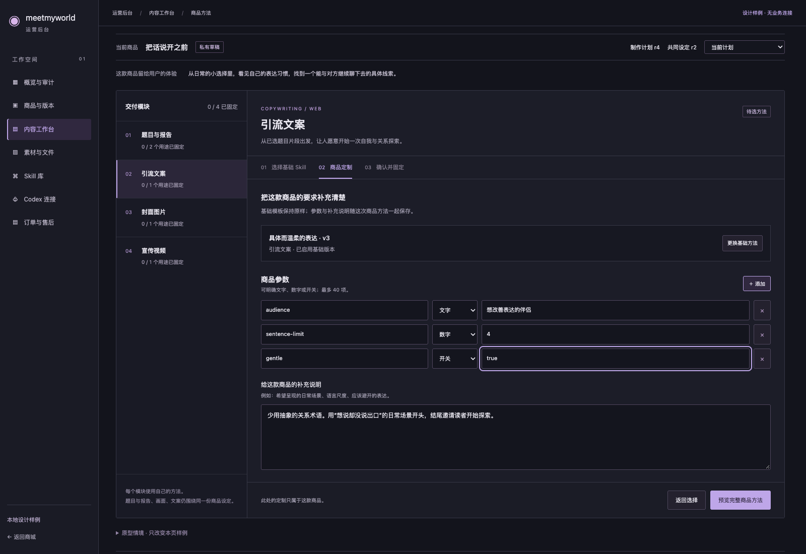
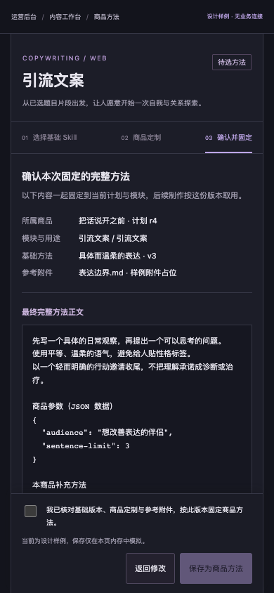
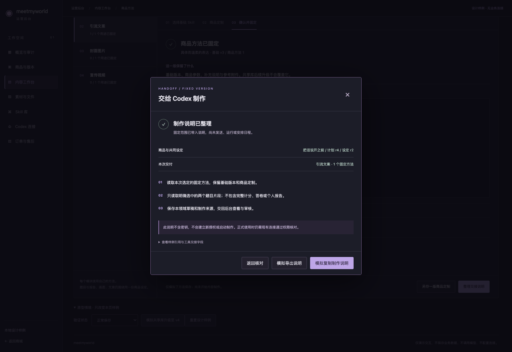

# O2 商品方法与制作交接 · 新设计待审核

2026-10-22，Asia/Shanghai。O1 的三张指定正式 UI 已获用户批准，见 [独立记录](../codex-connections-o1-formal-20261022/APPROVAL.md)。当前按顺序推进 O2：让运营者选好商品所用的基础 Skill，补充本商品要求，固定准确版本，再整理给 Codex 的制作说明。

**本批仅为独立设计原型，O2 新设计尚未批准，未接入正式后台或业务 API。** 停止点来自用户保留的“新 UI 先交具体设计、审核后再实现”关卡。O1 批准不扩大为 O2、真实账户/客户端或真机通过。

## 四步交互

1. 选择基础 Skill：区分已启用、已审核和本商品候选；归档、错用途/领域/形式不能用于新固定。基础版本始终明确，不暗中换成共享库最新版。
2. 商品定制：添加文字/数字/开关参数和补充说明，基础正文保持只读；定制只属于当前商品。
3. 确认并固定：一起核对基础版本、参数、补充、展开后的完整方法和参考附件，明确同意后保存。修改另存一版，旧方法与来源保留；题目设计/报告写作分别满足用途。
4. 整理制作说明：显式选择交接方法、最小输入和已有连接，检查缺项/范围后导出固定清单。整理与复制不启动制作、不签发新权限，说明不包含密钥。

拟从“内容工作台 → 商品项目 → 模块 → 选择/另存制作方法”进入这个模块级工作区，左侧继续选中内容工作台，不增加新的顶级后台。当前样例展示四类交付；正式接入保留 experience 两用途的可选域和既有权限规则。

## 桌面：商品定制

沿用 B 精密工具紫的暗色底、细分割线和克制紫色重点。左侧选择交付模块，中间完成当前用途的方法设置；商品目标和固定计划仍保持可见。这个截图位于运营区域的编辑滚动位置。

## 手机：确认完整方法

手机使用同一流程，不把完整方法压进横向表格；确认勾选和保存按钮在固定底栏，正文可独立阅读。截图是 390×844 模拟视口，不是实际手机验收。

## 制作交接

缺少方法/输入，或连接已撤销、工作区不含该商品、未允许读方法时，先解释缺项。完整后只整理固定范围及下一步说明；真实使用时仍由接口和每次工具调用重新核查。

| 其他画面 | 核对内容 |
| --- | --- |
| [桌面方法选择](desktop-method-picker.png) | 版本/生命周期/用途/形式与候选归属提示 |
| [桌面确认](desktop-confirm.png) | 基础、商品参数、补充说明、完整展开正文与明确同意 |
| [已固定方法](desktop-fixed-method.png) | 精确版本与本次交接显式选择 |
| [交接缺项](desktop-handoff-blocked.png) | 未授权读取方法时不能继续 |
| [历史只读](desktop-historical.png) | 历史或未保存计划不能新固定或交接 |
| [附件缺失](desktop-source-conflict.png) | 本图为附件缺失情境；源更新由同一检查覆盖，定制保留、没有新增固定记录 |
| [保存结果未知](desktop-unknown-save.png) | 锁定修改，先核对原请求，避免再存一份 |
| [手机商品定制](mobile-customization.png) | 参数、补充说明和可达的底部操作 |
| [手机固定方法](mobile-fixed-method.png) | 共享基础与商品固定版本的关系 |
| [手机交接核对](mobile-handoff-check.png) / [制作说明](mobile-handoff.png) | 明确输入/已有连接，弹窗操作可达，Escape 返回焦点 |

共 14 张截图，完整摘要与结果见 [verification.json](verification.json)。桌面方法选择/定制/交接、手机定制/确认/交接已目视核对。

## 已核实与待实现

真实后端已经有精确方法捕获/回读/附件服务、40 个类型参数、8000 字补充说明和确定性展开正文；前端目前只有固定方法查看/下载。通用库查询不能自动证明项目候选归属，管理员看得到也不表示所选 Codex 连接能读取。

正式实现需补选择/定制/捕获客户端与表单，必要的候选归属只读投影，以及服务端交接范围/文件校验和无凭据导出契约。不存在的接口没有写成已实现。复用现有不可变快照，新的商品定制不改共享库、不全局启用候选，不改变旧 ACTIVE 组合或历史审核。

本批拟采用“本页显式选择 → 服务端只读核对 → 导出固定清单”。固定方法在正式实现后保存在平台，交接选择在当前页关闭/重开时保留，刷新需重新选择；不把交接选择显示成已保存的运行。清单固定版本供外部客户端读取，运行状态和恢复留 O3。如果后续实现确需持久交接，先明确追加版本/向前迁移方案，不以浏览器缓存替代业务记录。

完整实码清单、规则与执行拆分以 [O2 能力与实施契约](../../../prd/v1/PLATFORM-BUSINESS-ACCEPTANCE.md#o2-能力与实施契约) 和 [T14-O2](../../../prd/v1/tasks/T14-mcp-ingestion.md) 为准。当前 O2-C/D 完成、O2-A 等审核，O2-I/V/UI 未开始。

## 原型检查与范围

`node output/design-review/project-methods-o2-20261022/check.mjs`：21 项交互检查、14 图通过，页面错误和 HTTP 请求均 0。覆盖无默认选择、搜索/状态、草稿/审核/归档/形式、类型参数、明确确认、相同/变更方法历史、共享升级不覆盖、两种 assessment 用途、候选不启用、缺输入及错范围连接、原型复制/导出、同页交接选择保留、历史/未保存阻止、取消/Escape/焦点、源更新/缺附件、失败和丢成功响应恢复、390px/360px 可达与运营区域滚动。

477 份既有正式源码、契约、迁移、测试、依赖/配置摘要保持；O1 三张批准图摘要保持。仅修改规划/状态文档，并新增独立原型及批准记录。O1 已有 448 项/11 个正式情境/57 项旧回归保留为历史，本次没有重跑或扩大这些平台证据。

原型中的“保存”、连接核对、版本升级、故障、复制和导出全是内存样例，不接真实 API/Auth、不写 Storage/系统剪贴板/客户端配置，不创建真实业务记录或持久授权；刷新会重置样例。没有模型调用、实际内容制作、云/付费/日程/发布。它不证明正式 API、真实权限、文件、刷新恢复或真机已通过。

交互源文件：[index.html](index.html)、[design.css](design.css)、[design.js](design.js)；可在本地浏览器直接打开 `index.html`，无需服务器或登录。测试使用单独无头浏览器，结束已关闭，没有改当前用户浏览器或开发服务。

请审核这组具体交互。按已保留的新 UI 关卡，确认后再实施 O2 正式页面/接口并用隔离样例验证，完成后再停正式 UI 验收；O3/O4 尚未启动，内容生成和模型档位比较继续暂停。
