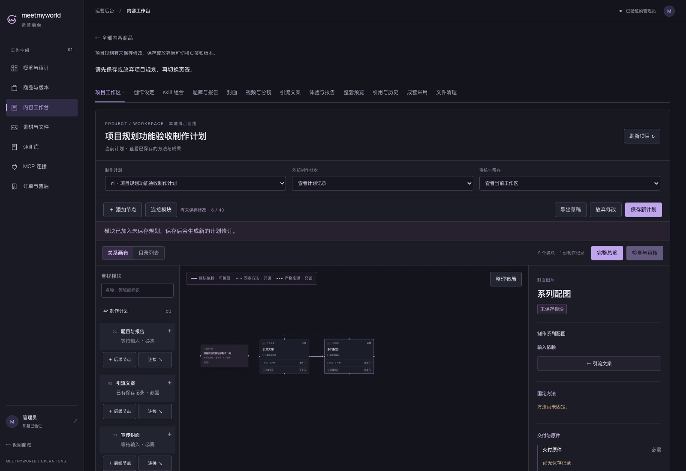
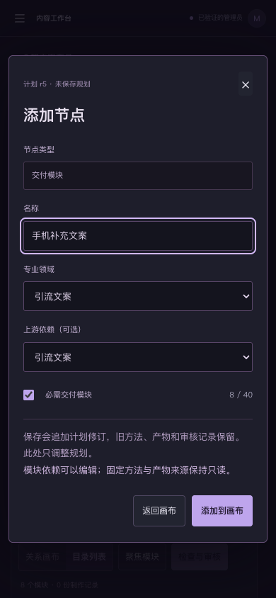
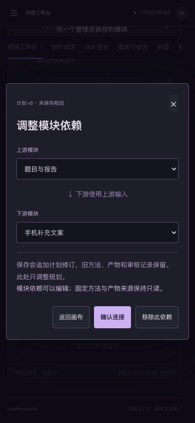

# G8 正式规划编辑界面评审

2026-10-22，Asia/Shanghai。G5 契约/布局、G6 正式编辑、G7 业务验证已通过；**G8 指定的桌面正式编辑、手机添加模块和手机保存后目录三图已获用户批准，T10-G 本地范围通过。** 批准依据及图像摘要见 [user-approval.json](user-approval.json)。不扩大为真机、平台整体或未来 UI 批准；G1/G4 原批准保持各自范围。

沿用已批 G1 暗色 React Flow 和 B 精密工具紫，在正式后台的商品项目工作区补齐规划编辑。商城前端不在本轮实现范围。截图是实际浏览器操作正式组件、连接独立真实 API 后取得的功能验收画面。

## 本批可审核的操作

- 进入编辑规划，添加交付模块/后续节点，选择名称、领域、必需项和上游；端口拖线可建立依赖，空白落点可添加下游模块。
- 模块依赖可连接、重接、移除；方法、产物来源和归属关系保持只读。无自依赖、重复边或循环，最多 40 模块；手机目录使用等价点选表单。
- 保存追加计划修订并精确回读；拖动/整理后可独立保存布局，刷新恢复位置。旧计划、方法、产物和审核仍可按原版本查看。
- 未保存规划保护页签/版本切换，浏览器返回后保留原草稿；冲突可导出草稿或放弃读取最新。丢成功响应使用同一请求确认，撤权后停止写入。

模块模板只声明配置，没有生成题目、图片、视频或文案，也没有执行节点/后台模型队列。

## 桌面：添加模块与保存新计划

新增“系列配图”依赖已有引流文案；侧栏显示未保存模块，工具栏提供导出/放弃/保存新计划，切页签时有草稿保护。

## 手机：添加模块

手机模拟视口 390×844，选择领域、上游与必需项后添加；主操作在该模拟首屏可见。这是响应式浏览器验证，不等于真机验收。

## 手机：调整或移除依赖

与桌面拖线编辑使用相同的计划规则，手机可明确选择上下游并移除既有依赖。

## 其他具体画面

| 画面 | 内容 |
| --- | --- |
| [手机保存后目录](mobile-saved-directory.png) | 已保存计划回读，模块和上游关系可从目录操作 |
| [历史计划与审核](desktop-historical-review.png) | 原计划、固定方法/来源与审核依据保持原样 |
| [40 模块聚焦](desktop-40-focus.png) | 有界聚焦与检索，拒绝第 41 个模块 |
| [撤销写权限](desktop-revoked-write.png) | 管理员权限撤销后停止保存并保留草稿 |
| [桌面最终编辑状态](desktop-final-editing.png) | 最新计划工具栏、目录/关系画布和独立布局入口 |

## 验证结果与边界

| 验证 | 结果 |
| --- | --- |
| `pnpm test` | API 349＋web 59＋SDK 19＝427 项，全部通过 |
| `pnpm typecheck` / `pnpm build` | 全量通过 |
| `node --env-file=.env apps/web/e2e/project-planning.mjs` | 14 个真实本地 Auth 浏览器情境，8 张截图，pageerror=0、5xx=0 |
| 数据与迁移 | 70 模型/23 迁移；63 类既有表 1157 行旧字段、旧迁移校验和、5 份 release 与历史引用不变 |
| 清理与开发服务 | 专用 TEST 库/独立 API/浏览器已回收，临时库 0；原 API ready/Vite 均为 200，未停止开发服务 |
| G8 与 T10-G 本地范围 | 指定三图后续已获批准；平台整体和真机另验 |

14 个情境包含：真实现有账号登录和隔离管理员授权；方法/来源只读与编辑期审核保护；添加/保存/刷新；独立布局；真实拖线与循环拒绝；双客户端冲突；丢成功响应恢复；手机添加/调整/移除；历史计划/方法/来源/审核保持；40 模块；空项目首份计划；撤销管理员权限；浏览器返回保留草稿；普通账户和缺 CSRF 拒绝。限流等待使用现有预算，没有清零或绕过限制。

登录使用现有本机 Supabase Auth 账号；浏览器没有 token 注入或 Auth Gateway 替身，管理员授权/撤销只发生在隔离业务 TEST 库。API 转发仅透明转交真实隔离服务响应，没有伪造业务成功。输入是静态结构和人工预置内容，只验证功能，不代表商品内容质量、W3 完整制作、真机或公网验收。

截图中的专用商品随 TEST 库清理，**没有可继续访问的测试商品 URL**；这些图片和结果文件用于本批审核。正常本地[内容工作台](http://127.0.0.1:5173/admin/content)仍可登录使用；选已有商品的最新计划进入项目工作区后查看“编辑规划”。没有计划但已保存创作设定的项目可添加首个模块。

本批浏览器结果：[verification.json](verification.json)。完整命令日志、代码/截图摘要和保全记录位于 Git 忽略的 `.local/g6-project-planning/verification.json`；G5 契约/迁移证据在 `.local/g5-plan-editor/`。验证文件中的 pending 是生成证据时的状态，保持原文件；后续批准单独记录在 user-approval.json。旧 G4 的 18 项检查/19 图及 57 项原业务浏览器回归保留为历史证据，没有算成本轮重跑。

交付时按关卡停在 G8；主会话于 08:09:36 UTC 展示指定三图及验证边界，转达用户于 08:47:12 UTC 回复「可以」，后续仅记录该范围批准。现进入 [O1 项目授权设计](../machine-project-authorization-o1-20261022/README.md)，其新 UI 另审。内容生成与模型档位比较继续暂停；本轮模型调用 0 次，无媒体生成、新机器凭据、云资源、日程或发布，也未暂存/提交/推送。
