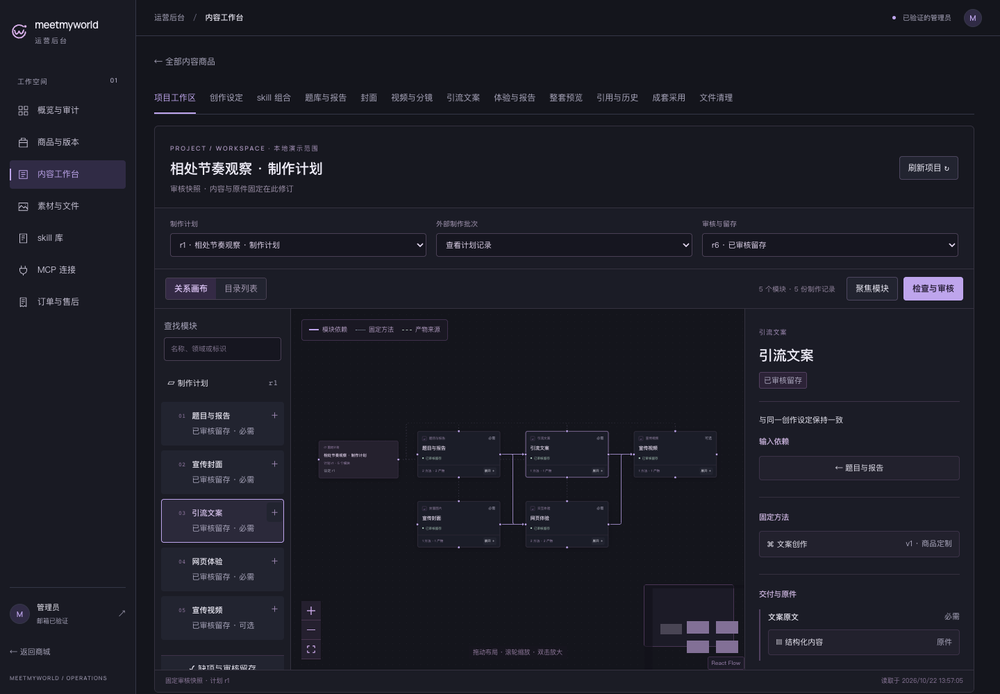
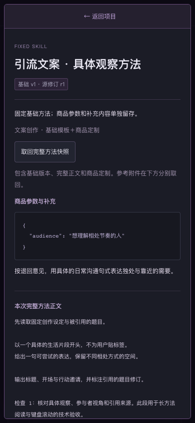

# 正式项目工作台 · G4 本批已批准

2026-10-22。按已批准的 G1 暗色 React Flow／B 精密工具紫实现，G2/G3 本地实现和 G4 技术检查通过；用户已于 2026-10-22 14:08（Asia/Shanghai）批准本批桌面工作台、手机 Skill 详情与审核留存画面，证据见 [批准记录](user-approval.json)。

[本地后台入口](http://127.0.0.1:5173/admin/content) · [40 模块截图](desktop-40-overview.png) · [验证记录](verification.json)

入口使用现有本地管理员账号；浏览器原有会话若不属于此隔离库，需要重新登录。批准后专用 TEST 库已回收，5173 已恢复连接原开发库；原验收项目地址仅为历史证据，不再指向运行样例。开发库既有内容未复制或替换。截图中的题目、文案、方法为验收样例，图片和视频采用既有本地测试文件；没有本轮收费制作或发布。

## 实际界面

| 查看内容 | 截图 |
| --- | --- |
| 正式项目目录、关系与详情 | [桌面工作区](desktop-final-project.png) |
| 固定方法、基础与商品定制、完整快照取回 | [方法与关系定位](desktop-linked-method.png)、[手机长正文](mobile-final-detail.png) |
| 缺原件、失败与受影响依赖 | [缺网页原件](desktop-missing-original.png)、[视频失败](desktop-failed-video.png)、[需要复查](desktop-needs-recheck.png) |
| 真实文件及原生报告 | [图片](desktop-cover-original.png)、[视频](desktop-video-original.png)、[演示报告](desktop-report-preview.png) |
| 人工退回、留存与旧版本 | [退回](desktop-returned-review.png)、[留存](desktop-retained-review.png)、[旧文案回读](desktop-historical-output.png) |
| 规模与手机目录 | [40 模块总览](desktop-40-overview.png)、[聚焦](desktop-40-focus.png)、[手机目录](mobile-directory.png)、[手机画布](mobile-canvas.png) |

## 本批交付

正式后台可选择计划、外部批次和固定审核快照，通过目录／画布／详情定位模块、skill 与产物。方法可读完整展开正文、固定基础版本、商品参数和补充方法，并取回完整 JSON 快照及对应附件。题库／报告／文案可取回结构化原件，图片／视频和网页原件使用实际平台文件入口；体验清单与制作原包分开显示。来源链接仅用于追溯。

画布当前查看固定关系，支持拖动布局、缩放、缩略图、单模块展开、最多 5 模块聚焦、检索和手机等价目录。选中方法／产物会自动展开所属模块；从筛选结果定位依赖时会跟随聚焦并显示目标。React Flow 免费版 attribution 保留。

原件检查、部分稿、提交、指定模块退回、修改后新稿重交和留存，均调用实际业务接口。新稿会使旧提交失效；留存后的历史关系独立回读。示例最新为审核 r6，r3 可查看退回与旧文案。审核留存后商品仍为私有草稿，skill 没有被全局激活。

## 验证

- 408 项测试（API 335、web 54、SDK 19）、typecheck/build，通过；末次导航调整另通过 web 构建与真实浏览器补测。
- 旧业务浏览器回归 57 项通过，包含商城、内容编辑／采用、skill、MCP、消费报告与体验回归。
- G4 共 18 项：16 个真实本地 Auth 端到端情境＋2 个定位／主按钮悬停对比度补测；19 张截图，pageerror=0、5xx=0。悬停对比度约 8.46。
- 使用已有本地 Auth 账号与真实验证服务，无 Gateway mock 或浏览器 token 注入。普通账户 403、跨 scope 商品 404。
- 缺件／失败 → 补交 → 提交 → 指定文案退回 → 修改方法／文案 → 视频需复查并补做 → 新稿重交留存，真实通过。补做视频复用已上传文件，旧文案和固定文件摘要可回读。
- 手机是模拟视口；未冒充真机验收、W3 全制作演练、云部署或已启用日程。

本机 22 迁移、69 模型；59 类旧业务表 1157 行原字段、旧迁移校验和、5 份 release／历史答卷报告引用保留。迁移验收时临时库为 0；批准后隔离评审进程及专用 TEST 库已回收，临时库 0；原开发服务与本地 Auth 可用，保全复核通过。

实现与权限边界见 [PROJECT-WORKSPACE.md](../../../prd/v1/PROJECT-WORKSPACE.md)，原始日志在 `.local/t14-w12/`。`pnpm test:e2e:project-workspace` 可重现真实 Auth 验收，前提是已有本地账号／Auth 已启动、5173 未被占用；不要为了运行测试重置开发库或重放 seed。

**本批 G4 视觉审核已通过，后续按任务依赖继续。** 本次批准不包含真机、内置浏览器或所有未来画面；下一新 UI、云服务、真实生产凭证、收费制作、日程及发布仍须另审。
