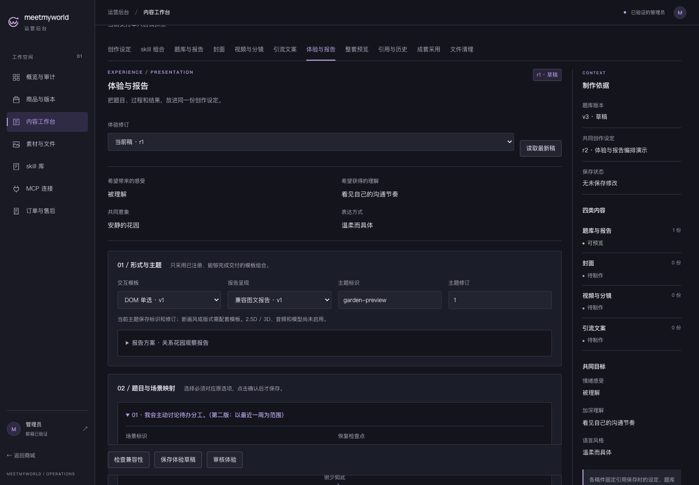
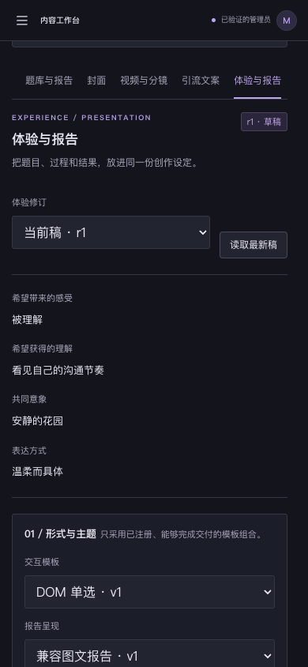
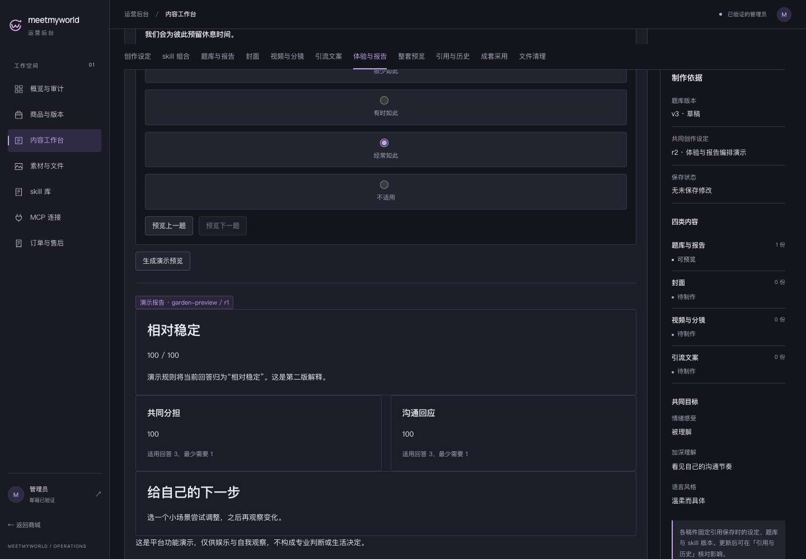
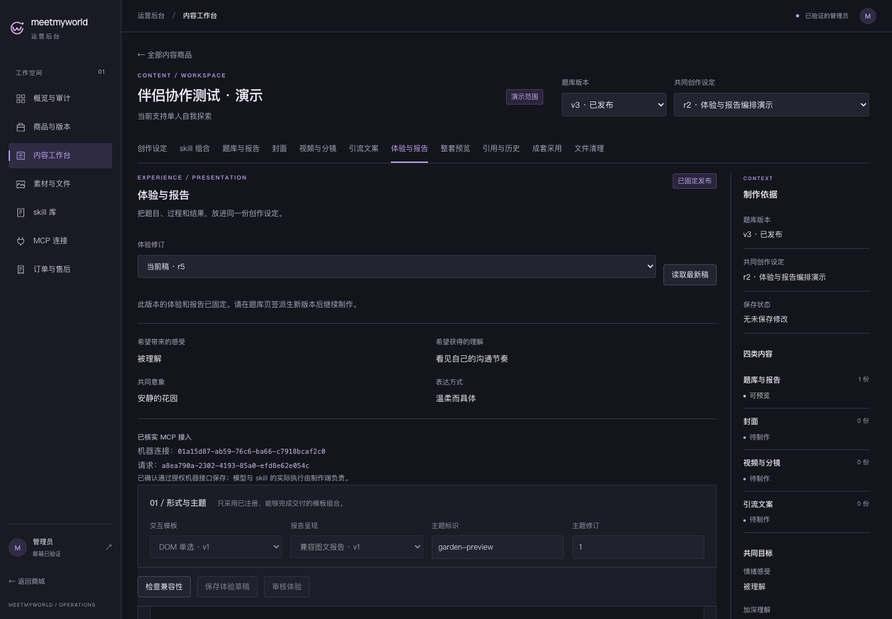

# T15-B 体验与报告制作界面审核

日期：2026-10-21。状态：技术验证通过，用户本次已批准这批界面，T15 已完成并开始 T16-A。批准仅覆盖本批已交付 UI；未来 UI 与云接入仍需单独审核。以下截图/验证文件保留审核时的实际样本与状态。

后台沿用 B 精密工具紫。入口为本机管理员登录后的「内容工作台 → 商品/题库版本 → 体验与报告」。可配置模板、主题标识/修订、场景映射、插画/纹理、两种制作方法，并保存草稿、检查兼容性、预览和审核。当前运行模板仍为 DOM 单选与兼容图文报告，主题标识尚不改变实际画风。

以下为隔离数据库和合成业务数据产生的真实页面截图，身份事实使用测试提供者；不作为云 Auth 或正式商品验收。完整流程没有向实际开发库新增商品、订单或机器凭据。

## 桌面配置

## 手机配置

## 演示报告

人工选择样例答案，复用现有评分，未创建权益、答卷、报告记录、消费或统计。

## 发布后固定状态

MCP 草稿经人工审核后发布，固定精确修订与资源，显示已核实机器来源；旧修订与旧 release 保持不变。

## 验证结果

- 后端 265＋前端 49＋MCP SDK 19＝333 项唯一测试通过。
- 完整浏览器 runner 53 项通过；最终方法候选顺序修正后，3 条新增流程用不同方法与逆序 MCP 输入再次通过，仍计 53 项唯一流程。
- 全量类型检查、构建、Prisma validate、隔离和实际 schema diff 均通过。
- 本机 50 模型/17 迁移；42 类表的 1156 条旧记录原字段摘要一致，前十六份迁移 checksum 不变；5 份历史 release 与答卷/报告引用保留，临时测试库残留 0。
- API/Vite ready，未登录的体验管理和资源接口均拒绝访问。

机器可读结果见 [verification.json](verification.json)，完整浏览器条目见 [browser-checks.json](browser-checks.json)。详细实施与权限见 [EXPERIENCE-RUNTIME.md](../../prd/v1/EXPERIENCE-RUNTIME.md)，私有日志在 `.local/t15-b/`。既有 pg 查询弃用提示仍存在；题目/报告懒加载失败日志是明确注入的兼容回退测试。

T15.7/.8 与 T15 整体已在本次批准后勾选。后续顺序为 T16-A → T10-L → T09；每一批新 UI 与云接入分别审核。本批没有启动云端、自动任务、3D 或新评分玩法，没有提交/推送。
