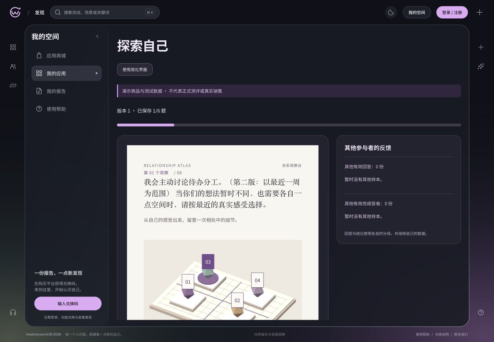

# 06 · 本地首帧、活动帧率与资源恢复实测

2026-10-28，应用修复固定于 `802c5e6`，公共静态压缩固定于 `af2b685`。本批仅为隔离 TEST 中的合成 A/B；**05/06父任务仍 active，完整内存和真实隐藏生命周期尚未通过**。没有使用正式商品、真实手机、云部署或交易。

## 实现与修复

1. 受限下载条件下，A压缩前首帧约3770ms，超出原3000ms目标。真实隔离Nginx测试先RED（`be97b50`），公共静态协商gzip后GREEN（`af2b685`）。私密API保留gzip off；Range、no-store及原文字节仍验证，4项协议/路由检查通过。只用缓存镜像，没有新构建镜像。
2. B带实际JPEG时，简化→重试会复用已撤销blob URL，触发再次回退；实际浏览器及缺失导出的单元测试先RED（`524b399`）。图片按attempt/release/retry批次隔离后，同一JPEG重试为ready、图片完成、已存often保留，107项前端测试与构建通过（`802c5e6`）。见[RED/GREEN](resource-retry-tdd.md)。

## 最终版本实测

原压缩前/修复前原始文件保留；最终版本独立保存于[post-resource-fix](post-resource-fix/summary.json)。测试入口提供原生产JS/CSS字节，另加载测试探针，公共文本gzip参数与已验证Nginx一致；不是已部署公网服务器。

| 检查 | 实际结果 |
| --- | --- |
| 冷缓存首帧 | 36/36 ≤3000ms；A/B ×1440/768/390px ×基线/受限 ×3次 |
| A首帧 | 基线455–509ms；受限1816–2470ms |
| B首帧 | 基线458–494ms；受限1948–2208ms |
| 活动绘制 | 24/24 ≥30fps，56.30–60.00fps；A/B ×1440/390px ×基线/受限 ×3段，每段3秒 |
| 反复装卸 | A/B各20次，5预热＋15观察；40/40卸载后250ms没有继续draw、pending RAF为0，跟踪的contexts均lost、live资源为0 |
| 挂载DOM数量 | 每次卸载后A恒243、B恒248；此数只含仍附着的节点 |
| 恢复矩阵 | 22/22，A/B各11项；真实JPEG请求阻断/恢复、原生WebGL context loss/新context重试、测试门控无WebGL/恢复、手动回退、未确认与已确认答案 |
| 全工作区回归 | API507＋web107＋MCP22＝636/636；typecheck/build通过；Nginx4项另计 |

受限条件为5Mbps下载、1Mbps上传、100ms延迟、CPU4倍降速。首帧是已提交真实WebGL draw、renderer ready、必需图片完成后的下一次RAF绘制机会；不是LCP或精确GPU呈现时间。新文档禁用HTTP缓存，浏览器已运行，未声称冷OS/GPU。活动采样是有界连续镜头/选择压力操作，统计实际有draw的RAF，不是人手持续60Hz操作，也不是移动设备成绩。

## 内存结果及未通过条件

原[测量合同](method.md)要求强制GC后比较堆中位数。当前CDP不提供HeapProfiler.collectGarbage；**没有强制GC，也不把自然GC样本改名为已满足原阈值**。Memory.getDOMCounters不支持，但Performance.getMetrics可读全局Nodes/JSEventListeners等；即时DevTools监听器读取可以工作，异步采样中该函数不可用，原始documentListeners/windowListeners为null，不作为已验监听器数量。

| 模板 | 预热5次heap中位数 | 末5次heap中位数 | 自然GC下变化 |
| --- | --- | --- | --- |
| A | 15,001,708 B | 20,637,796 B | +5,636,088 B；若直接套数值则超过5MiB，不能判通过 |
| B | 20,291,184 B | 14,785,620 B | -5,505,564 B；也不替代强制GC证据 |

A末5次全局Nodes为2154/2191/2336/2373/2518，JSEventListeners为728/694/752/718/776；B末5次分别稳定741与498。A仍有保留节点或未完整回收的疑点；自然GC、探针历史记录与工具包装影响未分离，不能据此确认泄漏，也不能宣布无泄漏。跟踪的create/delete/context-loss计数区分显式删除和context loss后的隐式失效，不是实际GPU内存测量。

真实隐藏/返回尝试打开第二个本地IAB标签，但原document.visibilityState仍为visible，故[该尝试](post-resource-fix/visibility-limit.json)不记为后台暂停通过。原生隐藏生命周期和严格内存筛查留在06，后续在支持相应控制的浏览器/设备执行；不通过改宽阈值或合成事件关闭。

## 清理与交接

临时网络/CPU/媒体/阻断/视口设置已恢复，本轮两个临时页签均关闭。向本轮fixture进程SIGTERM后正常退出，日志确认 `CLEANED isolated product template TEST fixture`，临时TEST库、文件和含测试码状态文件已移除。原5容器仍healthy，末次memory_pressure余量53%；未删除原卷、改系统资源或构建镜像。

[下一轮具体待验及设备交接](remaining-checks.md)保留06、10与正式商品的责任；[T18源码盘点准备](../t18-frontend-audit-preparation-20261028/README.md)可独立推进，不启动整站重设计。

