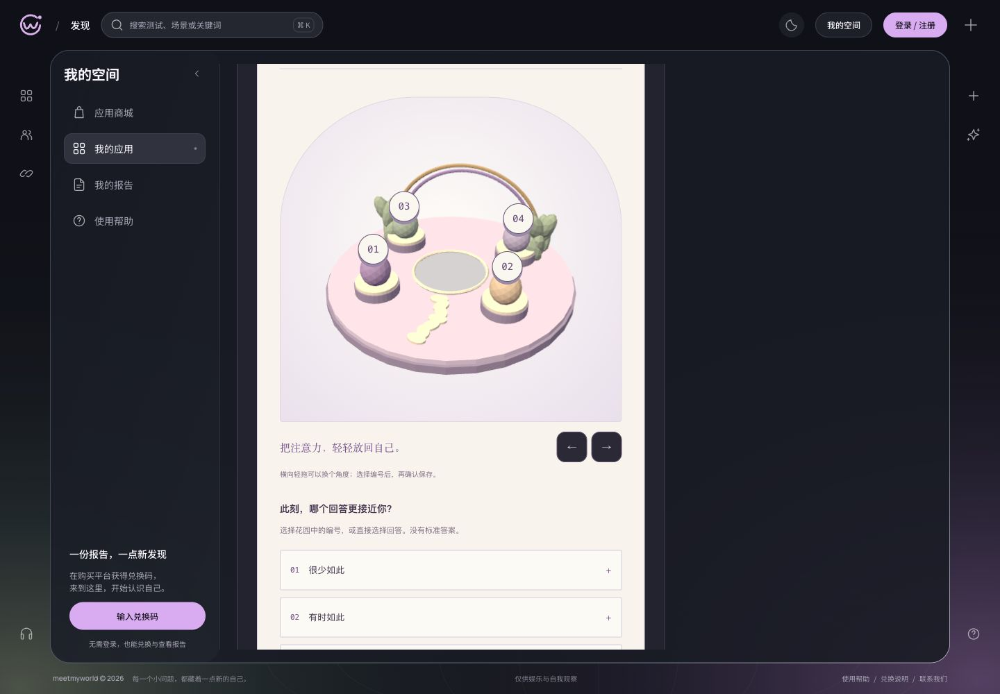
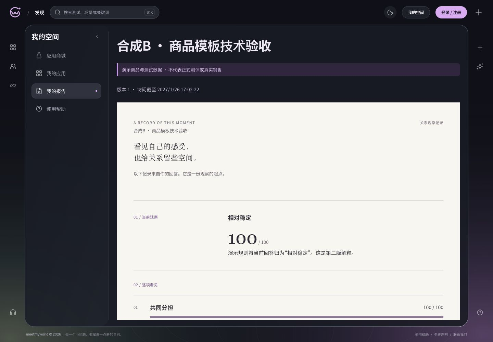

# 05/06 · A 制作链与 B 独立模板合成技术批次

2026-10-28。本批已完成可自主执行的合成技术实现；**05/06父任务仍未完成**。正式商品未选择，没有重写旧商品/权益/答卷/报告或启用真实内容、日程、云部署及交易。

## 实际实现

- A：MCP制作上下文现在校验显式提供的固定商品规划，即使还未选择方法也核对修订/摘要/模块；默认场景与报告采用该规划的精确声明。旧稿不能覆盖新规划的能力提示，未知协议仍拒绝。
- A：锁定整次拖动历史，拖动回到起点不再变成选项点击。花园的镜头操作继续与答案/服务端评分分离。
- B：新增 `relationship-atlas-prototype@1` / `atlas-notes-prototype@1` 独立组合。真实Three.js正交相机、分层观察台与2–4语义对象，固定镜头，无环境/镜头动画；报告直接呈现服务器结果。
- 两组合分别惰性加载。A/B仅在商品组件内按自身容器宽度重排，并修复宿主通用按钮样式覆盖；商城、账户和后台整体视觉没有改造，Task17未执行。
- 新增第30份前向迁移 `20261028010000_atlas_template_pair`，两处数据库检查明确允许A/B配对，使用null安全比较；固定规划、方法、审核、不可变引用及原件区别均保留。原29份迁移未改，**第30份仅在隔离TEST应用，开发/云库未应用**。

## TDD及真实链路

1. [A上下文](a-context-verification.md)：编译/运行RED，错误摘要200而非409、默认DOM而非花园；修复后同一2项GREEN。
2. A/B真实stdio MCP SDK读取固定规划/方法、上传已有JPEG实际字节、校验和保存、同requestId重试、读取固定稿与资源SHA。
3. 固定两个专业用途方法后，实际捕获项目方法快照并保存原生体验产物回执；`purpose=authoring`、`archiveReady=false`，不冒称导入ZIP原件。新增断言后A/B两条完整链再次通过。
4. 真实服务预览/审核/TEST版本发布，随后独立匿名HTTP会话执行发码/兑换、确认保存、重复/冲突、刷新恢复、服务端报告、一次消费和退款撤权；旧DOM固定版本仍可读。
5. [B模板](b-template-verification.md)：先以缺失实现及未注册配对RED；注册后实际到达SQL发布再RED（23514）；新迁移后同一完整链GREEN。
6. A往返手势新增运行RED（true而非false），锁定历史后同一用例及完整前端GREEN。RED/GREEN检查点都在当前分支，未压缩或改写。

## 验证结果

| 检查 | 结果 |
| --- | --- |
| API完整回归 | 507/507，顺序运行，约225.8秒；包括12项严格TLS/非superuser初始化检查及新迁移 |
| 前端完整回归 | 106/106；新增A拖动修复后再次运行 |
| MCP回归 | 22/22 |
| 自动测试唯一用例 | 635项；后续A/B原生产回执断言2项专项复跑不重复相加 |
| 类型与构建 | 工作区类型/完整构建通过；随后A手势及局部样式变更的前端类型/构建再次通过 |
| atlas model/scene覆盖 | 100%行、94.55%分支、100%函数；不代表DOM/WebGL适配器也有相同单元覆盖 |
| 构建门禁 | A/B各自计入完整静态依赖的gzip，均低于240/220KiB；应用入口不静态导入Three.js，精确值见verification.json |
| 自主CUA | 26通过、0失败；[记录](cua-verification.json)及[服务器计数](cua-server-proof.json) |

TLS测试夹具改用已有官方 `postgres:17.10-bookworm`，create→复制临时证书→start，256MiB/1CPU；未构建任何新Docker镜像或调整系统资源。全部fixture结束后，原5个运行容器healthy，Docker磁盘可用1,889,124,352字节，与本批开始时一致。临时浏览器设置已恢复、页签关闭，CUA专用TEST数据库及资源已清理。

## 实际浏览器证据

- CUA操作当前生产构建和真实隔离API，经过兑换页进入消费者页面，不使用纯合同解析或静态截图替代。
- B：键盘选择但不保存、390/768px长文无横向溢出、WebGL context丢失保留未确认选择、同题重试回到真实WebGL、离线保存失败/重试、模块下载失败/恢复、逐题确认及独立报告。
- A：真实花园、观察按钮不选答案、实际往返拖动不误选、390px布局、六题全部不适用与“信息不足/不填零分”的花园手记。
- 服务器在同一CUA TEST中核对A/B各6条答案、1份报告、只消费1次；A总分null、B总分100，报告分别固定原release和对应renderer。
- 当前实际绘制样本：A 22 draw calls/6600三角形；B选中时18/272（未选中17/176）。这些是本地帧图形数据，不是FPS或真机容量证明。

## 仍由后续任务持有

- 05：正式商品选择及各商品新规划、专业Skill/原件/媒体与存量版本转制；本批合成方法不启用或覆盖开发库04的四份DRAFT。
- 06：可重复冷启动/首帧、活动阶段FPS、内存与多轮卸载稳定性，以及剩余无WebGL/资源/隐藏恢复矩阵。当前未测字段保持未验，不能关闭整个06。
- 10：iOS/Android、三网与平台内置浏览器；390px桌面视口不当作手机真机。
- 11/13/14/15：正式成套内容、模型比较、真实制作及日更仍保持原暂停/未启用范围。
- 08：真实云部署与本批新版本维护包。07旧镜像只证明当时原29迁移版本，不能用旧镜像宣称第30迁移已入包或已部署；执行08需重新固定当前源码/迁移与部署证据。

原[盘点](inventory.json)及[准备验证](technical-preparation-verification.json)保留原时间点事实，没有覆写为本批结果。两份原JSON仍为planned，现行只读验证分别输出准备时/当前注册状态，仍拒绝把未绑定规划当成已交付商品。
