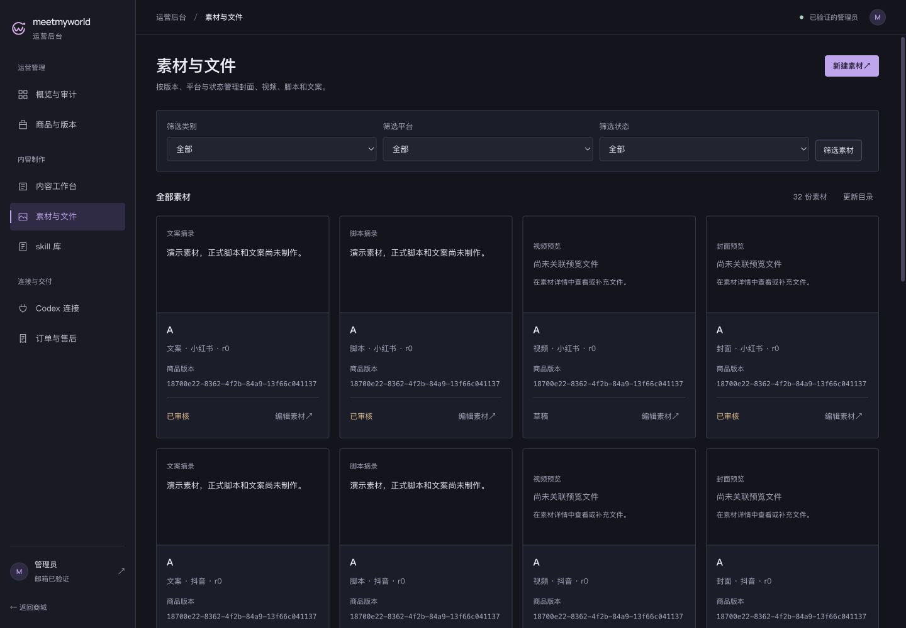
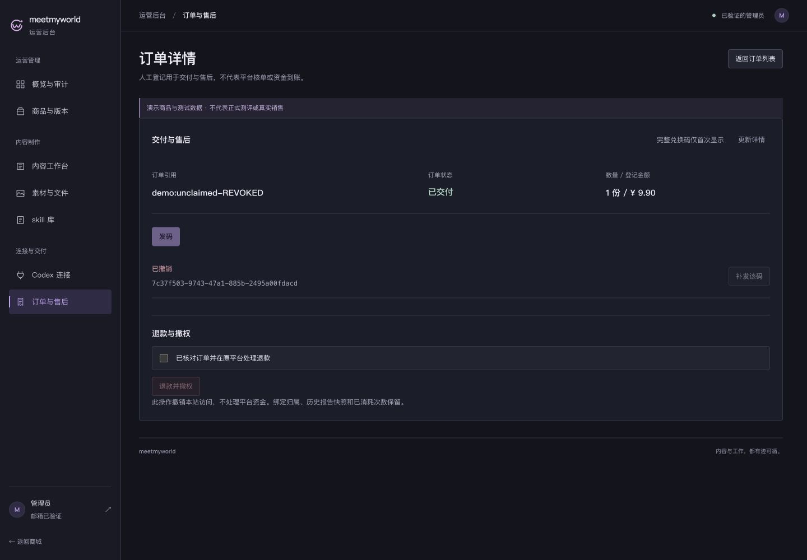

# T18 · 素材、订单与操作错误恢复

2026-10-29，沿用 B「精密工具紫」完成后台独立子批次。完整 T18 继续开放。

- [验证与限制](verification.md)、[机器记录及源码摘要](verification.json)、[47 项 CUA 检查](checks.json)。
- [改造前索引](before/index.json)与[改造后索引](after/index.json)：七类页面 × 1440/768/390px，21 组同一 TEST 数据前后对照。
- [旧错误残留 RED](red/action-scope.json)与[GREEN](red/action-scope-green.json)；[状态截图](states/)、[文字对比度](contrast.json)、[清理结果](cleanup.json)。
- [前端测试](logs/web-test.txt)、[类型与构建](logs/web-build.txt)。尝试与工具限制保存在 [attempts/](attempts/)，未把失败尝试计入通过数量。

这是合成 TEST 的真实应用界面。没有制作正式内容、上传媒体、发码、导入订单、退款或部署云端；测试入口、身份和数据库均已清理。
