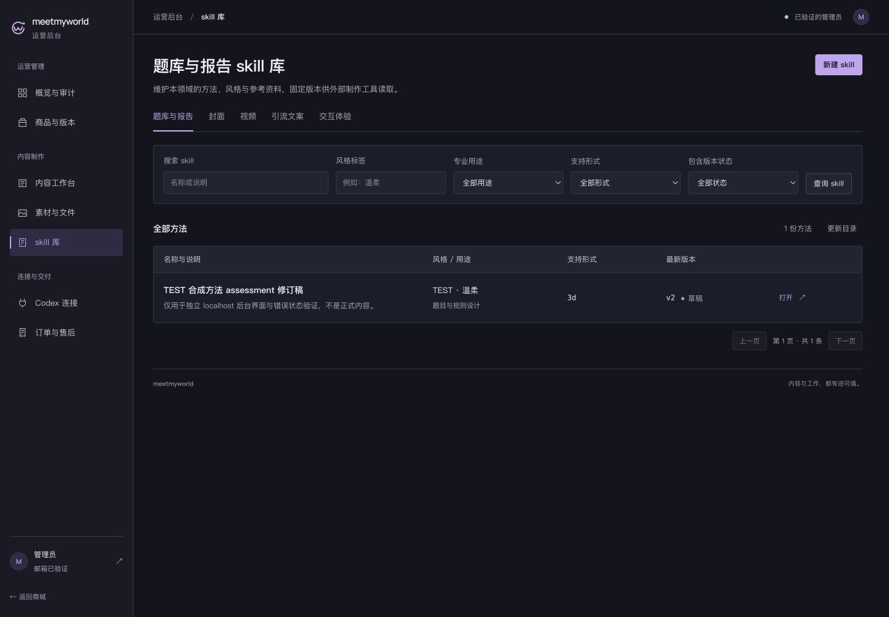
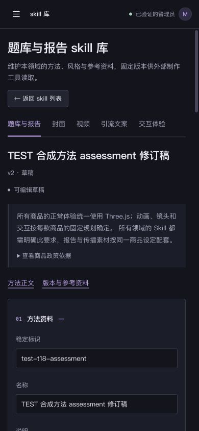

# T18 · Skill 目录与版本工作台

2026-10-29，B「精密工具紫」后台独立子批次。基线 `498459a`，完整 T18 不关闭。

有效 [RED](red/refresh-retention.json) 证明读取最新稿503后编辑器从1变0；[GREEN](red/refresh-retention-green.json)证明修复后保留编辑器。真实实现见 [源码摘要与结果](verification.json)，[28项CUA](checks.json)及[24组同库前后对照](after/index.json)通过。

先查看[五库/草稿/历史/新建基线](before/index.json)，确认普通错误替换编辑器、目录缺显式更新/清除、重复眉题与政策技术信息、手机版本入口埋在长文档后等问题，再实施：

- 目录统一计数、清除、更新、等待旧结果和空态；普通刷新保留目录及未提交筛选，旧结果暂禁打开。
- 编辑读取503和后台网络恢复503保留草稿；查询、保存、差异或附件403隐藏私有工作区，再经实际读取恢复。
- 保留所有Three.js共同要求及缺项警告，合格政策依据收进可展开明细；移除重复眉题和已完成的禁用补齐按钮。
- 手机增加方法正文/版本参考跳转和焦点，同页跳转不触发离开保护；跨库和历史切换仍保护未保存修改。
- 409/JSON错误保留输入，放弃修改清除旧操作错误；审核历史只读和原摘要保持。

`@orai/web test` 112项＋2项隔离检查、`@orai/web build`内含类型检查均通过，见[测试](logs/tests.txt)/[构建](logs/build.txt)。28项CUA含真实TEST成员403/退出401、历史摘要、冲突/加载失败/权限/空态、筛选返回、手机焦点及24组1440/768/390无整页溢出；六个文字样本最低[6.58:1](contrast.json)。

TEST方法由[确定性夹具](fixture.json)通过真实隔离API准备：四领域方法、一份审核历史与一份克隆草稿，仅属可销毁TEST，未恢复正式内容生产。PUT冲突/权限请求在进入API前拦截，无正式方法、附件或机器凭据变更。503/403/409为受控Fetch响应；实际普通成员403/退出401分别留证。初次等待首行失败是未准备Skill夹具的真实空库，随后显式准备夹具再截基线，不把空库算服务错误。

协议替身不代表真实Supabase、云端或真实设备验收；未上传文件、调用模型、配置客户端、创建机器授权、启用日程或部署。原五容器healthy，TEST库/私有状态/临时文件及自己的tab10已清理，网络/视口复原，见[清理](cleanup.json)/[浏览器](browser-cleanup.json)。商城、后端/合同/锁文件和旧output保持。连接配置/项目及完整状态仍继续，商城须先截图等用户明确审核。

