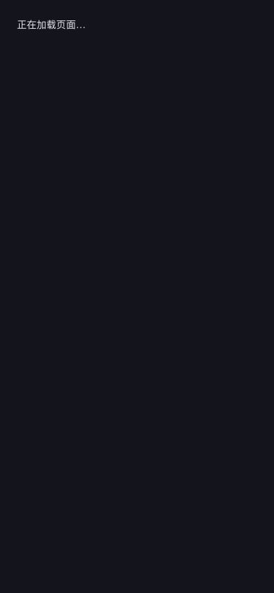

# T18 · 首轮页面基线及根加载状态技术子批次

2026-10-28。数据范围为一套随机隔离TEST、合成A/B及既有演示商品。来源沿用[项目Skill](../../../.agents/skills/anti-ai-web-design/SKILL.md)的R1/R5/R6/R8/R10及P1/P2/P3/P5/P12；没有新生成素材、真实内容生产、模型比较或云操作。

## 实际交付与范围

- [resting/baseline.json](resting/baseline.json)：八类页面 ×1440/768/390px，24张实际静态基线。核对精确可见h1、访问检查结束、字体完成、两次绘制机会及所有有限CSS入场动画结束，再复查截图后标题/遮罩。常驻环境动效保留；桌面模拟宽度不是真实手机。
- 页面为商城、演示商品详情、兑换、已领取应用、空报告、登录配置不完整、未登录账户、未登录后台。后台只采访问边界，不冒称概览/内容/Skill等授权业务页面均已审计。
- 原根目录、ready/及settled/采样保留导航、权限或入场中间状态；它们不是最终静态对照。曾因通用h1过早满足而捕获加载帧，最终改为精确可见标题和状态前后核对，不改写初次结果。
- 实际代码仅修复根Suspense的浅色背景过渡；商城/认证/后台主体布局、业务/权限/请求/数据和Three.js商品世界观未重设计。T18全项及05/06前置保持。

## 五项有截图依据的后续问题

| 问题与证据 | 对下一批的具体要求 |
| --- | --- |
| 首次懒加载整屏浅色：根加载RED为透明p、浅色body，仅72px高；与深色页面亮度突变 | 本批已修复根加载表面，以下GREEN；其他导航/身份检查单独复验，不把此项泛化为全部防闪屏完成 |
| 商城桌面有顶部问候、双侧工具栏、侧栏兑换、氛围光/玻璃框及底部线框同时争夺注意力（resting/store-1440.png） | 表达型页面先明确商品焦点，按R1/R6/P12减少重复层；保留紫色识别和实际入口，不新增装饰 |
| 应用/报告任务页仍显示“发现有趣的自己”横幅，与“我的应用/我的报告”二次争夺首屏（resting/apps-1440.png、reports-empty-1440.png） | 按P1/P2把当前任务/权益/继续操作置前，问候采用克制形式；不得改变本机/账户权益分组及显式绑定 |
| 当前演示商品在目录用高对比流体图作满幅背景、文字跨越图像亮暗面，详情又呈现白底演示封面（store/product两组） | 固定标题/说明的可读区域与真实预览来源；演示图不冒充正式Three.js商品资产，正式内容仍由11持有，不恢复生成任务 |
| 窄屏页眉显示Or-Ai，而桌面/标题/后台沿用meetmyworld识别；登录/账户外层工作台＋内层卡片＋重复导航层级较重（store-390、login/account-1440） | R8/P2/P3/R10要求按既有正式品牌资产统一标识，减少任务型页面重复容器；保持登录后跳转、管理员最左入口和权限拒绝 |

这不是已完成WCAG对比度、授权后台、全部错误/冲突/历史状态或整站设计方案的结论。已有后端统计与图表没有被截图数据替代，不凭演示数据编造趋势。

## 根加载状态TDD及验证

1. RED检查点 `e78f0a6`：[loading-red.json](loading-red.json)及原图，在600ms延迟、5Mbps下载下，背景透明且不覆盖视口，passed=false。
2. GREEN检查点 `070d4b8`：App根fallback使用app-route-loading，独立现有深色中性表面、100vh/100dvh，不改body或业务页面主题。保留role=status及原提示文字，没有新动效。
3. 同条件三视口实际背景均rgb(20,21,28)，宽/高覆盖390×844、768×1024、1440×1000，3/3通过；见[loading-green.json](loading-green.json)。
4. 当前源码107项前端测试、类型检查（web build内）及生产构建通过；本批未改API/MCP，不把原0b8de30的636项/CI追记为新提交已经通过。最新CI另由实际运行回执证明。

测试服务器只提供当前构建；公共字节和最小源码差异可复核。06原36首帧/24活动数据仍固定原修复版本，不自动转称新Root加载组合已完成全部性能或真机验收。

## 下一批与清理

T18.4尚缺已验证管理员的完整业务后台与关键错误/冲突/历史状态；T18.5完整规范/代表方案和主体实现仍未完成。先沿本清单审计各任务型/表达型表面，再按既有05/06依赖完成全站改造和功能回归，不删除依赖。06的A对象保留与真实hidden范围继续持有。

临时TEST、合成文件/状态和自己的页签已清理，所有浏览器临时设置恢复；原5容器healthy，内存余量46%、Docker可用约1.86GB。没有镜像构建、原卷删除、新客户端/持续凭据、真实发布/交易或定时任务。

