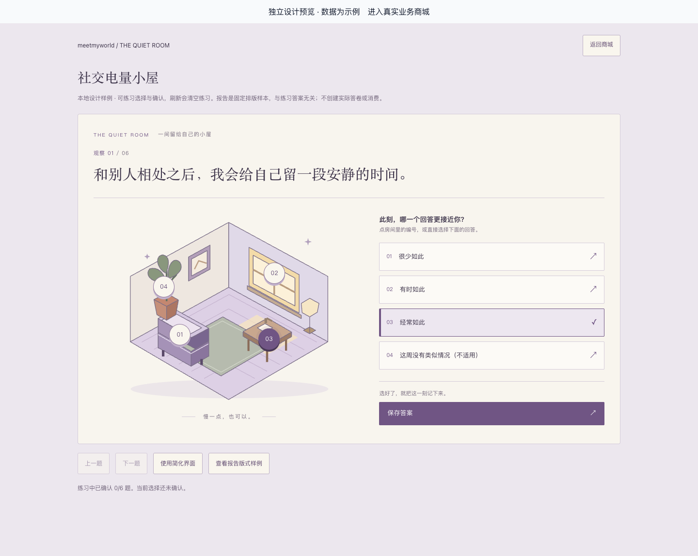
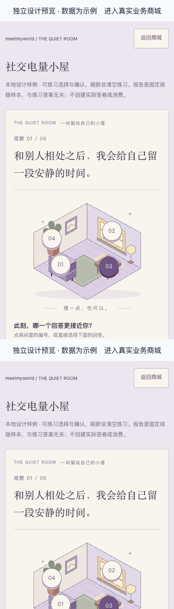
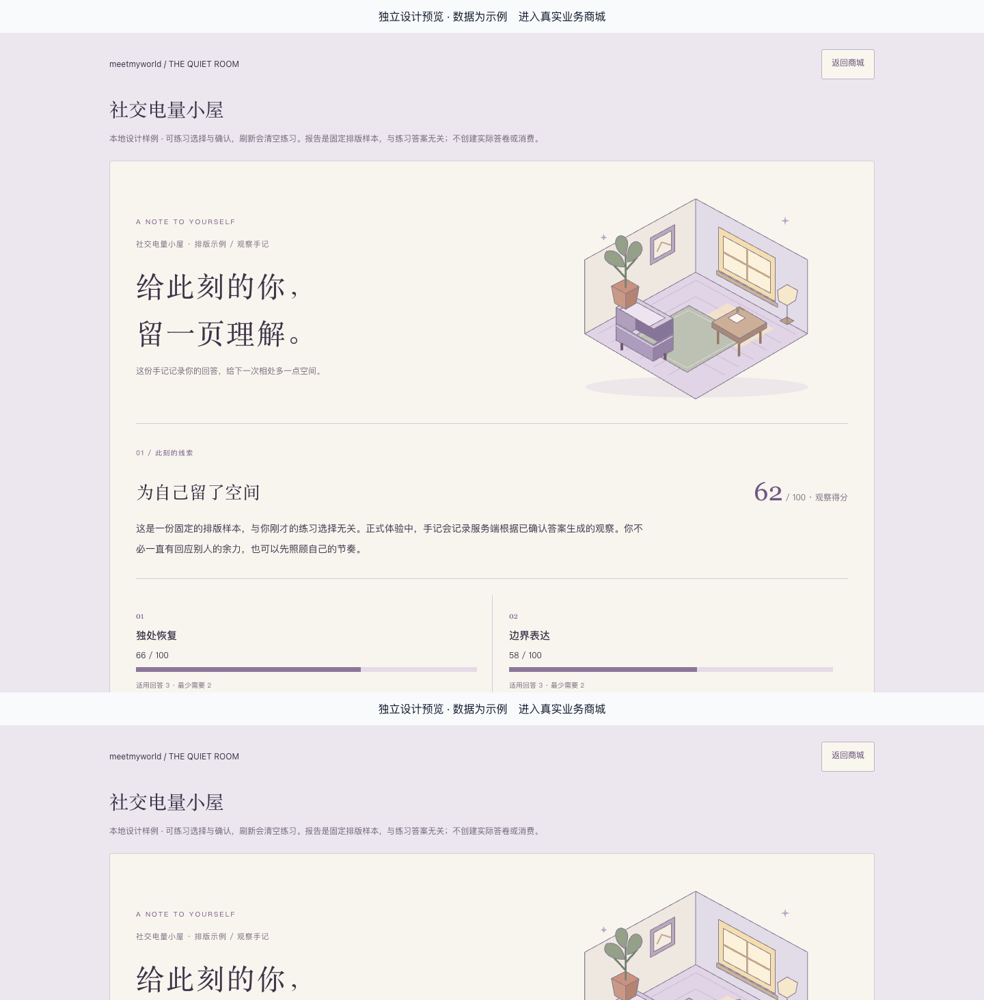
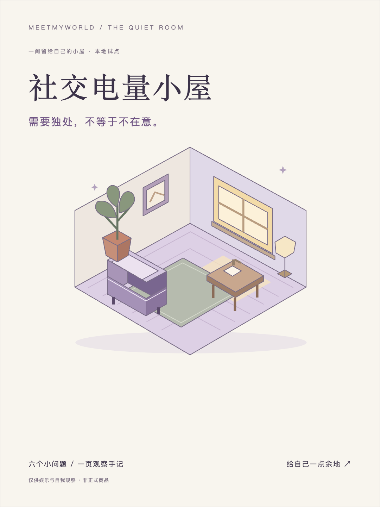

# T16-A 社交电量小屋 · 新 UI 审核

2026-10-21。T15-B 界面已获用户批准，本批新画面仍需单独审核。小屋、手记、配套封面/静音样片/文案已实现并通过技术验证，当前停在审核节点，T10-L 尚未开始；真实手机/内置浏览器保留待验收，云服务接入仍需另行批准。

[打开可试玩设计样例](http://127.0.0.1:5173/preview/experience/quiet-room)。可以练习房间选择和确认；报告为明确标注的固定排版样本，与练习选择无关，不创建业务答卷或消费。完整权益与报告流程在隔离数据库另行验证。

请重点确认房间意象、题目可读性、选项/保存的明确程度，以及手记与传播素材的风格。下面主画面来自显式设计预览；`runtime-` 画面来自真实业务组件和隔离权益数据。

## 桌面房间

## 手机房间

## 配套手记

[查看手机手记](field-notes-mobile.png) · [信息不足报告](runtime-field-notes-insufficient.png)

## 封面与静音演示

源内容在 [examples/social-battery-room](../../examples/social-battery-room/README.md)。同一设定包含六题、服务端报告、封面/视频和文案；录屏展示两道题与 hook/CTA，报告标注为独立排版样本。封面/插画来自可信本地 SVG，视频来自本机录屏，没有执行平台 Skill 或外部生成模型，没有公开发布或云上传。

## 技术与业务验证

- API 266＋前端 50＋SDK 19＝335 项唯一测试；完整浏览器 57 项通过，含新增 4 项试点流程，重复执行不累加。
- 原选项映射、键盘/触摸、明确保存、刷新恢复、DOM 同分、手记/场景模块失败和资源失败回退、重复提交一次消费及退款撤权通过。空分数保持 null，不显示零分条。
- 真实 MCP SDK 显式读取配对/预算、PNG 上传、草稿/重试、来源核验和人工审核发布通过；四类内容固定采用、视频两题/文案引用与可播放元数据通过。体验 release 在试点 manifest 中另行固定，原采用包格式不改写。
- 类型检查、构建、Prisma validate、实际 schema diff 通过。新增模板/插画/手记/CSS gzip 6172 字节，低于 45 KiB；不含既有 React/共享契约，不当作真机性能结论。
- 封面 85904 字节、静音视频 1695498 字节，均在预算内；资源最多两图、单图 512 KiB、合计 1 MiB。
- 仍为 50 模型/17 迁移，无新增迁移。42 类表的 1156 条旧记录原字段摘要一致，5 份历史 release 与答卷/报告引用保留，临时测试库残留 0。开发库没有新增商品/订单/机器凭据，运行服务继续 ready。

[完整验证结果](verification.json) · [57 条浏览器检查](browser-checks.json) · [隔离试点固定来源](pilot-manifest.json)

[实际权益的桌面房间](runtime-quiet-room-desktop.png) · [实际权益的手机房间](runtime-quiet-room-mobile.png) · [实际报告](runtime-field-notes-desktop.png) · [后台固定配置](runtime-quiet-room-admin.png) · [资源失败回退](runtime-quiet-room-resource-fallback.png)

手机证据使用 390×844 / 393×852 模拟视口，尚未测试真实手机或内置浏览器。身份事实来自测试提供者，不能计为云 Auth 或正式商品验收；此前 T06-O 的 11 项真实 Auth 证据保留。既有 pg 弃用提示仍存在，懒加载失败日志来自明确注入的回退测试。

当前等待用户审核这批新画面，批准后继续 T10-L，T16-B/新评分/云端均未开始。实施与边界见 [QUIET-ROOM-PILOT.md](../../prd/v1/QUIET-ROOM-PILOT.md)，私有日志 `.local/t16-a/`；保持原 checkout/分支/模型设置，未提交或推送。
