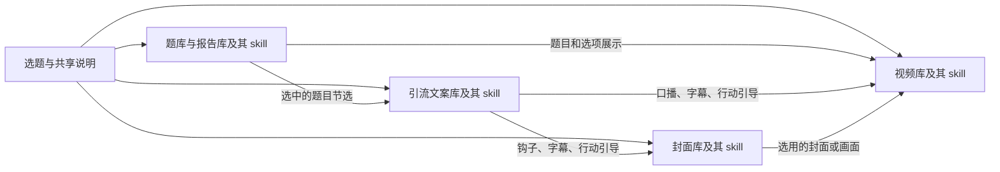

# 内容后台、风格 skill 与 MCP 接入规划

日期：2026-10-20。状态：T12-A/B/C 内容后台全部本地验收；skill 和 MCP 待后续批次。后台以同一选题/测评产品及其版本为入口，规划分别管理题库报告、封面、视频、文案及各自的 skill/MCP，通过固定引用连接产物。已实现范围见 [底座](CONTENT-FOUNDATION.md)、[工作台](CONTENT-WORKBENCH.md)、[引用与采用](CONTENT-ADOPTION.md) 交接，skill/MCP/调度等条目仍为规划。

任务入口：[T12 内容后台](tasks/T12-content-backoffice.md)、[T13 风格 skill 库](tasks/T13-style-skills.md)、[T14 MCP 接入](tasks/T14-mcp-ingestion.md)。基础鉴权、商品版本和素材接口先由 T07 提供，简单操作页面由 T08 提供；本文件统一定义后续扩展的业务边界，避免另建一套题库或文件仓库。

T07/T08、T06-O 与 T12-A/B/C 已通过本地验收。后续按 [ROADMAP.md](ROADMAP.md) 从 T13-A 开始四库 skill，再做本地 MCP；远程另在云条件就绪后验证。本文件描述能力契约，执行顺序不另行维护。

## 1. 能力与首期范围

用户已明确需要保存宣传封面、视频、题目、引流文案和不同风格的 skill，并支持 MCP 上传这些内容。首期按“后台保存和管理，外部 AI 制作后回传”规划；后台直接执行 skill、调用模型和视频渲染任务仍是后续独立能力，此选择为当前规划默认值。

平台宗旨是提供情绪价值、加深自我与关系理解。各商品按 [PRODUCT-CREATIVE-SYSTEM.md](PRODUCT-CREATIVE-SYSTEM.md) 定义情绪/理解目标、参与视角及整体创作设定；所有领域配套制作，报告内容与呈现同样属于核心交付。

| 内容 | 经营者可以做什么 | 关联方式 |
| --- | --- | --- |
| 题库与报告配置 | 编辑/导入题目、选项、维度、计分、类型和报告模板；校验、试答、比较版本 | 复用 `ProductVersion.configuration`，发布后保持不可变 |
| 宣传封面 | 保存商品封面、平台宣传图和分享卡素材；预览、下载、选择采用稿 | 精确关联商品版本、平台、用途、A/B 变体与文件修订 |
| 视频与脚本 | 上传视频成品，保存关联脚本、分镜说明、时长与画幅 | 视频文件和脚本文本分别保存并关联 |
| 引流文案 | 保存标题、正文、钩子、话题、行动引导及适用平台；比较不同版本 | 文案结构化保存，支持单独编辑与随商品打包导出 |
| 风格 skill | 保存 `SKILL.md`、输入/输出说明、风格标签、参考资料、示例和版本 | 可复用 skill 库；商品按用途绑定明确的 skill 版本 |
| 制作记录 | 查询内容由谁、以哪个 skill 版本和哪些输入制作，查看采用/退回记录 | 关联输入摘要、商品版本、skill 版本和产物修订 ID |

这里的“报告”主要指可复用的测评产品内容和报告模板。消费者的个人答卷、分数与报告快照继续由原权益服务管理，不进入宣传素材库或 MCP 默认读取范围。

### 1.1 四类内容库和各自的 skill 库

“选题”是整款测评产品，例如“伴侣协作体检”；“单题”是其中一道测评题。初期直接以已有 Product 作为选题内容项目，用稳定 productId 关联各库，不另外维护一份重复的选题表。

| 领域 | 独立管理的内容 | 本领域 skill 库 | MCP 工具示例 |
| --- | --- | --- | --- |
| assessment 题库与报告 | 题目、选项、维度、计分、类型、报告模板及可宣传的题目节选 | 出题、结构校验、报告表达等不同方法/风格及输入输出规范 | `assessment_draft_save`、`assessment_skill_list` |
| cover 宣传封面 | 主视觉、标题排版、平台尺寸、A/B 变体、原图/成品 | 封面构图、视觉风格、字体/色彩规范与参考素材 | `cover_draft_save`、`cover_skill_list` |
| video 视频 | 分镜、题目展示、字幕/口播、时序、成品及关联封面 | 视频叙事、剪辑节奏、镜头/字幕风格与制作规范 | `video_draft_save`、`video_skill_list` |
| copy 引流文案 | 开场钩子、正文、话题、字幕/口播候选、行动引导 | 平台写作、语气、钩子结构和不同风格示例 | `copy_draft_save`、`copy_skill_list` |

四类库在后台具有独立入口、字段、校验、权限和版本。实现时共用 skill 版本/文件存储底座，以必填 domain 区分库；同一风格词可以出现在多库，但视频 skill 与封面 skill 各自有指令、输入和输出。选择 skill 时必须指定领域和版本，不能仅凭“温柔风”标签混用。

每个领域都区分“制作方法”和“制作产物”：skill 是可跨选题复用的方法库，题目/封面/视频/文案是归属于具体选题的产物库。产物记录使用了哪个 skill，也记录使用了其他产物的哪些内容；这两种关系分别保存。

后续可新增 experience 体验制作领域，管理网页/2.5D/3D/小游戏模板配置、资源及其 skill，继续引用原题库和共享说明；视频可引用具体体验场景。该扩展按 [EXPERIENCE-PLATFORM.md](EXPERIENCE-PLATFORM.md) 的 T15–T17 排期，四领域 M7 范围保持原定义，后台任意代码/skill 执行仍不属于本期能力。

### 1.2 共享选题说明和内容引用

共享选题说明完善为版本化商品创作设定，包含人群、情绪/理解目标、参与视角、世界观/意象、交互形式、语言/视觉/声音、报告方案、渠道和公开节选。各领域用本领域 skill 做媒介适配，并符合这份共同设定；独立创意变体需明确标识和采用清单，不能仅因同题就混配不相容的风格。视频、封面和文案获取用途所需上下文，不因此取得完整计分或个人报告。

报告在 assessment 内区分题目/规则设计与报告写作两类专业用途，在 experience 中配置呈现模板/主题；例如小屋体验对应能量地图/回信式报告，像素冒险对应选择日志。T12 交付独立版本化的报告方案草稿 schema、内容编辑/结构校验和既有兼容报告的采用链；T15 再交付新运行投影、renderer 及发布兼容验证。未支持的形式只保存草稿，不进入采用，T12 不反向等待 T15 才完成。结构化结果事实和旧报告快照保持原含义。

同一选题下可保存多组草稿和采用稿。除 productId 外，产物还要声明具体用了哪些输入：例如视频 v1 使用题库 v2 的 Q03/Q07、文案修订 4 的 hook/cta、封面修订 2 和视频 skill v3。后台既能从视频查看来源，也能从某道题/某段文案反查使用它的封面和视频。

引用是“来源版本＋内容位置”，同时保存实际使用快照。视频为控制时长缩写题干时，记录为改写并保存实际字幕/口播文本，不修改原题。上游更新产生影响提示，原视频和历史记录仍固定旧输入；经营者选择重制时再生成新修订，不自动替换成 latest。

## 2. 固定约束与现有能力

- 沿用 React/Vite、NestJS、Prisma/PostgreSQL、Supabase Auth、现有商品版本和权限体系；本地先做，云端数据库、认证、对象存储和公网验证后置。
- 一个商品可有多个内容版本；每个版本可有多平台、多用途和多风格素材。已发布的题目/计分/报告模板不能原地覆盖，已有答卷与私人报告保持原版本。
- 题库、计分和报告模板以现有结构化配置为事实来源；表单和 MCP 都调用相同的校验、预览和版本服务。风格可改变内容表达，不能在消费者运行时暗中改变计分规则。
- 网页和 MCP 共用业务服务、数据范围、修订冲突检查与审计。MCP 适配层不直接连接数据库，不接受客户端自行声明管理员身份。
- 四类 MCP 按领域暴露独立工具集和权限；首期可由同一后端/适配包提供四份接入配置。独立接口不要求四套数据库或四份文件服务，跨领域读取走显式引用与用途上下文。
- 图片、视频和 skill 附件通过存储适配器保存；数据库记录文件引用及元数据。开发使用受控本地目录，公网使用 R2 等持久化对象存储。
- 上传产物默认进入草稿；文件上传成功、素材审核通过、商品发布分别记录。首期 MCP 可写草稿和读取授权内容，商品发布仍在已有管理员流程完成。
- `DEMO/LIVE` 范围沿用现有隔离规则；公共商城只读取经营者明确采用的公开素材，不直接枚举后台文件、完整题库、skill 或消费者数据。

现有 `CampaignAsset` 继续复用商品版本、平台、类别、变体和文件。T12-A 已追加 authoring、历史修订、引用与来源表及受保护 API；T12-B 已交付四类编辑、媒体探测与整套试读，引用/复查、固定采用/JSON 导出及清理已由 T12-C 完成，skill/MCP 等其余逻辑实体仍待对应任务落地。

## 3. 后台页面与业务流程

| 页面 | 主要能力 | 任务归属 |
| --- | --- | --- |
| 商品内容工作台 `/admin/content` | 商品搜索、分类/状态筛选、版本与素材齐备情况 | T12 |
| 商品内容详情 `/admin/content/:productId` | 商品创作设定、情绪/理解目标、参与视角和报告方案；四类内容页签、成套预览、引用/影响与采用组合 | T12，skill 组合由 T13 补齐 |
| 题库与报告编辑 | 结构化表单/JSON 导入、完整校验、试答预览、差异与新版本 | T07 基础服务，T12 编辑体验 |
| 素材库 `/admin/assets` | 图片/视频预览，脚本/文案编辑，平台/风格/变体筛选，历史与采用清单导出（媒体另行授权下载） | T12 本地已实现 |
| skill 库 `/admin/skills/:domain` | 题库报告、封面、视频、文案各自检索/编辑/版本管理，查看本领域参考素材与商品绑定 | T13 |
| 制作记录 `/admin/production-records` | 人工/MCP 来源、输入/产出清单、采用或退回 | T12 基础记录，T13 补充 skill 来源 |
| MCP 接入 `/admin/integrations/mcp` | 管理连接凭据、权限范围、有效期、撤销和最近调用结果 | T14 |

典型流程：确定情绪/理解目标及商品创作设定 → 选择各领域兼容 skill → 制作题目/规则、交互和配套报告方案 → 固定内容/模板版本及公开节选 → 制作相配的封面、视频、文案/分享卡 → 各域 MCP 回传设定修订和输入引用 → 成套预览、试读/试测与审核 → 固定采用组合。各库可独立保存探索稿，正式采用时核对传播承诺、实际体验和报告的连续性。

素材不要求一次全部提交。每次保存返回真实的对象 ID、修订号和状态，失败项可独立重试；齐备检查按明确清单显示缺失内容，不把空文件或占位链接算作完成。

### 3.1 Codex 每日制作与上传（后续试运行建议）

2026-10-19 用户希望后续每天由 Codex 自动任务调用自有 MCP，制作并上传四类交付物。这符合首期由外部 AI 制作回传的边界：Codex 承担调度和制作，MCP 提供受控读写，后台保存版本、引用、回执并提供预览与审核。具体运行时间、产量、制作工具和费用上限仍待实际配置；本次不创建定时任务。

建议先手动完成一个选题的一套草稿，再试运行每日一个选题。按用户后续澄清，目标为四个独立 Codex 制作任务，各调本领域 MCP，由后台共享批次、固定设定/skill 版本和依赖状态保持一致：题库与报告模板 → 文案 → 封面 → 视频 → 齐备检查和成套预览。每天也可补齐已有商品；没有准备好的选题时不强行新增。任务在生产窗口检查可领取阶段，成功保存后才解锁下游，具体频率在试运行配置。批次认领、阶段进度和自动续做另行实现，T12-A 的 batchKey 不代表已有执行队列。

该试点需要在 T12–T14 底座可用后补齐以下能力，具体模型与端点在实施批次确定，不提前算作已有功能：

- 制作批次：稳定批次标识、productId、创作设定、各领域 skill/输入/输出修订和目标交付清单；统筹工作流 skill 与四类专业风格 skill 分开维护。
- 阶段回执：区分制作、上传、校验、已保存和待审核，记录可重试失败；只有实际校验并保存的产物才算该阶段成功。脚本或分镜完成不等于视频文件完成。
- 续做与去重：根据批次及阶段查询已保存产物，失败时复用固定输入并只补缺失阶段；重跑不重复创建商品/附件，仍遵守 requestId、修订冲突和服务端校验。多次运行可能重叠时加入批次认领/租约，不依赖聊天记录判断唯一执行。
- 制作与质量：选定 Codex 可调用的出图、视频渲染或生成工具，记录费用/时长上限和最大重试次数；验证题库/评分与报告兼容、实际文件可读、题目/文案引用一致，并检查是否实现该选题的情绪/理解目标。
- 采用与权限：上传形成成套可预览草稿，经营者在后台审核采用；运行凭据只读取所需 skill/上下文并写入指定范围的产物，不默认写 skill 库或取得发布、订单和消费者私人报告权限。
- 运行环境：本机定时制作需电脑开机、桌面应用运行、工作目录与 MCP/生成工具可访问；本地链路先使用 T14-L，公网接入另依赖 T09/T14-C。先实际测试定时环境中的工具、认证和文件传输，再承诺每日无人值守。

试点验收建议：手动完成一套真实文件 → 人为中断一个阶段后恢复且无重复 → 在实际 Codex 定时环境跑通并核对后台同一批次，再逐步增加产量。该外部自动化试点另行排期，后台自身不因此增加模型执行队列或定时调度服务。

运行条件依据：[OpenAI 定时任务文档](https://learn.chatgpt.com/docs/automations?surface=app)、[Codex MCP 文档](https://learn.chatgpt.com/docs/extend/mcp)。实际可用工具、权限和认证以试点环境验证为准。

## 4. 实现契约

### 4.1 逻辑数据实体

下表为待实现的逻辑设计；名称可在实现时按仓库约定调整。新增关系均带数据范围约束，引用历史修订的记录不能因后续编辑发生漂移。

| 实体 | 关键数据与约束 | 复用/新增安排 |
| --- | --- | --- |
| 商品内容版本 | 题目、计分、报告模板、公开样例和版本状态 | 复用 `ProductVersion`，保留 T03/T05 的校验与不可变规则 |
| 商品创作设定修订 | productId、情绪/理解目标、参与视角、世界观、形式/语言/视觉/声音、报告方案、公开节选与渠道、修订号 | 在共享说明上完善；各域读取同一设定修订，变更保留历史 |
| 素材及修订 | 商品版本、平台、用途、变体、文本/文件引用、修订号、风格标签、审核和采用状态 | 复用 `CampaignAsset`；T12 增加修订历史，原 `variant` 不作为修订号 |
| 文件与上传会话 | 服务端文件键、原文件名、实际 MIME/大小/摘要、图片尺寸或视频时长、上传者、状态、期限 | T07 建最小文件契约；T12 完善历史引用与失败清理 |
| `StyleSkill` / 版本 | 必填 domain、名称、用途、风格标签、说明、`SKILL.md`、参数/输出结构、参考文件、示例、内容摘要、版本状态 | T13 新增；四类库共用底座，各自校验/授权，版本采用后不可覆盖 |
| 商品与 skill 绑定 | 商品/创作设定版本、领域/专业用途、明确 skill 版本、支持形式/风格 | T13 新增；领域及制作要求兼容，不自动漂移 latest |
| 报告内容与呈现方案 | 私有结构化报告内容模板、章节/叙事方案、公开样例、兼容的呈现模板/主题版本 | T12 设计内容，T15 扩展呈现；旧报告快照/结果事实保留 |
| 内容输入引用 | 来源产物修订、目标版本/修订、questionId 或文案 blockId 等位置、使用角色、引用/改写方式、内容摘要与实际使用快照 | T12 新增；支持反查、同范围约束、循环/失效校验，禁止仅用标题或数组序号定位 |
| 视频分镜与文案块 | 稳定 sceneId/blockId、时序、题目展示、口播/字幕/CTA 的引用及实际文本 | T12 扩展视频/文案修订的结构化数据，不把全部依赖埋进自由文本 |
| 渠道采用清单 | 商品/创作设定版本、题目/体验/报告方案与模板、封面/文案/视频修订及 skill 来源 | T12 固定 manifest 并成套预览；可扩展 Campaign |
| 制作记录 | 人工/外部 AI/MCP 来源、输入摘要、输入版本、输出修订、skill 版本、操作者、采用/退回说明 | T12 建立，T13/T14 补充来源；这是来源记录，不是后台执行任务队列 |
| MCP 连接凭据 | 服务端生成的主体、允许的数据范围/商品/操作、摘要、到期、撤销和创建管理员 | T14 新增；凭据不拥有超出签发者的权限 |

视频、原图不存进 PostgreSQL JSON 字段。素材已有文件键需通过向前迁移/校验接入文件记录；历史缺失文件显示不可用，不伪造迁移成功。原迁移、题目版本和私人报告快照不改写。

### 4.2 生命周期与失败恢复

- 商品版本继续使用 `DRAFT → REVIEWED → PUBLISHED → ARCHIVED`。表单或 MCP 更新已发布内容时，创建新版本草稿。
- 素材沿用 `DRAFT → REVIEWED → READY → ARCHIVED`；修改已审核内容产生新修订并重新审核。旧采用稿和渠道导出清单固定引用历史修订。
- skill 版本规划为 `DRAFT → REVIEWED → ACTIVE → ARCHIVED`；已启用版本不可覆盖，归档不删除既有绑定或制作来源。
- 上传会话区分 `PENDING / VERIFYING / UPLOADED / AVAILABLE / FAILED / EXPIRED / DELETING / DELETED`；只有完成服务端校验的文件才能进入可用素材。中断或校验失败保留可定位回执，清理仅处理过期且未被引用的临时对象。
- 写入带 `requestId`，更新带预期修订号；相同请求重试返回同一结果，不同内容复用请求 ID 或旧修订写入返回冲突，不覆盖其他管理员/MCP 刚保存的内容。
- 文件存储与数据库不能当作一个跨系统事务：先上传隔离对象，再校验，最后事务关联；关联失败允许幂等恢复。已被引用的文件不直接物理删除。
- 内容引用固定到已保存修订；已发布题目用 productVersionId＋questionId 定位，草稿题目额外固定配置修订/摘要和输入快照。文案通过 assetRevisionId＋blockId 定位，封面/视频用明确素材修订；表单重排不改变 ID。
- 上游有新稿时，标记依赖它的下游“来源有更新，待复查”，不修改既有成品或自动触发生成。缺失引用、摘要不匹配、领域不符、循环依赖和越范围为保存/采用校验错误；合法旧版本可经明确选择继续采用。
- 发布/导出采用组合前校验输入是否齐全、是否已审核、来源是否存在以及是否有未处理的更新提示。仅同属一个 productId 不代表任意封面/视频/文案可以混配。
- 采用组合还需固定创作设定与报告方案/呈现版本，检查各领域兼容形式、必要交付项和审核；语气、意象与情绪/理解目标由成套人工试读确认。旧版产物可明确采用兼容的旧设定，不自动套用新风格。

### 4.3 管理接口与模块边界

以下为规划接口族，不表示端点已经存在；具体 DTO 在对应 task 中加入 `@orai/contracts/admin` 并记录到 API-CONTRACTS.md。

| 接口族 | 能力 | 服务归属 |
| --- | --- | --- |
| `/api/admin/products`、商品版本操作 | 草稿导入、校验、预览、审核和发布 | 复用 catalog/versions 与 T07 管理入口 |
| `/api/admin/assets` | 查询、保存素材草稿、历史修订、审核/采用、导出清单 | T07 基础，T12 扩展 |
| `/api/admin/creative-profiles`、`/api/admin/content-contexts`、`/api/admin/content-references`、`/api/admin/content-revisions` | 设定/输入、固定历史、反查、差异、影响与复查；精确路径见 API-CONTRACTS | T12 已实现 |
| `/api/admin/content-packages`、`/api/admin/file-cleanups` | 固定采用/JSON 清单、清理预演及确认执行；精确路径见 API-CONTRACTS | T12 已实现 |
| `/api/admin/uploads` | 创建上传会话、受控传输、完成校验、查询状态、授权下载 | T07 基础存储适配器；T12/T14 共用 |
| `/api/admin/skills/:domain` | 四类 skill 库、版本、参考文件、检索、商品绑定和导出 | T13 |
| `/api/admin/production-records` | 保存和查询制作来源及产物清单 | T12/T13 |
| `/api/admin/integrations/mcp` | 管理连接凭据与审计；仅管理员网页/管理 API 可签发或撤销凭据 | T14 |

建议在现有 NestJS 服务中增加 content/assets、skills、integrations 模块，数据库仍复用受限运行账号。独立本地 MCP 适配进程仅调用授权管理 API；不另建业务数据库或重复实现发布规则。

### 4.4 MCP 工具与文件上传

首期 T14-L 提供四份本地 stdio 接入配置，按 domain 暴露本领域工具与获授权的共享上下文工具；后续 T14-C 可提供远程 Streamable HTTP（规划入口 `/api/mcp/:domain`）。同一适配包可按领域启动，四类接口共用业务后端。远程认证、发现机制和客户端兼容性在实现时核对最新官方 MCP 规范，不把浏览器 Cookie 直接当成机器连接凭据；工具列表过滤不代替服务端权限检查。

| 规划工具 | 输入/输出重点 | 最小权限 |
| --- | --- | --- |
| `assessment_draft_save` / `assessment_validate` | 题库与报告草稿，输入商品版本/修订；保存完整配置需题库领域授权 | `assessment:write` |
| `cover_draft_save` / `cover_upload_prepare` | 封面文件与构图说明、引用的文案块、skill/brief 版本 | `cover:write` |
| `video_draft_save` / `video_upload_prepare` | 成品、分镜、题目/文案/封面引用及实际字幕/口播快照 | `video:write` |
| `copy_draft_save` | 结构化钩子/正文/字幕/CTA 块及其来源，不改写原题 | `copy:write` |
| 各领域 `*_list` / `*_get` | 本领域内容分页与固定修订读取；同样限制商品和数据范围 | 对应领域 `:read` |
| 各领域 `*_skill_list` / `*_skill_version_get` / `*_skill_draft_save` | 读取/上传本库 skill，domain 与工具一致 | 对应领域的 `skills:read` / `skills:write` |
| `context_bundle_get` / `references_validate` | 按选题、用途和所选引用读取已授权题目节选/文案块/封面，返回输入版本清单；不返回完整私有计分模板 | `context:read` 加各引用的显式读取授权 |
| `upload_complete` / `upload_status` | 完成和查询绑定领域、身份、目标的文件上传会话 | 创建会话所需领域权限，完成时重新校验 |
| `production_record_save` | 关联本领域输入、skill 版本与已保存产物，返回来源记录 | 对应领域 `:write` 及输入引用授权 |

连接凭据按领域区分内容读写、skill 读写、共享上下文读取及商品范围；例如视频写入凭据可获指定题目节选/文案块读取权，但不能因此修改文案、读取完整计分或修改其他库 skill。每次调用、引用解析、上传完成和下载均重新校验有效权限；普通用户、已撤销/到期的凭据及跨范围请求被拒绝。首期不向 MCP 暴露商品发布、退款、批量发码、物理删除或任意数据库操作。

文件上传步骤：

1. MCP 传入商品/skill 目标、用途、文件名、预期类型/大小/摘要和 requestId；服务端生成绑定身份与目标的 uploadId。
2. 返回短期受控上传地址/传输说明。客户端或本地适配器流式传输文件字节；图片和视频不作为大段 Base64 塞进工具参数。
3. 调用完成接口，服务端核验实际对象、MIME、大小、摘要和所属范围；校验未完成时返回 VERIFYING，不能返回“素材已就绪”。
4. 经对应领域工具，用可用 fileId、brief/skill 版本和 inputs 引用清单保存草稿并写制作记录；校验引用后返回 ID、修订号、审核状态及可定位的失败原因。附件用途不能通过修改工具名切换领域。

context_bundle_get 为每个任务提供 creativeProfileRevisionId、情绪/理解目标、参与视角、商品形式/报告方案、领域/用途、skill 版本和所选最小输入。视频另带 questionRefs/copyRefs/coverRefs 与分镜实际使用位置；产物回传声明相同设定及来源。后台验证版本/兼容性并将风格冲突标为待复查，不要求客户端自行拼装完整私有配置。

本地适配器如支持文件路径，只能读取用户明确指定且在配置目录内的文件；路径不交给远端服务执行读取。后台不按任意 URL 拉取文件。Markdown、附件清单和 ZIP 导入需限制相对路径、大小、文件数量和解压总量；上传 skill 的指令不触发后台执行或安装。大视频分片、缩略图转码按实际样本评估，基础验收先保证流式上传和中断后重新上传/幂等完成。

### 4.5 访问、审计与运营要求

- 完整题库/计分/报告模板、未发布素材和 skill 仅供授权后台或 MCP 读取；公共封面由独立公开引用提供，签名私有链接不保存为永久公开地址。
- 网页继续使用现有账户会话、邮箱状态、ADMIN 角色和 CSRF/来源校验；机器入口使用独立、可撤销的能力凭据，经相同业务授权适配。
- 审计记录操作者/连接主体、入口来源、目标、版本、动作、结果与 requestId；不记录完整凭据、上传签名 URL 或大段私人内容。
- 页面显示上传中、校验中、失败、缺失、草稿、审核和采用状态；视频未上传不显示成已有成品，MCP 返回成功以实际落库/校验状态为准。
- 引用中的内容采用归档/新修订；清理预演列出候选文件及引用情况，实际清理不得破坏已发布商品、历史素材包和 skill 版本。

## 5. 本期不承担的能力

后台直接执行任意 skill/代码、模型密钥托管、生成队列与失败重试计费、自动视频渲染、每日热点定时任务、社交平台自动发布、公开创作者多租户与积分收费，均留作独立扩展。保存 skill、读取 skill 和记录外部制作结果不表示这些执行能力已具备。

外部 Codex 定时制作按 3.1 的建议单独试运行；此处的后台定时/生成服务边界保持不变。

2026-10-19 用户确认混合存储：本地/NAS 备份原件、母版、源工程和未采用大文件；后台登记归档编号与摘要，云端按需保存轻量预览和站内采用稿。平台投放长视频可记录观看链接，本地保留原件；站内必要资源仍需稳定可访问。登记、预览上传、正式文件上传分别记录，契约与实现边界见 [T12-A 交接](CONTENT-FOUNDATION.md)。

消费者完成测评时仍使用 T05 的固定规则和报告模板，不引入逐次 AI 解读，也不将消费者私人答案交给内容制作客户端。

## 6. 待确认事项与默认值

| 事项 | 当前规划值 | 是否阻塞 |
| --- | --- | --- |
| skill 是否在后台执行 | 首期保存/版本管理，由外部 AI 读取并回传；直接执行另排任务 | 不阻塞 T07/T12/T13 |
| 风格和用途 | 四类库各自管理标签、指令和输入输出；可先用演示 skill，不以同名风格自动跨库复用 | 不阻塞数据与接口设计；示例不代表正式内容 |
| 文件大小、格式与空间预算 | T07 固定基础上传限制，T12 按实际图片/视频样本调整配置，T09 验证云限额 | 不阻塞规划；文件接收实现前固定并测试 |
| 主要 MCP 客户端 | 先提供四领域的标准本地 stdio 配置；远程各领域入口在 T14-C 明确客户端与认证方式 | 不阻塞本地工具开发 |
| 新后台视觉 | T12–T14 先完成功能界面，独立列设计覆盖情况 | 不阻塞服务和本地功能验收 |

## 7. 执行交接与验收

执行建议：T07 基础管理 API/上传 → T08 业务联调与简单后台 → T12 内容工作台 → T13 风格 skill 库 → T14-L 本地 MCP。T12–T14 是新增的后台扩展任务，可在云部署前本地完成；编号用于引用，不表示必须等 T11 后才开始。原 T01–T11 的平台/商业里程碑不自动增加这些必需前置，本次规划也不扩大原“执行到 T08 后停止”的自动执行范围。

T12-A/B/C 已按本契约完成内容后台，最新范围见 [采用交接](CONTENT-ADOPTION.md)。导出为内容 JSON 与受保护媒体引用，媒体另行授权下载，当前没有 ZIP；采用不会发布商品。T13/T14 按各任务逐批开发；四任务调度另做试运行，目前没有创建定时任务或云资源。

新增后台本地验收：同一选题具有共享说明、完整题库/报告配置、两平台封面、实际测试视频、结构化脚本/文案；四类库各保存至少一个演示 skill，其中一个库有两个版本。经四领域 MCP 保存产物，视频明确引用两道题和文案的 hook/cta，网页可反查与预览同一对象；修改被引用文案后标记受影响视频，旧成品与快照保持原样，新稿经重新选择/审核后进入固定采用清单。重试不复制、旧修订不覆盖、领域权限不越界；云存储与远程 MCP 分别通过 T09/T14-C。
