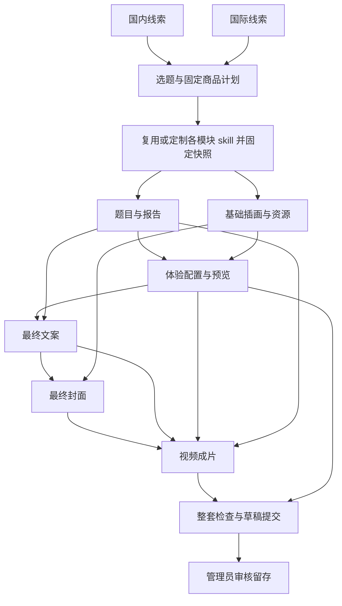

# 外部 Agent 商品制作闭环审查与能力约定

日期：2026-10-21。依据：用户当日最新预期；本次只审查和补规划，未实现以下新增能力。原 T12、T13、T14-L、T15 的已完成记录保留；T16-A 新 UI 审核未解除，T10-L 未获后续执行批准，T09 云服务仍需单独批准。排期唯一入口仍为 [ROADMAP.md](ROADMAP.md)。

后续实施更新：用户已授权平台优先，T14.P1/P2 的实际实现与验收见 [PRODUCTION-PLANS.md](PRODUCTION-PLANS.md)，G1 设计见 [设计审阅](../../output/design-review/project-workspace-g1-20261021/README.md)。下文差距矩阵保留 review 当时的代码状态与规划口径，不代表后续仍全部未实现；原 review 的“本轮不开发”不覆盖用户后续实施授权。新的平台 UI、云服务与实际日程仍按各自关卡批准。

## 1. 目标、责任与证据口径

管理员在本地 Agent 客户端连接商城 MCP，由一个或多个外部定时任务获取实时国内/国际热点和热梗、选题、形成商品规划，再按图片、文案、商品体验（网页/3D 等）、视频模块制作对应 skill，使用这些 skill 生成产物，回传同一商品项目的草稿。管理员可查看内容与关系、退回修改或审核留存；通过后各模块产物及制作时的 skill 版本保留在平台。后台按一商品一项目文件夹组织，尽量用图形画布展示模块、skill、产物和引用。

| 责任方 | 应承担 | 不因本次预期而增加的职责 |
| --- | --- | --- |
| 外部 Agent / 外部定时器 | 实时检索、选题判断、商品规划、编写 skill、调用制作工具、生成图片/文案/体验/视频、调度与重试，向平台报告真实结果 | 不代替管理员审核；不默认获得商品发布、Skill 全局激活、订单或消费者数据权限 |
| 商城平台 / MCP | 授权读写、项目草稿初始化、计划/模块/skill/产物固定关联、文件校验和持久化、阶段回执与冲突处理、管理员审核留存、展示和历史读取 | 不托管爬虫/模型密钥，不运行任意 skill/脚本，不建立平台内定时器、模型队列或自动上架 |

本轮读取父目录 `AGENTS.md`（项目内没有 `.agents/skills`）、相关本地 `product-capability` 与 `mcp-server-patterns` skill，核对产品文档、task、Prisma、实际服务/契约、后台组件和测试用例。skill 文件未修改。线程清单显示「任务窗口 1」为空闲；写入前目标文档摘要未变化。审查以当前含未提交文件的工作区为准，不把文档中的“已规划”或历史测试数直接当成本轮通过证据。

界面核查使用 `apps/web/src/admin/content.tsx`、`content-skills.tsx`、`content-experience.tsx`、`content-references.tsx` 与既有后台截图 `.local/t15-b/e2e/experience-authoring-desktop.png`。本轮浏览器连接不可用（iab 不可用，浏览器清单为空），没有重新登录或操作后台；画布缺失判断有路由/组件代码支持。本轮未重跑应用测试、迁移或制作流程。

## 2. 差距矩阵

状态含义：**已实现**有当前代码/模型支撑；**已有规划但未实现**此前有明确文字或 task，尚无对应实现；**部分覆盖**已有底座但不满足完整预期；**完全缺失**此前没有对应的具体交付设计/task，也无实现。

| 能力 | 审查状态与代码证据 | 相对最新预期的差距 / 后续归属 |
| --- | --- | --- |
| 本地客户端连接、分域授权和真实文件上传 | **已实现**：`packages/mcp/src/server.ts`、`content-tools.ts`、`experience-tools.ts`；`machine-request.guard.ts`、`machine-upload.service.ts`（均在 `apps/api/src/operations/`）；`packages/contracts/src/machine.ts` | 本地 stdio 可用不等于公网接入。远程 **已有规划但未实现**：T14.C1–C3，依赖 T09；本次不重建传输层 |
| 实时国内/国际热点、选题与完整商品规划 | **已有规划但未实现**：`PRODUCT.md` §9、`CONTENT-BACKOFFICE.md` §3.1 提过选题池/每日生产；只有 `CreativeProfileRevision.profile`，没有热点证据、计划修订与模块清单的完整契约 | 外部获取与制作；平台保存来源、时间、计划和明确模块。T14.P1、T14.W3–W4；没有要求商城自己抓热点 |
| 从新选题初始化商品/设定/skill 的 MCP 链 | **部分覆盖**：`packages/contracts/src/machine-content.ts` 只枚举领域工具；`packages/mcp/src/content-tools.ts` 不含商品/设定/库/组合创建；`apps/api/src/catalog/machine-authorization.ts` 按已授权 productIds/skillIds 限制 | 现在先由管理员准备，Agent 无法从零完成项目草稿。补受限初始化和项目内候选 skill 写入，而非万能管理员 token：T14.P2–P3 |
| 为该商品先生成模块 skill，再用它生成产物 | **部分覆盖**：`StyleSkill/StyleSkillVersion`、`CreativeSkillSet/Binding` 和 `ProductionRecord.skillVersions` 已存版本；但 `skill-bindings.service.ts` 的 `save` 仅新绑 ACTIVE，`experience-authoring.service.ts` 的 `methods` 同样要求 ACTIVE（已有归档绑定除外） | 新 skill 草稿不能直接进入当前生产组合；不能为完成流程就自动激活。增加项目内不可变候选方法快照、生成来源和事后审核留存：T14.P2。已有可复用库和绑定继续使用 |
| 图片、文案、体验、视频模块齐备 | **部分覆盖**：四领域 cover/copy/video/assessment，加独立 experience；`packages/contracts/src/content-domain.ts`、`skills.ts`、`experience-authoring.ts` | 图片不只封面；体验和评估/报告职责不可合并丢失。计划逐项声明交付槽位、用途和必需/可选，复用各领域存储：T14.P1/P4。3D **已有规划但未实现**，仍归 T16-B；新答案类型归 T17 |
| 计划 → 模块 → skill → 产物的完整追溯 | **部分覆盖**：`schema.prisma` 中设定/内容修订/引用/制作记录/五用途绑定已关联，`batchKey` 只有普通字段和索引；体验另有 `ExperienceAuthoringRevision.methods` | 没有正式计划/模块 ID、统一批次状态；仅 batchKey 不能证明同一计划、完整依赖与已生成。T14.P1/P2/P4、T14.W1 |
| 草稿保存、单次幂等、冲突、上传失败 | **已实现**：`admin-mutation.service.ts`、`content.service.ts`、`machine-content.service.ts`、`experience-authoring.service.ts`、`machine-upload.service.ts`；测试在 `machine-content.test.ts`、`content-workflow.test.ts`、`experience-authoring.test.ts` | 这些是单操作保证；多客户端/定时任务的批次去重、部分失败和续做 **已有规划但未实现**（原 §3.1）。T14.W1–W2 复用现有机制扩展，不声称已有工作流 |
| 审核通过后统一留存产物和 skill | **部分覆盖**：`content-packages.service.ts` 的 `check/adopt` 固定四类内容和五用途 skill；`schema.prisma` 的 ContentPackage 与 ExperienceAuthoringRevision/Release 分开；体验审核和发布已独立实现 | 当前包 `runtime` 固定 web/compatible_standard，没有体验草稿/两用途方法、计划与完整项目审核结论。T16-A 只在试点 manifest 另固定 release，不能当通用项目归档。补完整审核快照与留存，独立于发布：T14.P4–P5 |
| 一商品一项目文件夹 | **部分覆盖**：`content.tsx` 的 `/admin/content/:productId` 已以 Product 为根，共享库可跨商品使用 | 没有完整项目目录（计划、模块、候选 skill、产物、批次和审核）。补聚合投影与文件夹视图，复用 productId，避免重复业务仓库：T14.P1/P4、T10-G |
| 图形画布查看模块、skill、内容与关系 | **完全缺失**：`content.tsx` 当前为页签、表单、列表、制作依据侧栏；`content-references.tsx` 为引用列表，没有项目关系画布或相应 task | T10.G1–G4；先设计并审核、再实现和验收。无需强制拖拽编排、可视化执行器或物理磁盘目录 |

上述文件名未写完整前缀者，服务位于 `apps/api/src/operations/`，模型位于 `apps/api/prisma/schema.prisma`。消费端仍只运行已注册模板与固定评估；`apps/api/src/catalog/experience-authoring.ts` 的 `experienceDraftIssues` 和 `packages/contracts/src/experience.ts` 的注册表拒绝未知组合。上传任意网页/3D 源码后直接可售运行与现有架构冲突，不能在 MCP 规划中暗中开放执行；站内新增模板复用 T16-B/T17。未知形式可保留设计/原件草稿，须标明未运行验证，不能通过可运行交付验收。

## 3. 后续实现必须满足的关系与状态

以下是 T14-P/W 的**待实现约定**，字段/端点在该批实现时落入现有 contracts；不是当前已可调用的工具清单。

- 根项目复用 `productId`；商品规划用稳定 `planRevisionId + digest` 固定热点来源、发布时间（可未知）、检索时间、地域/语言、选题理由、情绪/理解目标与交付模块。热点“实时”的时间窗由管理员配置；取不到数据、数据过旧或无适合题材可报告无产出，不伪造当天热点。
- 每个模块有稳定 `moduleId`、类型/用途、必需性、输入依赖和目标形式。使用现有 assessment/cover/copy/video/experience 专业职责；例如图片可有封面/场景插画等多个槽位。模块数量与实际交付清单驱动齐备检查，不固定为“四个任务都成功”。
- 关联链为：热点证据 → 计划修订 → 模块 → skillVersion/不可变候选快照（正文、manifest、参考文件摘要）→ 外部制作尝试 → 产物修订/文件 → 项目审核快照。关联同时保留旧设定、五用途组合和体验两用途引用；模板注册版本、输入摘要也固定。多个图片/多个 skill/共享 skill 均可表达，不强制一对一。
- skill 草稿可编辑；一次外部执行必须固定当时内容摘要与不可变快照，不能只绑定可变 DRAFT 的 versionId。后续修改产生新快照/修订与新执行记录，历史产物仍能回读原指令和附件。外部“实际使用”是来源申报与回执，不能冒称平台已执行或证明模型内部过程。
- 单操作继续使用 requestId / expectedRevision；批次与模块尝试使用稳定业务键，区分新计划、新变体和原任务重试。相同请求/相同内容返回原对象，不同内容复用 requestId 拒绝；跨客户端重叠不能覆盖当前有效写者。数据库唯一约束/事务、短期认领或等效排他方案属实现选择，平台只记录和校验外部执行，不主动调度。
- 模块状态至少区分待输入、制作中（外部申报）、上传中、校验失败、已保存草稿、待审核、退回/需修改、审核留存；允许部分完成、失败可重试、取消和恢复。上传成功不等于模块完成；脚本/分镜不等于视频文件。补做一个模块不得重建商品或覆盖其他成功稿；改上游产生明确影响与待复查，不自动改旧引用。
- 草稿提交审核固定本次选中的计划、模块、内容、方法和文件摘要；审核期间变更须使该提交失效或产生新提交，拒绝用旧 fingerprint 审核新稿。审核通过以事务或等效可恢复提交保留完整快照，失败不得显示整套通过；重复审核不复制归档。退回保存原因与历史，仅修改项回到制作，不删除已上传内容。
- **审核留存、Skill 库全局 ACTIVE、内容采用、运行 release、商品公开发布为独立动作。** 草稿本来就需持久保存供审核；通过表示固定整套可追溯成果，不表示此前没有存储。通过留存不会自动上架、改变公开目录/现有商品当前版本、暴露素材或启用 skill；发布仍走管理员已有校验。若未来允许一并操作，须单独明确产品选择，默认只留存。
- **原件留存已确认（用户 2026-10-21 13:32 UTC）：**图片、视频、网页/3D 包等商品原文件及生成时对应的 skill 精确版本均由平台保存；skill 正文、清单及其必要参考附件随固定版本保留。外部地址仅作来源记录，不得作为唯一存储，本地/NAS 可另作备份，不能代替平台原件。平台存储指受平台管理的逻辑归属，本轮不指定云供应商、不开服务或启动迁移。原件与预览分别记录用途、版本、大小/摘要和实际导入状态；原件导入未完成/失败、缺失或校验失败时，不得标记对应模块完整或整套审核留存通过。管理员应能按选定或历史版本取回原文件及对应 skill，下载内容与固定摘要一致；来源地址失效不影响取回，历史引用继续受清理保护。该新要求尚待 T14-P 实现，不能用现有归档编号/预览能力宣称已满足。

## 4. 不做与可选建议

明确不做：本轮实现代码、重写现有 skill、评价样例题材/文案质量、启动后续开发、创建实际定时任务、连接云/收费生成服务、自动发布商品或社交内容。未来平台内模型执行、创作者多租户、积分计费也不由本计划增加。

工程建议而非用户硬需求：用租约实现多任务互斥、用“节点＋侧栏”展示关系、为外部运行设置最大重试/费用上限、先手工跑一套再启用日程。可选择等效方案；不强制新队列/Redis、拖拽编排/连线编辑、ZIP 全量导出、物理目录同步、热点榜或自动选优。

## 5. 产品决策与交接

| 编号 | 决策项 | 当前结论与落实方式 |
| --- | --- | --- |
| D1（已确认） | 商品原文件与对应 skill 精确版本的平台留存 | 用户 2026-10-21 13:32 UTC 接受建议：图片、视频、网页/3D 包等原文件及对应 skill 精确版本均由平台保存，外部地址仅作来源，不得作为唯一存储。T14.P1/P4/P5 补契约、原件导入完整性及按版本取回验收，T10.G1/G2 展示实际状态/内容。物理存储实现另在执行时设计，本轮不选云供应商或迁移；该产品选择不再待用户决定 |
| D2 | 整套审核通过后，所用新 skill 仅随商品项目留存，还是还要自动成为全局可复用库的 ACTIVE 版本？ | 明确先做到项目留存，保留独立的管理员库审核/启用；全局自动启用不是硬需求。只有需要这一附加行为才另定，不阻塞候选快照和草稿流程 |

审核通过不自动上架已作为固定边界，无需为此阻塞实现。用户 10:21 UTC 已明确目标为 **Codex 客户端，Ultra 是推理档位**；具体桌面版本/账户可用项与时间/时区/产量/热点时间窗/生成工具和预算在 W5/W4 验证配置，不再将客户端品牌或 Ultra 含义列作待答问题；不硬编码四个客户端或四个定时器。

任务归属：[T14-P 项目制作契约与留存](tasks/T14-mcp-ingestion.md#t14-p-商品项目制作契约与审核留存待执行)、[T14-W 外部制作接续](tasks/T14-mcp-ingestion.md#t14-w-外部-agent-制作接续与运行交接待执行)、[T10-G 项目画布](tasks/T10-final-ui.md#t10-g-一商品一项目文件夹与关系画布待执行)。优先级由 ROADMAP 推荐队列说明；本次交付是可供下一窗口实施的规划，所有新增复选框保持未完成。

## 6. 推荐外部编排：一个统筹入口，按边界短期分工

依据用户 2026-10-21 10:19/10:21 UTC 的补充，以下比较是**设计建议，尚未实施或启用**。推荐首期只准备一条 Codex 客户端生产定时入口，每次读取平台项目/批次回执，创建或恢复一个商品级逻辑 run；同一轮内仅为独立、有明确产出的工作使用短期 subagent。热点采集与制作频率确需分离时再拆第二条入口。长视频渲染等超过客户端单轮时限的工作，可分离为外部制作作业/后续任务，通过 runId 和回执接续。持久的是计划、状态、输入与成果，不依赖某个 Agent 一直在线或永远记住对话；无需先建设 Agents API 或独立托管 Agent 系统。

| 组织方式 | 适用边界 | 代价与本项目取舍 |
| --- | --- | --- |
| 每阶段一个独立后台 Agent 任务 | 长耗时媒体、独立工具/机器/权限或需人工多次接续的阶段；多商品吞吐确有需求时 | 每次需恢复状态，易重复轮询和跨阶段竞争；依赖回执不能靠多个日程的钟点先后。留作按需拆分，首期不固定建四个/七个长期 Agent |
| 一个主任务内部 subagent | 本轮可收敛的国内/国际线索整理、候选方法编写、互不重叠的模块制作、独立检查 | 启动/上下文有成本，继承工具权限不等于领域隔离；客户端中断后的子线程恢复不能当事务保证。适合有限并行，主任务负责合并校验 |
| 单 Agent 顺序执行 | 没有 subagent 或细粒度模型配置能力的客户端、初次验证、小规模生产 | 较慢但最便于追踪；采用同一计划/模块/回执契约，可随时替换成并行执行，不阻塞平台设计 |

### 6.1 实际阶段、输入输出和先后关系

所有 worker 只读取同一不可变 `productId + planRevisionId/digest + creativeProfileRevisionId/digest`，以及该阶段明确的 moduleId、方法快照、输入修订/摘要；不得改共享 brief。需要变更 brief 时交统筹追加新修订，并显式让受影响下游待复查。阶段开始/保存均核对版本；上传后立即保存模块草稿，不等最后一次性上传才建立记录。

| 阶段 | 输入 → 输出 | 串行/并行与执行建议 | 通过条件 |
| --- | --- | --- | --- |
| S0 热点检索 | 时间窗、地区/语言、来源范围、去重历史 → 有来源/时间戳的候选证据 | 国内/国际可两路并行，统筹归并；检索由外部工具进行 | 能回到来源，区分源发布时间/检索时间/未知；取不到数据则无产出 |
| S1 选题与商品规划 | 候选证据＋平台能力清单 → 选题理由、商品 brief、模块依赖/交付槽位和预算、计划修订 | 统筹串行决策并冻结共同设定，不能各模块各自选题 | 必需交付、体验形式、评估/报告兼容、成本边界清楚；未知 3D 模板不许假设可运行 |
| S2 各模块 skill 准备 | 固定计划＋可复用库/模板 → 各模块定制方法或复用声明、候选快照、输入/输出规则 | 图片/文案/体验/视频及必要评估/报告方法可并行准备；每模块自身方法检查并固定后即可推进该模块，不必等待其他无依赖方法 | manifest、附件和用途齐备，正文/版本摘要不可变；这里只完成方法，不代表产物生成 |
| S3 核心内容与基础图像 | 冻结 brief＋对应方法 → 题目/规则/报告草稿；不含最终文案的场景插画/视觉资源；可选文案探索稿 | assessment 内容串行自洽；基础插画可并行。文案探索可先做，不能冒称最终交付 | 题库与报告结构有效、资源是真实文件，固定 questionId 和可宣传片段；不以文本描述冒充图片 |
| S4 体验与最终文案 | S3 的固定题目/报告、资源＋体验方法 → 已注册网页体验配置/预览；实际交付事实＋文案方法 → 最终文案块 | 体验依赖题目/资源；最终文案在对应体验事实可核对后定稿，避免传播内容承诺尚未实现功能 | 映射、renderer、资源预算/读取权限、报告兼容与预览通过；不新增评分或任意脚本执行 |
| S5 最终封面与视频 | 固定文案/基础图像 → 文字排版封面；题目节选＋文案块＋封面/体验画面＋视频方法 → 成片与脚本/分镜 | 最终封面依赖需要使用的文案；视频最后，等待其实际选用的全部输入。无依赖的变体可有限并行 | 成片能播放，输入使用快照和 scene/block/question 定位正确，脚本不算成片；体验画面需合法、固定来源 |
| S6 技术/一致性检查与草稿提交 | 各模块平台回执 → 缺项、结构/文件/引用/形式检查、成套预览及固定审核提交 | 机械校验先行；需要判断的跨模块检查可独立短期 reviewer，统筹汇总 | 不合格模块退回，新尝试只修该模块及受影响下游；齐备通过才提交人工审核；不自动扩写/激活共享 skill |
| S7 管理员审核留存 | 精确提交快照、实际内容/方法、差异与存储状态 → 退回原因或整套留存包 | 人工最终关卡，不由 worker 自批；审核后需发布时另行操作 | 通过时固定全部选定版本，失败/并发不半套通过；上架和全局方法激活保持独立 |

其中 S3 基础插画和 S5 封面排版属于图片模块不同交付槽位，不是两套重复商品。文案探索、主视觉、体验骨架和视频脚本在自身方法/输入已固定后可提早并行；最终装配才等所用素材定稿。平台只强制实际声明的依赖，例如视频不使用封面就无需等待封面，没有体验录屏/场景输入时不必等待体验；可选模块明确 skipped，汇合只等必需模块。下图是包含体验画面的视频样例推荐顺序，不能机械固化为永久全序。

### 6.2 共享模板与每商品定制方法

专业库保存可复用的基础方法（schema/附件规范/制作流程/兼容约束）；商品计划提供题材、目标、风格、具体输入与预算。S2 先检查适配度，足够时引用基础 skill 的固定版本并保存该商品参数；有差异才添加项目定制层或新的模块方法。每个模块均有明确的**有效方法快照**（基础版本＋定制层/参数＋完整展开指令摘要＋参考文件），管理员能看到本次到底使用什么，而非每天重写整套低复用提示词。

“制作 skill”和“执行 skill”分为两个状态/动作；前者检查 manifest/输入输出及参考资料，后者由外部 Agent 调用检索、出图、代码/渲染等实际工具并提交产物和来源。提升可复用基础 skill 是独立的人工库版本流程，不把某商品定制内容悄悄写回全局。统筹方法只负责依赖/回执/预算，不能代替各专业方法，也不代表本轮授权创建或重写任何实际 skill。

### 6.3 模型、推理档位与客户端能力核查

仓库 `packages/mcp/README.md`、`MCP-SDK-NOTES.md`、`MCP-LOCAL-TRANSPORT.md` 只证明 SDK stdio 与本地 API 的连接/上传测试，并明确没有安装用户 Codex 持久连接；仓库没有 Agent 宿主/模型配置或 subagent 恢复/跨任务通信实现。`packages/mcp/src/config.ts` 配的是 domain/API/根目录等，不决定模型或推理。故“能连商城 MCP”不能推出“能生成视频、可配置 ultra 子代理、可持久恢复”。本轮只读运行 `codex --version` 和 `codex exec --help`，确认本机 `/opt/homebrew/bin/codex` 为 **0.133.0**，帮助列有 `exec resume`、`--json`、`--output-schema`；未启动执行会话、未改设置/认证，CLI 证据不能证明桌面模型选择和实际恢复已经验收。

官方 OpenAI documentation 于 2026-10-21 核对：模型身份与 reasoning effort 分开；Ultra 属支持模型/客户端/账户才有的推理/编排选项，并非模型名。子代理可以继承父级模型/档位，支持的客户端也有单独配置；更高档位和多代理增加时间与用量。本项目只将其作为条件能力，不自动套给全部阶段。[Models](https://learn.chatgpt.com/docs/models)、[Subagents](https://learn.chatgpt.com/docs/agent-configuration/subagents)。

建议策略：统筹、商品规划和跨模块矛盾处理使用当前可用的可靠模型与中等/较高推理；证据抽取、字段整理和机械上传使用默认/较低档或确定性工具；未知体验设计/难解失败再按需提高。Ultra 仅在代表性任务验证收益且预算允许时用于少量复杂规划/复核；不为等待渲染或固定 schema 校验消耗高推理，不在不支持的模型上配置 Ultra。具体 model ID、effort 及实际生效值在 W5/W4 核实并记录，不凭本轮工具可选项替用户客户端承诺。

官方说明本地项目定时运行需要电脑及桌面应用可用，并建议先手动验证；网页任务不能直接依赖本机目录。未来启用时应选择能访问本地 stdio/文件的运行环境，或在 T09/T14-C 后使用真实远程接入，不直接把本地配置搬到云日程。[Scheduled tasks](https://learn.chatgpt.com/docs/automations?surface=app)。

可选接续路径已有官方支持：CLI 可按明确 session ID `exec resume`，Codex SDK 可 start/continue/resume thread；仅当桌面交接不足时才评估轻量本地 runner，不先给商城加 SDK/执行器依赖。本轮没有安装 SDK 或验证这些 API。恢复身份可记 threadId；业务判断始终核对平台 checkpoint，不能把最近会话当正确商品 run。[Non-interactive mode](https://learn.chatgpt.com/docs/non-interactive-mode)、[Codex SDK](https://learn.chatgpt.com/docs/codex-sdk)。

| 运行能力 | 本次证据 / 状态 | 启用前验证 / 无此能力的替代 |
| --- | --- | --- |
| MCP 领域工具、媒体/方法附件上传 | 仓库真实 SDK 测试有证据；用户实际客户端配置仍待验 | W3/W5 实际客户端读取/上传；不凭 tools/list 成功认定全制作链通过 |
| 子代理可调用所需工具，指定 model/effort 或 Ultra | 官方存在条件能力；用户所选客户端/账户/模型的具体组合待确认 | 验证实际 model/effort/工具及权限；否则同一 Agent 顺序执行，保留相同阶段契约 |
| 长作业、子线程跨重启恢复、跨独立任务发消息 | 仓库没有保证，当前客户端尚无验收证据 | 按平台回执/本地非敏感 manifest 重建上下文；长渲染保存外部 jobId，后续查询状态，禁止未知结果直接重提付费作业 |
| 定时环境能读本机文件/安全注入凭据/使用检索和媒体工具 | 当前未配置；不因日程功能存在就假定可用 | 手动能力检查后准备具体配置；不支持本地时先手动续做，不创建绕过审批的云执行器 |
| 每个领域 worker 的权限隔离 | 子代理继承父级工具/权限不是隔离证据 | 服务端按实际 token/domain/project 限制；严格隔离需分进程/单独凭据等经验证的方式，不能只在提示词写角色名 |

### 6.4 恢复、质量与预算策略

客户端无关的交接 manifest 至少记录 runId、计划/设定摘要、模块/尝试 ID、方法快照、输入 ID/digest、预期修订、requestId、外部 jobId、状态与产物回执；权威成果以平台保存确认为准。多任务各写自己的交接文件，不能共同覆盖一个 JSON 或依赖直接线程消息。收到网络超时先查上传/保存/外部渲染作业状态；只有已知失败且允许重试才提交新尝试，避免重复计费或复制内容。

推荐从每次一个商品、两个独立生成工作并行、一个重型媒体作业起步，最大自动重试两次；这些数值是初始建议，不是已确认预算。W4 要配置全批次和各阶段 token/费用/时长/并发上限，把重试、subagent、媒体工具计入总预算；如无法计量费用，标明未知并设置次数/时长硬上限，需新增收费能力则停待批准。长视频等待不占一个持续高推理 Agent，采用工具等待/状态接续。达到上限记为部分完成/待人工，保留成功稿；不反复重生成全套。先比较顺序与有限并行的质量/耗时/用量，再决定是否拆成独立常驻任务。

验证分三层：确定性校验（schema、引用/摘要、文件真实可读/可播放、renderer 与输入兼容、模块齐备）→ 跨模块事实与交付一致性检查（可独立 reviewer，不等于自我批准）→ 管理员最终审核。热点跨语言事件去重、来源可靠性/新鲜度窗口、版权/不适宜选题过滤建议在选题前作为可配置策略，由用户决定具体规则；本轮不评价样例内容质量，不声称已实现过滤或实时趋势排名。对应新增 T14.W5–W6，与 W1/W2 的状态/恢复验证共同验收。
