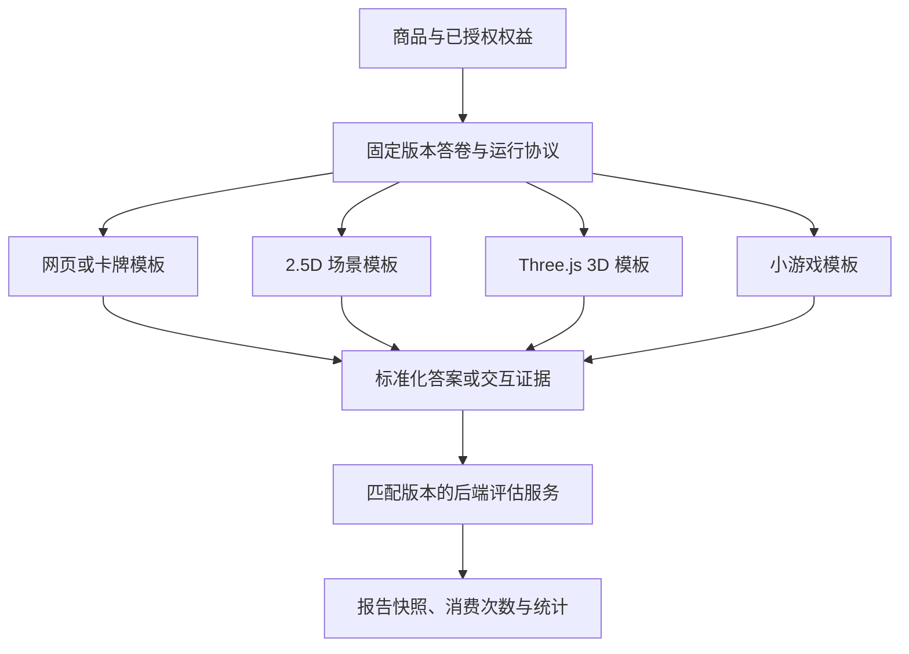

# 多形态测评商品与交互体验扩展

日期：2026-10-16。状态：后续能力规划，尚未实现。商品可以采用网页叙事、卡牌、2.5D 场景、Three.js 3D 或小游戏交互，继续共用目录、订单、兑换、权益、账户和报告服务。通过独立的体验模板和输入协议支持这些形态；视觉变化和测量规则变化分别版本管理。

所有形式服务于情绪价值及自我/关系理解，按 [商品创作设定](PRODUCT-CREATIVE-SYSTEM.md) 配套设计题目、过程、最终报告和传播内容。世界观、叙事、视觉/声音与报告方案同属商品制作要求，选择渲染技术前先明确用户希望获得的感受和理解。

任务入口：[T15 体验模板与协议](tasks/T15-experience-runtime.md)、[T16 网页与沉浸式商品试点](tasks/T16-immersive-products.md)、[T17 游戏交互与新评估引擎](tasks/T17-interactive-evaluation.md)。与 [内容后台规划](CONTENT-BACKOFFICE.md) 共用选题、固定输入引用、skill 版本及制作来源。

## 1. 可做的商品与当前边界

| 商品形态 | 示例 | 对后端的影响 |
| --- | --- | --- |
| 网页叙事/卡牌 | 对话选择、翻牌、漫画式题目、场景卡片 | 若最后仍确认某个 questionId/optionId，可复用现有评分 |
| 2.5D 沉浸场景 | 斜视角房间、分层插画、点击场景物件回答 | 稳定对象映射到已有选项时，可复用现有评分；增加体验状态/资源配置 |
| Three.js 3D 场景 | 进入房间、选择座位/门/物品、探索后确认回答 | 渲染模板/模型/交互状态需要新增；明确选择仍可映射现有选项 |
| 排序/资源分配小游戏 | 卡片优先级、有限预算分配、物件放置 | 新增结构化答案、校验与评估规则，不能只更换渲染器 |
| 真正分支/动作型游戏 | 根据路径出现不同任务，使用轨迹/试次/反应时间形成结果 | 新增分支/任务状态、完整性判断、评估与统计口径 |

当前 `ProductConfigurationSchema.engine` 固定为 `dimensions_v1`；题目是单选结构，回答保存 questionId/optionId，评分要求当前版本全部题目作答。`experienceType` 现有 score/tendency 是业务分类，`themeKey` 是主题元数据；当前代码尚无 Three.js、场景运行器、排序答案或游戏评估服务。

纯视觉/输入呈现变化可作为现有评估链的前端扩展；答案类型、分支、完成条件或评估规则变化必须显式新增运行能力。保留既有单选版本与历史报告，不能把未适配的小游戏标成已支持的测评。

## 2. 商品按四个维度配置

这四个维度在同一份创作设定下组合，先固定情绪/理解目标和参与视角，再确定形式与风格；报告方案贯穿内容与体验呈现。图文地图、回信、日志等报告可承接不同技术形式，并保持该商品的语言与意象。

| 维度 | 负责什么 | 示例 |
| --- | --- | --- |
| 内容题材 | 测什么、题目表达、选项/结果与报告内容 | 伴侣协作、社交电量、消费偏好 |
| 评估机制 | 接收什么答案、如何判断完成和计算结果 | 已有 dimensions_v1；未来 ranking_v1、allocation_v1、branching_v1 |
| 交互模板 | 用户如何看到题目、操作与确认 | 网页卡片、对话场景、2.5D 房间、Three.js 场景、排序小游戏 |
| 视觉主题 | 配色、字体、画面风格、声音和动效 | 手绘、极简、梦幻、像素、低多边形 |

未来引擎/模板名称仅为规划示例，不代表已注册能力。Three.js 是渲染技术，一个 3D 模板仍可使用已有单选评估机制；一个普通网页也可以承载需要新评估机制的排序题。

同一套题可以制作不同体验稿。只有确认题意、选项及操作语义一致时才视为可映射的呈现；改变任务目标、可选结果或完成条件时必须重新评估并发布内容版本。首期正式采用的不同交互模板使用独立商品版本，复用内容源引用，沿用现有按 productVersionId 隔离的统计；同一版本多运行模板及合并统计需先定义新的统计分组规则。

## 3. 共用业务与扩展架构

前端注册可复用的体验模板，加载该商品的公开体验配置和必要资源；后端负责权益、可用任务/题目、答案合法性、状态、完成判断与结果。摄像机移动、粒子和过场动画留在前端，确认回答/任务进度才进入业务保存流程，避免把每帧状态写入服务器。

### 3.1 体验发布清单

在现有 ProductVersion 旁增加待实现的体验发布配置，绑定：

- 内容版本及输入 schema、评估引擎版本。
- rendererKey/templateVersion 和配置修订，themeKey/主题修订。
- 允许的场景、questionId/optionId 映射、对象/步骤 ID、确认方式和恢复检查点。
- 固定资源清单：模型、纹理、插画、音频、字体/动效引用及内容摘要。
- creativeProfileRevisionId、报告内容方案、报告呈现模板/主题版本及兼容的结构化结果 schema；体验结束与报告的意象/语气/交互衔接。
- 设备能力要求、加载策略、无 WebGL/低性能/减少动态效果时的兼容呈现。

名称与 DDL 在 T15 固定；现有严格的 ProductConfiguration 不能直接接受未知场景字段。公开体验清单与私有计分配置分别投影，前端不会因加载 3D 场景获得分值/权重或完整报告模板。

权益/答卷锁定内容与体验发布版本，恢复不自动跳到新场景/新任务；重复确认/提交不重复消费。兼容回退使用同一组题目、选项和已确认答案，不创建第二份权益或丢弃进度。历史资源需可定位，退役模板需提供明确兼容策略。

### 3.2 两类运行协议

| 协议 | 回传内容 | 首期处理 |
| --- | --- | --- |
| 选择型展示 | questionId、optionId、修订、幂等 ID；可关联已授权 sceneId | 复用 T05 的授权、保存、评分/报告，仅新增兼容的体验元数据 |
| 新答案/游戏行为 | 带类型的排序/分配/任务选择、试次/步骤、序号与证据 | T17 注册答案 schema、后端完整性/合法性校验、评估与统计投影 |

拖动相机或播放过场不自动视为已答题；需要明确的确认/提交动作。未获服务端确认的状态显示待保存/失败。游戏客户端只提交答案/证据，不能自报最终分数、已完成或已消费；后端按锁定版本计算。

新增分支引擎要由服务端检查可达节点和该路径完成条件；不能继续使用“全部题都必答”假装支持跳题。排序、分配和反应时间分别选择有解释的评估规则，不将复杂行为强行塞进 optionId。涉及计时的服务端起止、暂停/网络影响与精度限制在对应玩法实现前明确。

### 3.3 工程落点与兼容性

- `apps/web` 增加体验运行宿主与模板注册表；DOM/Canvas/Three.js 按实际模板懒加载。现有商城和账户路由不加载全部 3D 依赖。
- 报告另有可注册的呈现模板/主题，以结构化结果和已授权叙事内容渲染，配套商品设定；报告形式不要求沿用场景的同一渲染技术，旧版图文报告保持可读。
- `packages/contracts` 增加体验清单、选择映射/检查点和未来类型化答案契约；已有 v1 的严格契约与数据保持兼容。
- `apps/api/src/runtime` 增加注册/分派层和体验配置读取；dimensions_v1 继续调用现有评分函数，新评估引擎独立实现与版本化。
- 模型、纹理与音频通过原文件服务保存，新增明确的资源用途/MIME/大小校验；不把 3D 资源塞进现有 COVER/VIDEO 元数据冒充可运行模板。
- 先采用随项目审核、构建和注册的模板，由 MCP 上传资源与校验后的场景配置。任意 HTML/JS 游戏包的上传执行、依赖安装或独立托管需要另设审核与隔离方案，不作为首期模板能力。

2.5D 可用 CSS、Canvas 或轻量渲染器；复杂 3D 交互时选 Three.js/适合 React 的适配层，具体版本在实现前核验。无需每个商品都引入同样的渲染依赖。

## 4. 与内容后台、skill 和 MCP 的关系

保留题库报告、封面、视频、文案四类库；新增可选的 experience 体验制作领域，负责场景/交互模板配置和风格。它读取既有题目内容与共享选题说明，不另建一套无关联的题库。

| 制作阶段 | skill 与输入 | 输出 |
| --- | --- | --- |
| 题库/评估设计 | assessment skill，选题说明 | 内容与规则版本 |
| 体验制作 | experience skill，固定题目/结果公开节选、模板能力与风格约束 | 场景布局、题目/对象映射、资源清单、检查点及体验草稿 |
| 报告写作与呈现 | assessment 的报告写作用途＋experience 呈现模板，共用创作设定/固定结果 schema | 配套章节、叙事、图表/插画、排版和分享摘要 |
| 宣传制作 | cover/video/copy skill，选中题目/文案、体验画面与制作引用 | 对应封面、视频与文案；可定位来源场景和版本 |

T13/T14 已实现后，按新版本扩展 domain、experience_skill_*、experience_draft_save/validate 和必要文件用途权限；它们共用上下文/引用/文件服务。首次四领域的 M7 验收不因 experience 扩展重新定义。无 MCP 时可先用受保护管理入口/测试配置验证运行样例，机器接入部分保持待验收。

内容后台增加“交互体验”页签，选择模板、主题，管理场景/模型/音频、题目映射和能力检查，预览后发布。视频可以引用体验版本/sceneId 并保存对应画面或录制成品来源；体验升级提示关联宣传素材复查，不自动更改旧视频。

## 5. 体验内部依赖与试点

全局排期统一见 [ROADMAP.md](ROADMAP.md)：本轮推荐先完成内容/skill/本地 MCP，再做 T15/T16-A；Three.js 和新玩法放在首款商品试运营后的扩展队列。以下仅说明体验内部依赖，不表示所有体验能力必须先于 T09/T10/T11 完成。

1. 完成 T07/T08 本地业务联调，保留可用的网页答题基线。
2. T15 固定“内容＋评估＋交互模板＋主题”契约、宿主与恢复规则，注册已有 DOM 单选模板验证旧业务。
3. T16-A 做一个网页叙事/2.5D 房间试点：点击不同物件选择答案，明确确认；沿用 dimensions_v1，复用原报告流程。
4. T16-B 再做一个小规模 Three.js 场景，验证真实手机、触摸、加载、WebGL 丢失与同内容回退；性能阈值按目标设备和样本固定。
5. T17 选一个确实需要的小游戏输入，例如排序或预算分配，单独实现协议/评估；真正分支、动作和计时继续按玩法分批，不一次承诺全部支持。

T15/T16 的基础运行验证依赖 T05/T08；T12 的内容/资源引用用于后台完整管理，T13/T14 的 experience skill/MCP 可随后接入，不把缺少云端或机器接入当成本地渲染样例的阻塞。T17 只在有明确玩法/评估定义时开发。T01–T11 原验收与原 T08 自动执行范围不变。

建议第一款沉浸商品是“社交电量小屋”：目标是被理解、看见舒服的社交节奏；进入房间/选座回答明确选项，结果用同画风的能量地图、恢复路线和一段回信呈现。先复用原维度结果，报告新内容/呈现契约按 T12/T15 校验；封面/视频/文案共享小屋意象。用少量场景验证理解、情绪感受、恢复和手机成本，再决定是否加入路径/动作评分。

## 6. 验收与待定事项

T15：旧版单选商品仍可用；同一套选项提交经不同兼容呈现得到相同评分；版本、授权、冲突、进度和消费语义保留，公开清单不泄露计分。

T16：实际网页/2.5D 和小型 3D 样例可以完成兑换→交互→保存/恢复→报告；键盘/触摸、减少动态、资源失败和无 WebGL 回退可操作。记录资源大小、加载与稳定帧率等真实设备结果，具体合格阈值在试点前固定，不以开发机截图代替手机验收。

成套试读还需核对报告承接体验、传播内容与实际交付一致，以及用户是否获得具体发现或可用的表达/行动建议。单人关系视角和未来双方参与分别按创作设定标识，不通过配对视觉或文案暗示已经具备双方数据。

T17：为所选玩法提供可重复的评估、服务端答案/可达路径校验、幂等完成与统计口径；旧商品与历史报告不受新输入影响。不同玩法的完成/反馈/保存定义单独记录，未实现的玩法保持待开发。

首款题材、视觉参考、目标设备、资源预算及新玩法的评估依据可在对应试点开始前确定；不阻塞当前基础后台开发。本轮仅规划，不制作 3D 场景、不安装引擎或开通资源。
