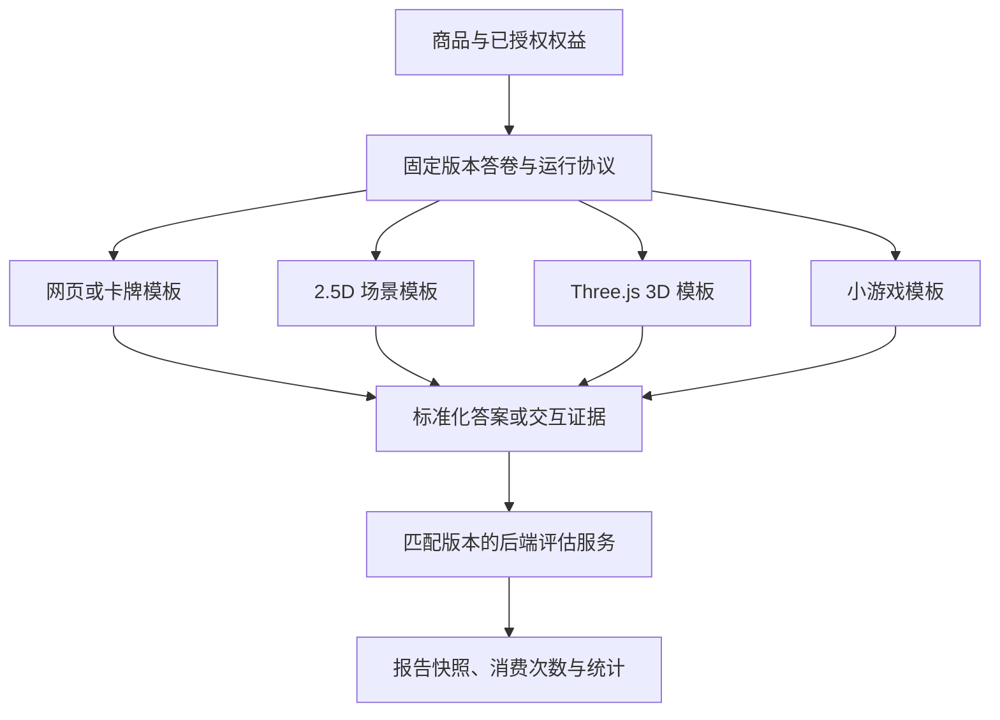

# 多形态测评商品与交互体验扩展

2026-10-27：03已完成项目制作链与新正式发布校验。人工/API/MCP制作稿固定v2规划和模块，审核要求实际注册Three.js场景/报告、已实现决定、资源预算和精确方法；新采用包v3保留规划/体验，默认无体验稿发布拒绝。注册兼容与设备验收分别显示，旧DOM发布/权益/报告保持原清单。当前仅花园配对已实现，其他商品模板仍待05；证据见[03验证](../../output/implementation/threejs-publication-gates-20261027/verification.md)。下文带日期的早期默认发布说明保留历史事实。

2026-10-26 最新商品规划：所有商品的正常体验必须使用 Three.js；2D/2.5D/3D 是风格选择，动画和玩法按具体商品规划决定。统一规范见 [PRODUCT-IMPLEMENTATION-POLICY.md](PRODUCT-IMPLEMENTATION-POLICY.md)。当前已注册的花园只是一个单选模板，不代表其他计划已实现。旧 DOM/小屋继续历史兼容，新正式商品和 Skill 的政策门禁、前向转制分别进入 T16-C/T13-C；下文早期将技术形式作为同等可选项的规划由此更新。

2026-10-26 更新：已注册小型 Three.js 单选场景 `reflection-garden@1` 与配对 `garden-notes@1`，后台/API/MCP 通过显式能力 v2 发现；原严格 v1 与旧模板保持兼容。T16-B 本地技术检查通过，真实手机/内置浏览器和 3D 宣传成套内容待验，T16 整体未关闭。当前范围见本文第 8 节，此前带日期的执行记录保留为历史。

日期：2026-10-21。T15 已验收，B 界面获用户批准。T16-A 已注册轻量网页的 2.5D 小屋与手记组合，技术验证通过、待新 UI/真机验收，见 [QUIET-ROOM-PILOT.md](QUIET-ROOM-PILOT.md)。DOM/旧图文组合继续兼容；Three.js 和小游戏仍是后续能力。商品共用原目录、权益和报告服务，视觉与测量规则分别版本管理。

所有形式服务于情绪价值及自我/关系理解，按 [商品创作设定](PRODUCT-CREATIVE-SYSTEM.md) 配套设计题目、过程、最终报告和传播内容。世界观、叙事、视觉/声音与报告方案同属商品制作要求，选择渲染技术前先明确用户希望获得的感受和理解。

任务入口：[T15 体验模板与协议](tasks/T15-experience-runtime.md)、[T16 网页与沉浸式商品试点](tasks/T16-immersive-products.md)、[T17 游戏交互与新评估引擎](tasks/T17-interactive-evaluation.md)。与 [内容后台规划](CONTENT-BACKOFFICE.md) 共用选题、固定输入引用、skill 版本及制作来源。

## 1. 可做的商品与当前边界

| 商品形态 | 示例 | 对后端的影响 |
| --- | --- | --- |
| 网页叙事/卡牌 | 对话选择、翻牌、漫画式题目、场景卡片 | 若最后仍确认某个 questionId/optionId，可复用现有评分 |
| 2.5D 沉浸场景 | 斜视角房间、分层插画、点击场景物件回答 | 稳定对象映射到已有选项时，可复用现有评分；增加体验状态/资源配置 |
| Three.js 3D 场景 | 进入房间、选择座位/门/物品、探索后确认回答 | 渲染模板/模型/交互状态需要新增；明确选择仍可映射现有选项 |
| 排序/资源分配小游戏 | 卡片优先级、有限预算分配、物件放置 | 新增结构化答案、校验与评估规则，不能只更换渲染器 |
| 真正分支/动作型游戏 | 根据路径出现不同任务，使用轨迹/试次/反应时间形成结果 | 新增分支/任务状态、完整性判断、评估与统计口径 |

当前 `ProductConfigurationSchema.engine` 固定为 `dimensions_v1`，回答保存 questionId/optionId，要求当前版本全部题目作答。`experienceType` 的 score/tendency 是业务分类。T16-A 注册等距 2.5D 小屋/手记，T16-B 注册内置几何体的 Three.js 花园/手记，均沿用确认、恢复和同题回退。`web` 可选三组注册组合，`3d` 仅支持花园配对；自定义 2.5D/3D、排序答案、游戏评估仍未启用。创作设定与上传资源本身不会注册运行模板。

纯视觉/输入呈现变化可作为现有评估链的前端扩展；答案类型、分支、完成条件或评估规则变化必须显式新增运行能力。保留既有单选版本与历史报告，不能把未适配的小游戏标成已支持的测评。

## 2. 商品按四个维度配置

这四个维度在同一份创作设定下组合，先固定情绪/理解目标和参与视角，再确定形式与风格；报告方案贯穿内容与体验呈现。图文地图、回信、日志等报告可承接不同技术形式，并保持该商品的语言与意象。

| 维度 | 负责什么 | 示例 |
| --- | --- | --- |
| 内容题材 | 测什么、题目表达、选项/结果与报告内容 | 伴侣协作、社交电量、消费偏好 |
| 评估机制 | 接收什么答案、如何判断完成和计算结果 | 已有 dimensions_v1；未来 ranking_v1、allocation_v1、branching_v1 |
| 交互模板 | 用户如何看到题目、操作与确认 | 网页卡片、对话场景、2.5D 房间、Three.js 场景、排序小游戏 |
| 视觉主题 | 配色、字体、画面风格、声音和动效 | 手绘、极简、梦幻、像素、低多边形 |

未来引擎/模板名称仅为规划示例，不代表已注册能力。Three.js 是渲染技术，一个 3D 模板仍可使用已有单选评估机制；一个普通网页也可以承载需要新评估机制的排序题。

同一套题可以制作不同体验稿。只有确认题意、选项及操作语义一致时才视为可映射的呈现；改变任务目标、可选结果或完成条件时必须重新评估并发布内容版本。首期正式采用的不同交互模板使用独立商品版本，复用内容源引用，沿用现有按 productVersionId 隔离的统计；同一版本多运行模板及合并统计需先定义新的统计分组规则。

## 3. 共用业务与扩展架构

前端注册可复用的体验模板，加载该商品的公开体验配置和必要资源；后端负责权益、可用任务/题目、答案合法性、状态、完成判断与结果。摄像机移动、粒子和过场动画留在前端，确认回答/任务进度才进入业务保存流程，避免把每帧状态写入服务器。

### 3.1 体验发布清单

T15-A 已在 ProductVersion 旁增加不可变 ExperienceRelease。以下是统一约定，基线已固定内容/设定、DOM/报告模板、主题元数据、确认恢复、映射和图片资源；其他设备/模板能力由 T16 扩展：

- 内容版本及输入 schema、评估引擎版本。
- rendererKey/templateVersion 和配置修订，themeKey/主题修订。
- 允许的场景、questionId/optionId 映射、对象/步骤 ID、确认方式和恢复检查点。
- 固定资源清单：模型、纹理、插画、音频、字体/动效引用及内容摘要。
- creativeProfileRevisionId、报告内容方案、报告呈现模板/主题版本及兼容的结构化结果 schema；体验结束与报告的意象/语气/交互衔接。
- 设备能力要求、加载策略、无 WebGL/低性能/减少动态效果时的兼容呈现。

名称与 DDL 已在 T15-A 固定，资源运行引用独立使用 ExperienceResource；model/audio/font 仅预留用途/MIME，当前 renderer 不允许发布或运行。现有严格的 ProductConfiguration 不能直接接受未知场景字段。授权体验清单与私有计分配置分别投影，前端不取得分值/权重或完整报告模板。

权益/答卷锁定内容与体验发布版本，恢复不自动跳到新场景/新任务；重复确认/提交不重复消费。兼容回退使用同一组题目、选项和已确认答案，不创建第二份权益或丢弃进度。历史资源需可定位，退役模板需提供明确兼容策略。

### 3.2 两类运行协议

| 协议 | 回传内容 | 首期处理 |
| --- | --- | --- |
| 选择型展示 | questionId、optionId、修订、幂等 ID；可关联已授权 sceneId | 复用 T05 的授权、保存、评分/报告，仅新增兼容的体验元数据 |
| 新答案/游戏行为 | 带类型的排序/分配/任务选择、试次/步骤、序号与证据 | T17 注册答案 schema、后端完整性/合法性校验、评估与统计投影 |

拖动相机或播放过场不自动视为已答题；需要明确的确认/提交动作。未获服务端确认的状态显示待保存/失败。游戏客户端只提交答案/证据，不能自报最终分数、已完成或已消费；后端按锁定版本计算。

新增分支引擎要由服务端检查可达节点和该路径完成条件；不能继续使用“全部题都必答”假装支持跳题。排序、分配和反应时间分别选择有解释的评估规则，不将复杂行为强行塞进 optionId。涉及计时的服务端起止、暂停/网络影响与精度限制在对应玩法实现前明确。

### 3.3 工程落点与兼容性

- `apps/web` 增加体验运行宿主与模板注册表；DOM/Canvas/Three.js 按实际模板懒加载。现有商城和账户路由不加载全部 3D 依赖。
- 报告另有可注册的呈现模板/主题，以结构化结果和已授权叙事内容渲染，配套商品设定；报告形式不要求沿用场景的同一渲染技术，旧版图文报告保持可读。
- `packages/contracts` 增加体验清单、选择映射/检查点和未来类型化答案契约；已有 v1 的严格契约与数据保持兼容。
- `apps/api/src/runtime` 增加注册/分派层和体验配置读取；dimensions_v1 继续调用现有评分函数，新评估引擎独立实现与版本化。
- 模型、纹理与音频通过原文件服务保存，新增明确的资源用途/MIME/大小校验；不把 3D 资源塞进现有 COVER/VIDEO 元数据冒充可运行模板。
- 先采用随项目审核、构建和注册的模板，由 MCP 上传资源与校验后的场景配置。任意 HTML/JS 游戏包的上传执行、依赖安装或独立托管需要另设审核与隔离方案，不作为首期模板能力。

2.5D 可用 CSS、Canvas 或轻量渲染器；复杂 3D 交互时选 Three.js/适合 React 的适配层，具体版本在实现前核验。无需每个商品都引入同样的渲染依赖。

## 4. 与内容后台、skill 和 MCP 的关系

保留题库报告、封面、视频、文案四类库；新增可选的 experience 体验制作领域，负责场景/交互模板配置和风格。它读取既有题目内容与共享选题说明，不另建一套无关联的题库。

| 制作阶段 | skill 与输入 | 输出 |
| --- | --- | --- |
| 题库/评估设计 | assessment skill，选题说明 | 内容与规则版本 |
| 体验制作 | experience skill，固定题目/结果公开节选、模板能力与风格约束 | 场景布局、题目/对象映射、资源清单、检查点及体验草稿 |
| 报告写作与呈现 | assessment 的报告写作用途＋experience 呈现模板，共用创作设定/固定结果 schema | 配套章节、叙事、图表/插画、排版和分享摘要 |
| 宣传制作 | cover/video/copy skill，选中题目/文案、体验画面与制作引用 | 对应封面、视频与文案；可定位来源场景和版本 |

T15-B 已扩展可选 experience domain、体验方法/草稿/校验和独立图片权限，且界面已获用户批准。T16-A 复用真实 SDK 上传/草稿链，通过显式 `includeTemplates:true` 读取小屋/手记配对与预算；场景/报告分别固定方法，由后台人工审核发布。首次四领域的 M7 不重新定义，新画面继续单独审核，运行仍按精确注册能力限制。

内容后台增加“交互体验”页签，选择模板、主题，管理场景/模型/音频、题目映射和能力检查，预览后发布。视频可以引用体验版本/sceneId 并保存对应画面或录制成品来源；体验升级提示关联宣传素材复查，不自动更改旧视频。

## 5. 体验内部依赖与试点

全局排期统一见 [ROADMAP.md](ROADMAP.md)：本轮推荐先完成内容/skill/本地 MCP，再做 T15/T16-A；Three.js 和新玩法放在首款商品试运营后的扩展队列。以下仅说明体验内部依赖，不表示所有体验能力必须先于 T09/T10/T11 完成。

1. 完成 T07/T08 本地业务联调，保留可用的网页答题基线。
2. T15 固定“内容＋评估＋交互模板＋主题”契约、宿主与恢复规则，注册已有 DOM 单选模板验证旧业务。
3. T16-A 做一个网页叙事/2.5D 房间试点：点击不同物件选择答案，明确确认；沿用 dimensions_v1，复用原报告流程。
4. T16-B 再做一个小规模 Three.js 场景，验证真实手机、触摸、加载、WebGL 丢失与同内容回退；性能阈值按目标设备和样本固定。
5. T17 选一个确实需要的小游戏输入，例如排序或预算分配，单独实现协议/评估；真正分支、动作和计时继续按玩法分批，不一次承诺全部支持。

T15/T16 的基础运行验证依赖 T05/T08；T12 的内容/资源引用用于后台完整管理，T13/T14 的 experience skill/MCP 可随后接入，不把缺少云端或机器接入当成本地渲染样例的阻塞。T17 只在有明确玩法/评估定义时开发。T01–T11 原验收与原 T08 自动执行范围不变。

建议第一款沉浸商品是“社交电量小屋”：目标是被理解、看见舒服的社交节奏；进入房间/选座回答明确选项，结果用同画风的能量地图、恢复路线和一段回信呈现。先复用原维度结果，报告新内容/呈现契约按 T12/T15 校验；封面/视频/文案共享小屋意象。用少量场景验证理解、情绪感受、恢复和手机成本，再决定是否加入路径/动作评分。

## 6. 验收与待定事项

T15：旧版单选商品仍可用；同一套选项提交经不同兼容呈现得到相同评分；版本、授权、冲突、进度和消费语义保留，公开清单不泄露计分。

T16：实际网页/2.5D 和小型 3D 样例可以完成兑换→交互→保存/恢复→报告；键盘/触摸、减少动态、资源失败和无 WebGL 回退可操作。记录资源大小、加载与稳定帧率等真实设备结果，具体合格阈值在试点前固定，不以开发机截图代替手机验收。

成套试读还需核对报告承接体验、传播内容与实际交付一致，以及用户是否获得具体发现或可用的表达/行动建议。单人关系视角和未来双方参与分别按创作设定标识，不通过配对视觉或文案暗示已经具备双方数据。

T17：为所选玩法提供可重复的评估、服务端答案/可达路径校验、幂等完成与统计口径；旧商品与历史报告不受新输入影响。不同玩法的完成/反馈/保存定义单独记录，未实现的玩法保持待开发。

2026-10-21 历史批次选择「社交电量小屋」作为待审样例，题材/视觉/预算和模拟视口已固定，当时尚未制作 3D 场景或安装 Three.js。后续自主 UI 验证与 T16-B 的实际范围以本文最新更新为准；云资源仍未开通。

## 7. 2026-10-23 · 商品能力声明与内容工作台适配（本地已完成）

用户同意后已完成本节第 1 批：整理当前可运行能力、适配后台模块，并统一 API、
MCP 与发布检查。没有扩展严格的 v1 输入/评估/结果协议，也未开始 Three.js 或新玩法实现。
本批截图是自主验证证据，不记为用户逐页批准；T16/T17 整体状态保持。

### 能力目标与当前缺口

运营在同一商品项目中，按实际内容、交互和交付能力制作、预览并采用配套内容。
情绪目标、自我/关系理解目标、参与视角和商品风格为共同设定；内容工作台根据
适配能力呈现编辑模块。

当前体验清单仍固定 `single_choice_v1` / `dimensions_v1`，只注册 DOM 单选和
2.5D 小屋组合。工作台选择器明确标为“内容版本 · 单选 v1”，保留真实的题库语义；
新入口为商品内容、体验设计、结果交付，原 `tab=assessment/experience` 深链接继续有效。
创作设定中的 `3d/game` 仅表达作者方案，不能据此认定拥有对应运行能力。

Three.js 是呈现技术。明确单选的 3D 场景可以保留题库、规则和报告逻辑；
排序、分支剧情、任务或自由探索须分别定义输入、完成/恢复协议及结果交付。
不需要评估的商品与可选报告应作为后续协议设计选项，不能由现有字段直接启用。

### 已实现的工作台结构

| 模块 | 共用或按能力适配 |
| --- | --- |
| 商品项目、创作设定、版本与方法 | 共用情绪/理解目标、世界观、语气和视觉设定；固定输入与 Skill 版本 |
| 商品内容 | 单选商品显示题目、选项和评估规则；剧情/关卡/任务在实现对应能力后显示专属编辑器 |
| 体验设计 | 按已注册模板编辑布局、场景对象、资源、交互映射、检查点和兼容呈现 |
| 结果交付 | 已拆开现有结果文案、叙事方案、呈现模板与公开样例；结局、体验回顾和无评估交付仍待对应协议 |
| 宣传内容 | 共用封面、视频和文案工作流，引用同一商品设定、内容、场景与交付版本 |
| 预览、审核、采用与历史 | 按同一兼容能力描述核对完整交付与来源 |

“题库与报告”保留为测评内容的专属编辑能力，不再承担所有商品的上层分类。
版本选择器明确注明当前是单选协议，未把旧配置迁成通用剧情/关卡数据。
内容/结果文案共用一个内容草稿，场景/结果呈现共用一个体验草稿；切换入口保留
未保存输入。结果文案未保存时不允许审核体验或生成可能与当前输入混淆的演示结果。

### 接口、数据与固定约束

- 已实现 `ProductCapabilitiesSchema` v1：组合内容种类、输入/评估协议、运行模板和交付模板。
  后台、API、MCP 上下文与发布校验共用能力信息，不能只靠前端隐藏字段实现适配。
- 描述需固定输入/输出 schema、所需编辑模块、资源预算、兼容组合与实际支持状态。
  未注册的模板或协议显示待开发，不能因创作设定可选或上传完成而发布运行。
- 题库/报告 Skill 继续服务已有测评；体验设计、未来剧情/关卡和结果呈现的方法
  按实际用途、输入/输出和模板能力匹配。四类交付物及既有 MCP 接口保持兼容，
  新内容类型通过明确扩展接入，继续使用同一商品和共同设定的固定引用。
- 新内容协议不能向严格 v1 配置任意添加字段。旧商品、发布快照、答卷、历史报告、
  权益、授权和消费次数的既有约束保留；新输入或结果结构须独立版本化与验收。
- 模板描述与资源上传均不提供任意代码执行能力，当前注册/审核规则继续适用。

能力注册集中在 `packages/contracts/src/experience.ts`：两组模板的输入、结果、编辑器、
形式/参与视角、报告方案与图片预算共用一份声明。网页、制作检查、默认/自定义发布
和制作计划检查复用它；大小限制不再在 MCP 和体验编辑器中各写一套。

`GET /api/admin/products/:product/versions/:version/experience?includeCapabilities=true`
显式返回能力；省略时保持旧响应。原四领域和可选 experience MCP 的
`context_bundle_get(includeCapabilities:true)` 同样显式发现。四领域上下文的
`basis=creative_profile` 不选择运行版本；experience/工作台的 `basis=content_version`
描述具体版本，并用 `profileBinding=fixed/candidate/none` 区分已固定与候选设定。
`includeTemplates:true` 仍兼容原模板/预算发现。权限、固定引用和宣传片段脱敏保持。

未支持形式的新内容入口显示待开发，已有单选内容只读保留；不再生成一套默认测评
冒充剧情或游戏。旧版的日志/书信叙事方案仍可作为 authoring-only 方案保留，实际
单选内容与标准结果可以维护，不能将方案宣称为已启用的呈现。新体验制作仍要求
兼容的标准方案。没有体验草稿的默认发布路径也检查输入形式/参与能力，防止绕过；
已发布历史版本、答卷和报告读取不增加新的回溯限制。

### 建议执行顺序与验收

1. **本地已完成**“商品能力声明与内容工作台适配”：以当前两组可运行模板整理能力描述和
   页面模块，明确已有单选逻辑与场景呈现的关系。验收旧测评链完整可用、体验
   模块按能力展示、规划类型明确不可运行，以及网页/MCP/发布校验一致。
2. 再由 T16-B 注册一个实际 Three.js 选择场景，以同一已确认选项验证保存、
   恢复、结果一致及兼容回退，并与对应报告和宣传内容配套。
3. 真正分支、排序等按 T17 的具体玩法分别立项；无评估/可选结果交付的协议
   按目标商品另行确定，不将它们并入本轮界面整理或标为已支持。

验证：contracts/API/web/MCP 构建与类型检查通过，web 86、相关 API 113、MCP 19，
合计 218 项测试通过。API 使用独立临时 TEST 数据库，含真实 MCP SDK；浏览器验证
现有登录下的入口、草稿切换、模板配对、默认/390 像素视口与后台内部滚动。
既有 E2E 脚本已适配新入口并通过语法检查，本轮未重跑完整浏览器 E2E 集合。
截图与详细范围见 [本批验证](../../output/implementation/product-capabilities-20261023/verification.md)。

后续按 T16-B 的进入条件注册小型 Three.js 明确选择场景，再按 T17 为真正新玩法
分别设计协议；本批不提前勾选这些工作，也不恢复已暂停的内容生成或美术打磨。

## 8. T16-B 静心花园本地技术实现（2026-10-26）

`reflection-garden@1` / `garden-notes@1` 已进入共享注册表。它使用 2–4 个明确单选对象、内置几何体和配套手记；当前允许 `web` / `3d` 形式、单人视角和标准结果方案。任意 GLB、音频、脚本、自由探索和分支仍不属于该模板能力。现有图片预算保持最多 2 张、单张 512 KiB、合计 1 MiB。

能力声明新增显式 v2：后台工作台请求 `includeCapabilities=true&capabilityVersion=2`，原四领域及 experience MCP 请求 `includeCapabilities:true, capabilityVersion:2`。v2 提供三组模板和 WebGL2 图形预算；不传 includeCapabilities 时继续省略能力字段，不传版本时维持原严格 v1。v1 只投影旧两组；遇到 3D 设定/版本会提示改用 v2，不将未知枚举塞入旧客户端。`includeTemplates:true` 的原模板/预算结构继续可用；原 supported DOM 值表示兼容基线，具体运行组合读取显式模板/能力信息。

后台仍保存固定设定、题目、场景映射、两用途方法及体验/结果版本，服务端校验固定形式与精确配对。3D 设定不能走「无体验稿」默认 DOM 发布以绕过审核。MCP 仍只上传/保存草稿；人工审核发布、消费者授权/评分/消费/退款约束不变。

Three.js 0.186.1 通过 React effect 挂载，不引入额外 React 3D 框架。场景与渲染器分开懒加载；构建自动核对入口静态依赖不含 Three.js，整个渲染器静态依赖图 gzip 为 163,912 字节，低于 240 KiB。渲染预算为 DPR 1.5、1,500,000 像素、14,000 三角形及 48 draw calls；本机选中场景为 7,080 三角形/23 draw calls。只在选择/视角/尺寸变化时绘制，隐藏/卸载取消帧并释放资源。

加载阶段保留文字回答；模块失败、WebGL 不可用、context 丢失可回退同题文字表单，并保留已确认与未确认状态。浏览器已验模块阻断/清除后重试、无 WebGL/恢复、context 丢失/重建、键盘选择、鼠标横拖不作答、390 像素无横向溢出及配对报告。后端另在隔离库验证真实 SDK、同分、保存恢复/冲突、一次消费和退款撤权。共 web 91＋相关 API 138＋MCP 19＝248 项通过，详情见[验收证据](../../output/implementation/t16b-threejs-20261026/verification.md)。

独立预览 `/preview/experience/reflection-garden` 使用原六题与固定报告样本，只做本页练习；它不是当前商品预览，也不创建真实答卷/报告或消耗次数。真实设备触摸、手机/内置浏览器加载与稳定性、3D 配套封面/视频/文案及实机全流程未验；T16.5–.8 保留对应待验项，不关闭整体 T16，不恢复已暂停的内容制作。
