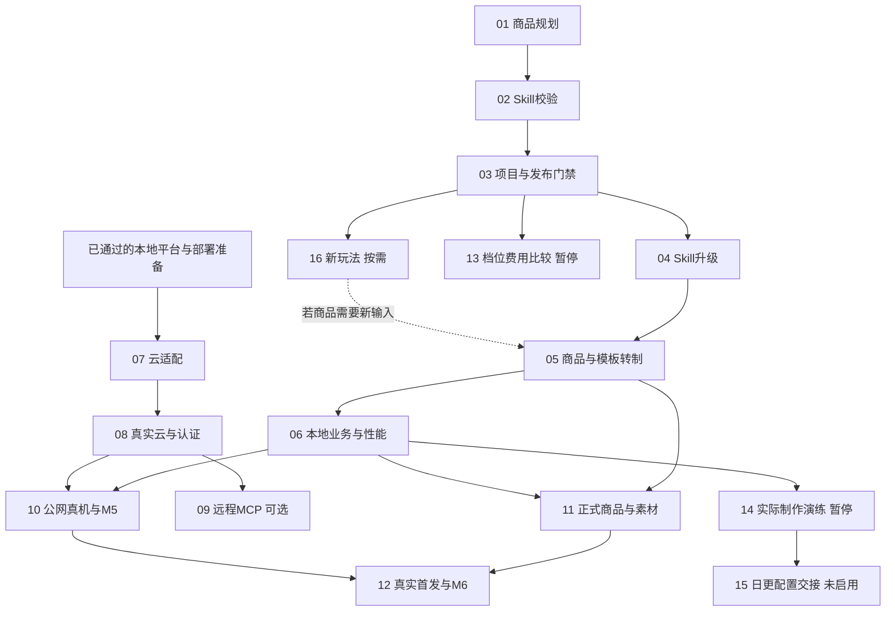

# 当前任务：执行顺序与归档

更新：2026-10-28。01商品规划合同、02 Skill服务端政策、03项目/发布校验和04旧方法前向升级已完成各自本地范围并归档；**当前任务为[05 商品与模板转制](active/05-product-template-migration.md)**。04代码594项、最终专项13项及16项自主CUA通过，开发库追加四份DRAFT，未自动启用或重绑；旧托管CI失败断言仍待权限可读日志，见[调查](../../../output/implementation/ci-investigation-20261028.md)。本地技术完成不等于云端或商业上线。

实际待办集中在 `active/`。原完整完成任务在 `archive/completed/`；包含未完成项的旧文件与旧总表在 `archive/history/2026-10-26/`，不认定为完成。根目录的 `Txx-*.md` 仅兼容旧链接，不是另一套待办。新旧编号逐项见 [TASK-MAP.md](TASK-MAP.md)，状态数据见 [registry.json](registry.json)；其中 legacyCoverage 的 disposition/carryover 明确记录被替代方向及剩余验收承接。

## 固定规则

- 所有正常商品体验实际使用 Three.js，视觉/世界观/动画/镜头/交互按该商品规划确定；模板注册和 Skill 文字不能代替实际实现。
- 商城、登录、账户和后台沿用现有应用；DOM 只保留文字/无障碍/故障回退和旧历史，不重写全部站点 UI。
- 原商品/权益/答卷/报告、Skill/组合/方法/采用包的固定版本与摘要不覆盖；新需求走新修订/新版本。
- 内容/美术生成和实际模型比较此前暂停；此次重新排序不恢复它们。外部配置尚未启用，不能自动创建日程、开云收费资源或公开发布/交易。
- 用户已取消逐页人工 UI 停点，既有授权内自主实现与验证；新截图不能记作用户已批准。其他实际外部操作仍按具体授权范围。

## 按执行顺序的完整队列

| 顺序 | Task | 稳定标识 | 当前状态 | 硬前置（顺序号） |
| --- | --- | --- | --- | --- |
| 05 | [按各商品规划制作模板并转制存量商品](active/05-product-template-migration.md) | T16.C3 | 进行中：商品与版本只读盘点 | 01、03、04（均已完成） |
| 06 | [完成 Three.js 商品本地业务与性能验收](active/06-local-experience-acceptance.md) | T16.C4-L | 等待前置 | 05 |
| 07 | [实现云端路由、持久存储与初始化适配](active/07-cloud-adapters.md) | T09-I | 方案已定，可独立实施 | 已验收底座 |
| 08 | [预发布部署与真实账户、邮件、存储验收](active/08-cloud-auth-validation.md) | T09-V / T06-C | 等待07与真实部署验收 | 07 |
| 09 | [实现并验收远程 MCP 连接](active/09-remote-mcp.md) | T14-C | 等待云条件 | 08 |
| 10 | [公网真机、内置浏览器与平台最终验收](active/10-public-device-acceptance.md) | T10-V / T16.C4-D | 等待前置与设备 | 06、08 |
| 11 | [首款正式 Three.js 商品、报告与宣传内容](active/11-formal-product-package.md) | T11-A | 可准备政策，正式内容待恢复 | 05、06 |
| 12 | [受控首发与真实订单、售后验收](active/12-commercial-pilot.md) | T11-B | 等待正式商品与发布条件 | 10、11 |
| 13 | [补齐制作质量、档位与费用验证](active/13-production-cost-evaluation.md) | T14.W6 | 暂停：模型比较未恢复 | 01、02、03 |
| 14 | [真实 Codex/MCP 手动制作与退回重做演练](active/14-manual-production-rehearsal.md) | T14.W3 | 暂停：实际内容生成未恢复 | 04、05、06 |
| 15 | [交付日更生产配置与恢复说明](active/15-external-schedule-handoff.md) | T14.W4 | 等待手动全链与运行参数 | 14 |
| 16 | [按商品需要选择并实现首个新玩法](active/16-new-interaction-engine.md) | T17 | 待玩法选型 | 01、02、03 |

01–04已归档；05–06 是后续商品本地实现主线；07–08 补真实云端；10 完成公网平台/启用模板的真机验收；11–12 完成正式商品与首发。**顺序号是推荐排期，硬依赖以上表和各任务为准**，不能用“前面有暂停项”停止无关工作。

09 只在启用远程 MCP 时执行，依赖08，不是普通商城 M5/M6 的硬前置。13–15 是外部日更制作分支：13/14 暂停，15 等真实手动全链后交接配置，仍不启用日程。16 按具体商品需要插入05之前；首款可以使用已有明确单选协议，不强制开发小游戏。

## 依赖与可独立推进范围

07 的方案已定为 Cloudflare 域名＋已购香港 VPS＋Supabase＋R2＋Resend，已有基础检查，详见[服务职责与待接入项](active/07-cloud-adapters.md#目标与现状)。07 可与05–06独立推进，不再等待托管选型；08 等07适配完成并核实实际预发布隔离、DNS/发信与额度后部署验收。11 的政策/渠道资料可提前准备，正式内容部分仍等恢复范围。09、13–16不阻塞无关主线。涉及共享 schema/文件时顺序合并，不因图中可独立就默认启用多代理。

## 每个任务怎么执行

1. 读取该任务、[统一商品规范](../PRODUCT-IMPLEMENTATION-POLICY.md)及其列出的工程入口，核对前置的真实退出证据。
2. 在当前工作区按一个明确批次实现，保留现有 NestJS/Prisma/PostgreSQL、React/Vite、工具链与历史数据；不重建环境或重放开发 seed。
3. 运行与改动匹配的类型/构建/单元及必要真实集成检查；浏览器用 CUA。真机、云身份、真实媒体/订单分别记证，不用模拟替代。
4. 发现未确定的产品决定先保留草稿/待规划，外部条件未齐则登记具体缺项，继续无关的可执行任务；不把未满足条件写成已完成。
5. 留下应用/合同/模板/数据版本、实际结果与遗留，更新注册表、进度和对应旧ID的映射。

## 完成与归档规则

- **完整任务：**必需检查全部通过且无必需待验项后，把该 `active/*.md` 迁至 `archive/completed/`，附完成日期、范围与证据；索引移入完成表，保留旧路径兼容入口及稳定标识映射。
- **部分完成：**只归档已关闭子批次及其证据；剩余范围继续在 active 中明确持有，不能因为“本地通过”归档云端/真机/商业范围。
- **被新规划替代：**记为 superseded/历史，不写 completed。旧 DOM 小屋剩余美术/UI方向不恢复，仍有价值的成套/设备验收转到新 Three.js 商品。
- **暂停/待外部条件：**仍是未完成任务，不归档为完成。13/14的暂停及08/10的真实外部条件只有获得相应事实/指令后才变化。
- **保存历史：**不修改已封存 `output/` 验收文件。归档正文只修复相对链接，状态/数字/原 pending 保留；新的结论另记。不得通过重编号掩盖旧待验项。

## 已完成范围

新增执行批次：[01 商品规划合同](archive/completed/01-product-plan-contract.md)（555项、19项CUA）与[02 Skill服务端政策](archive/completed/02-skill-policy-validation.md)（564项、13项CUA、类型/构建和24项离线检查）已完成技术范围。另[03 项目/发布校验](archive/completed/03-threejs-publication-gates.md)已通过581项、17项自主CUA、类型/构建和本地恢复；后续04升级结果如下，商品转制仍由05持有。

[04 旧方法前向升级](archive/completed/04-skill-library-upgrade.md)于2026-10-28完成：594项、类型/构建、最终专项13项和16项自主CUA通过；实际开发库追加四份v2 DRAFT，保留全部旧版本/组合/采用包及附件字节。05/11另行固定实际商品规划、复核并显式使用新方法，不将本批记为已启用或已转制商品。

完整归档9项：T01、T02、T03、T04、T05、T07、T08、T12、T15。混合任务已闭合的本地子批次另见[完成批次](archive/completed/BATCHES-20261026.md)。T06/T09/T10/T11/T13/T14/T16/T17 的原完整文件只作历史快照，仍有未完成范围，全部已映射到本队列。

归档入口：[archive/README.md](archive/README.md)。

