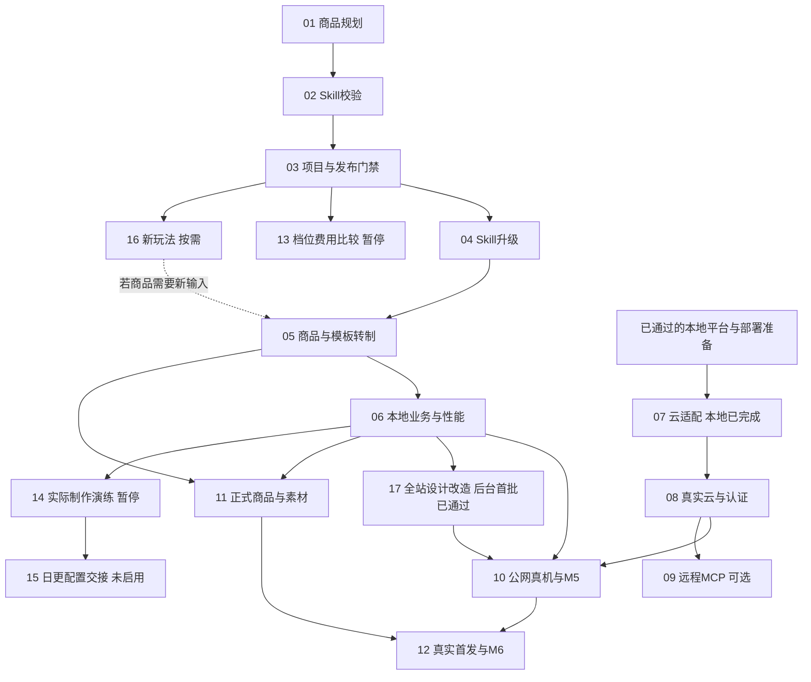

# 当前任务：执行顺序与归档

更新：2026-10-30。01–04及[07云适配](archive/completed/07-cloud-adapters.md)已完成各自本地范围并归档；**当前接续[05商品与模板转制](active/05-product-template-migration.md)**及06剩余本地验收；A/B合成技术子批次已通过635项与26项自主CUA。07通过626项、类型/构建、35项离线检查、12项初始化专项及最新Linux镜像/恢复证明；真实部署仍属08。新增[17全站前端设计改造](active/17-frontend-design-refinement.md)：原Skill ZIP已接收核验、项目安装并完整读取，设计标准、24张静态基线/根加载修复及后台共享骨架/概览首批已有证据，全站改造未完成，17独立排期。旧托管CI失败断言仍待权限可读日志，见[调查](../../../output/implementation/ci-investigation-20261028.md)。本地技术完成不等于云端或商业上线。

实际待办集中在 `active/`。原完整完成任务在 `archive/completed/`；包含未完成项的旧文件与旧总表在 `archive/history/2026-10-26/`，不认定为完成。根目录的 `Txx-*.md` 仅兼容旧链接，不是另一套待办。新旧编号逐项见 [TASK-MAP.md](TASK-MAP.md)，状态数据见 [registry.json](registry.json)；其中 legacyCoverage 的 disposition/carryover 明确记录被替代方向及剩余验收承接。

## 固定规则

- 所有正常商品体验实际使用 Three.js，视觉/世界观/动画/镜头/交互按该商品规划确定；模板注册和 Skill 文字不能代替实际实现。
- 商城、登录、账户和后台沿用现有应用；DOM 只保留文字/无障碍/故障回退和旧历史，不重写全部站点 UI。
- 原商品/权益/答卷/报告、Skill/组合/方法/采用包的固定版本与摘要不覆盖；新需求走新修订/新版本。
- 内容/美术生成和实际模型比较此前暂停；此次重新排序不恢复它们。外部配置尚未启用，不能自动创建日程、开云收费资源或公开发布/交易。
- 2026-10-29最新审核边界：后台页面可直接实施、复验、正常提交推送；商城用户端只能先制作本地可审阅改造稿与截图，必须交用户并等待明确审核通过后再定稿或继续该端改造。影响商城外观的共享组件适用相同边界；截图不能记作用户已批准。其他实际外部操作仍按具体授权范围。

## 按执行顺序的完整队列

| 顺序 | Task | 稳定标识 | 当前状态 | 硬前置（顺序号） |
| --- | --- | --- | --- | --- |
| 05 | [按各商品规划制作模板并转制存量商品](active/05-product-template-migration.md) | T16.C3 | A制作链、B独立模板/报告和CUA通过；正式转制待做 | 01、03、04（均已完成） |
| 06 | [完成 Three.js 商品本地业务与性能验收](active/06-local-experience-acceptance.md) | T16.C4-L | 36首帧/24活动/22恢复通过；内存与真实隐藏生命周期待验 | 05 |
| 08 | [预发布部署与真实账户、邮件、存储验收](active/08-cloud-auth-validation.md) | T09-V / T06-C | 07已完成，真实预发布待执行 | 07（已归档） |
| 09 | [实现并验收远程 MCP 连接](active/09-remote-mcp.md) | T14-C | 等待云条件 | 08 |
| 10 | [公网真机、内置浏览器与平台最终验收](active/10-public-device-acceptance.md) | T10-V / T16.C4-D | 等待前置与设备 | 06、08、17 |
| 11 | [首款正式 Three.js 商品、报告与宣传内容](active/11-formal-product-package.md) | T11-A | 可准备政策，正式内容待恢复 | 05、06 |
| 12 | [受控首发与真实订单、售后验收](active/12-commercial-pilot.md) | T11-B | 等待正式商品与发布条件 | 10、11 |
| 13 | [补齐制作质量、档位与费用验证](active/13-production-cost-evaluation.md) | T14.W6 | 暂停：模型比较未恢复 | 01、02、03 |
| 14 | [真实 Codex/MCP 手动制作与退回重做演练](active/14-manual-production-rehearsal.md) | T14.W3 | 暂停：实际内容生成未恢复 | 04、05、06 |
| 15 | [交付日更生产配置与恢复说明](active/15-external-schedule-handoff.md) | T14.W4 | 等待手动全链与运行参数 | 14 |
| 16 | [按商品需要选择并实现首个新玩法](active/16-new-interaction-engine.md) | T17 | 待玩法选型 | 01、02、03 |
| 17 | [依据anti-ai-web-design审计并改造全站前端](active/17-frontend-design-refinement.md) | T18 | 内容/结果配置与来源恢复通过；10局部、3未独立审计及完整全站仍待 | 完整改造依赖05、06；现状审计可先准备 |

01–04及07已归档；当前05–06商品本地实现→17前端改造→10最终真机，08独立持有真实云端；11–12完成正式商品与首发。17是新需求的队列编号（稳定ID为T18），完整退出在05/06之后、10之前；已独立完成根加载与后台共享骨架/概览首批，不重新编号旧任务或移除依赖。**硬依赖以上表和各任务为准**，不能用“前面有暂停项”停止无关工作。

05/06的[原准备合同](../PRODUCT-TEMPLATE-PREPARATION.md)已接续为[实际合成技术批次](../../../output/implementation/product-template-migration-20261028/verification.md)：A制作链、B独立模板/报告/注册、635项及26项自主CUA通过；仅[归档该子批次](archive/completed/05-06-synthetic-template-slice-20261028.md)。正式转制与完整性能仍由active的05/06持有，不将合成原型升格正式商品。

后续[06实测](../../../output/implementation/local-experience-performance-20261028/verification.md)通过636项/类型/构建；已验证的36首帧、24活动、40卸载资源检查及22恢复仅[归档技术子范围](archive/completed/06-first-frame-activity-recovery-slice-20261028.md)。A自然heap/全局Nodes有增长、强制GC及真实hidden条件未具备，06不整体归档。17已独立完成[源码盘点准备](../../../output/implementation/t18-frontend-audit-preparation-20261028/README.md)，没有开始整站改造。

再续[06内存对照](../../../output/implementation/local-experience-memory-audit-20261028/README.md)完成220次有界装卸，A旧canvas保留仍复现，Runtime.queryObjects可用但完整保留路径未取得，06内存待办保持。[17页面基线/根加载修复](../../../output/implementation/t18-frontend-baseline-20261028/verification.md)完成24张静态基线、五项首轮问题及三个视口加载GREEN/107项回归；仅[归档根加载子项](archive/completed/17-root-loading-flash-slice-20261028.md)，全站主体改造和授权后台完整审计未完成。

后续[17后台共享骨架/概览首批](../../../output/implementation/t18-admin-shell-20261028/verification.md)已完成有效SSR RED/GREEN、108前端＋2隔离专项、类型/构建、授权合成TEST七页三视口的21组前后比较和20项CUA；导航分组、main/焦点、区域滚动及概览可读性已有真实代码，390px商品整页溢出修复。仅[归档该子范围](archive/completed/17-admin-shell-overview-slice-20261028.md)，全站/编辑器/完整状态与05/06退出依赖不变。

2026-10-29续[商品/内容目录与工作台首批](../../../output/implementation/t18-catalog-content-20261029/verification.md)：111前端＋2隔离专项、类型/构建、18组同TEST前后比较及36项CUA通过，包含普通刷新保留、权限拒绝隐藏、加载/失败/空态、冲突草稿、固定历史、手机栏目和未保存保护。[仅归档该子批次](archive/completed/17-admin-catalog-workbench-slice-20261029.md)；素材/订单/Skill/连接等剩余表面与完整状态继续推进，完整T18及05/06依赖保持。商城按最新截图审核边界另行执行。

随后完成[素材/订单与错误恢复首批](../../../output/implementation/t18-admin-media-orders-20261029/verification.md)：111前端＋2专项、类型/构建、21组同TEST前后比较及47项CUA，七样本文字最低7.16:1。[仅归档该子批次](archive/completed/17-admin-media-orders-slice-20261029.md)；Skill/连接/运行配置/项目与完整状态继续，父任务和商城截图审核边界保持。两TEST已清理，未上传、发码、导入或退款。

09 只在启用远程 MCP 时执行，依赖08，不是普通商城 M5/M6 的硬前置。13–15 是外部日更制作分支：13/14 暂停，15 等真实手动全链后交接配置，仍不启用日程。16 按具体商品需要插入05之前；首款可以使用已有明确单选协议，不强制开发小游戏。

另完成[Skill目录/版本工作台](../../../output/implementation/t18-admin-skills-20261029/README.md)：112前端＋2专项、类型/构建、24组同TEST前后比较与28项CUA，普通刷新/网络恢复保留、权限隐藏、历史摘要与手机跳转已验。[仅归档此子批次](archive/completed/17-admin-skills-slice-20261029.md)，继续连接配置/项目及完整状态，完整T18/05/06和商城审核边界不变。

## 依赖与可独立推进范围

07已按Cloudflare域名＋已购香港VPS＋Supabase＋R2＋Resend完成本地应用适配与隔离验证，详见[归档](archive/completed/07-cloud-adapters.md)及[维护说明](../VPS-OPERATIONS.md)；08核实实际预发布隔离、DNS/发信/额度后执行真实部署验收。11政策/渠道资料可提前准备，正式内容部分仍等恢复范围。09、13–16不阻塞无关主线，17不加入07完成条件。涉及共享schema/文件时顺序合并，不因可独立就默认启用多代理。

## 每个任务怎么执行

1. 读取该任务、[统一商品规范](../PRODUCT-IMPLEMENTATION-POLICY.md)及其列出的工程入口，核对前置的真实退出证据。
2. 在当前工作区按一个明确批次实现，保留现有 NestJS/Prisma/PostgreSQL、React/Vite、工具链与历史数据；不重建环境或重放开发 seed。
3. 运行与改动匹配的类型/构建/单元及必要真实集成检查；浏览器用 CUA。真机、云身份、真实媒体/订单分别记证，不用模拟替代。
4. 发现未确定的产品决定先保留草稿/待规划，外部条件未齐则登记具体缺项，继续无关的可执行任务；不把未满足条件写成已完成。
5. 留下应用/合同/模板/数据版本、实际结果与遗留，更新注册表、进度和对应旧ID的映射。

## 完成与归档规则

- **完整任务：**必需检查全部通过且无必需待验项后，把该 `active/*.md` 迁至 `archive/completed/`，附完成日期、范围与证据；索引移入完成表，保留旧路径兼容入口及稳定标识映射。
- **部分完成：**只归档已关闭子批次及其证据；剩余范围继续在 active 中明确持有，不能因为“本地通过”归档云端/真机/商业范围。
- **被新规划替代：**记为 superseded/历史，不写 completed。旧 DOM 小屋剩余美术/UI方向不恢复，仍有价值的成套/设备验收转到新 Three.js 商品。
- **暂停/待外部条件：**仍是未完成任务，不归档为完成。13/14的暂停及08/10的真实外部条件只有获得相应事实/指令后才变化。
- **保存历史：**不修改已封存 `output/` 验收文件。归档正文只修复相对链接，状态/数字/原 pending 保留；新的结论另记。不得通过重编号掩盖旧待验项。

## 已完成范围

新增执行批次：[01 商品规划合同](archive/completed/01-product-plan-contract.md)（555项、19项CUA）与[02 Skill服务端政策](archive/completed/02-skill-policy-validation.md)（564项、13项CUA、类型/构建和24项离线检查）已完成技术范围。另[03 项目/发布校验](archive/completed/03-threejs-publication-gates.md)已通过581项、17项自主CUA、类型/构建和本地恢复；后续04升级结果如下，商品转制仍由05持有。

[04 旧方法前向升级](archive/completed/04-skill-library-upgrade.md)于2026-10-28完成：594项、类型/构建、最终专项13项和16项自主CUA通过；实际开发库追加四份v2 DRAFT，保留全部旧版本/组合/采用包及附件字节。05/11另行固定实际商品规划、复核并显式使用新方法，不将本批记为已启用或已转制商品。

[07云端适配](archive/completed/07-cloud-adapters.md)于2026-10-28完成本地技术范围：626项、类型/构建、35项离线、12项初始化专项、最新Linux维护镜像/前端协议与7项恢复通过。两个本机资源事件分别留证并恢复原容器，73表1521行/29迁移/3参考文件摘要保持。真实云部署及T09父项仍未完成。

完整归档9项：T01、T02、T03、T04、T05、T07、T08、T12、T15。混合任务已闭合的本地子批次另见[完成批次](archive/completed/BATCHES-20261026.md)。T06/T09/T10/T11/T13/T14/T16/T17 的原完整文件只作历史快照，仍有未完成范围，全部已映射到本队列。

归档入口：[archive/README.md](archive/README.md)。

2026-10-30完成[连接与运行配置子批次](archive/completed/17-admin-connections-configurations-slice-20261030.md)：643业务＋2专项、类型/前端构建、18组前后对照、47项CUA通过。503保留、完整权限隐藏/恢复、原保存请求、409/历史/手机导航已验；项目页继续，17/T18及05/06不关闭。

随后完成[项目工作区/父级恢复](archive/completed/17-admin-project-workspace-slice-20261030.md)：有效RED/GREEN、643业务＋2专项、类型/构建、12组对照及29项CUA。子页在父级503保留、403隐藏，规划和原请求恢复；方法固定/交接及回执自身设计/状态继续，不关闭T18。

再完成[商品方法与运行回执子批次](archive/completed/17-admin-methods-runs-slice-20261030.md)：四类有效RED/GREEN、112前端＋2专项、含类型检查的最终构建、21组对照及42项CUA，10文字样本最低6.85:1。权限完整隐藏/成功重读恢复、503/409输入与历史选择、手机焦点及未知方法/停止原请求保持已验；没有真实写入，完整路由/状态及父T18/05/06继续，商城审核与云08独立持有。

随后完成[后台覆盖矩阵与文件清理恢复](archive/completed/17-admin-coverage-cleanup-slice-20261030.md)：30个表面中15项有代表状态最终证据、11项局部、3项未独立审计、1项外部范围，不称全覆盖。两个有效RED、112前端＋2专项、类型/构建、九组对照与39项CUA通过；无成功写入/删除。下一批从商品内容/结果交付配置与来源读取继续，详细[矩阵](../../../output/implementation/t18-admin-coverage-cleanup-20261030/coverage-after.md)保留各项缺口，父任务及商城边界不变。

再完成[商品内容/结果配置与来源恢复](archive/completed/17-admin-assessment-source-slice-20261030.md)：有效RED、首轮失败及修复分别留证，112前端＋2专项、类型/构建、九组对照及45项CUA通过；配置/来源权限、缓存/草稿、原请求、JSON及手机输入已验，无成功写入/发布。最新[矩阵](../../../output/implementation/t18-admin-assessment-20261030/coverage-after.md)为16代表最终/10局部/3未独立审计/1外部，下一批接体验/结果呈现与历史，完整父项和商城审核不关闭。
